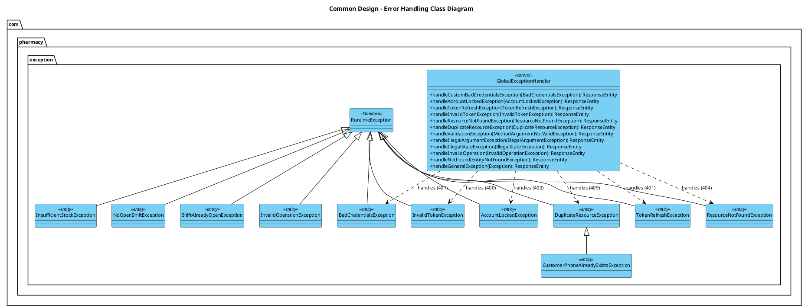
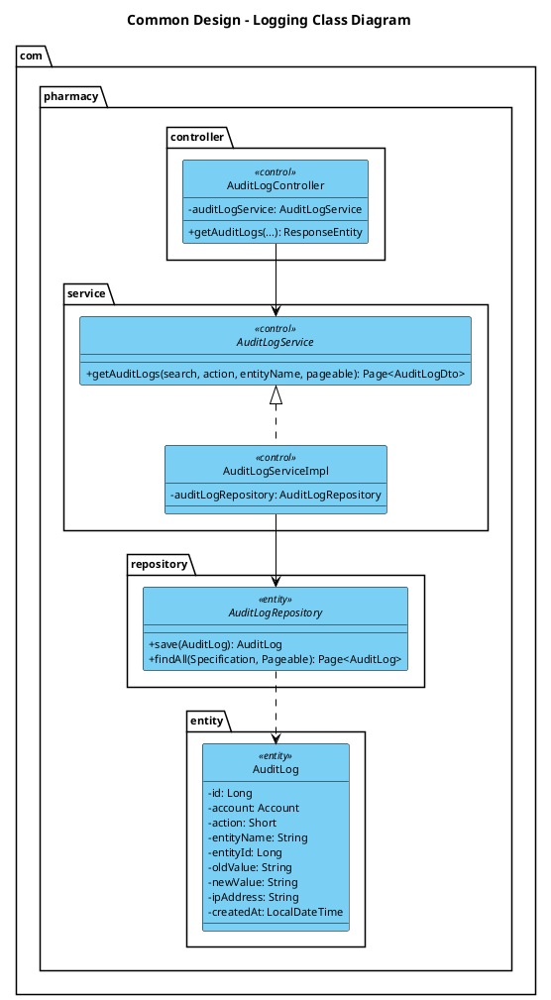
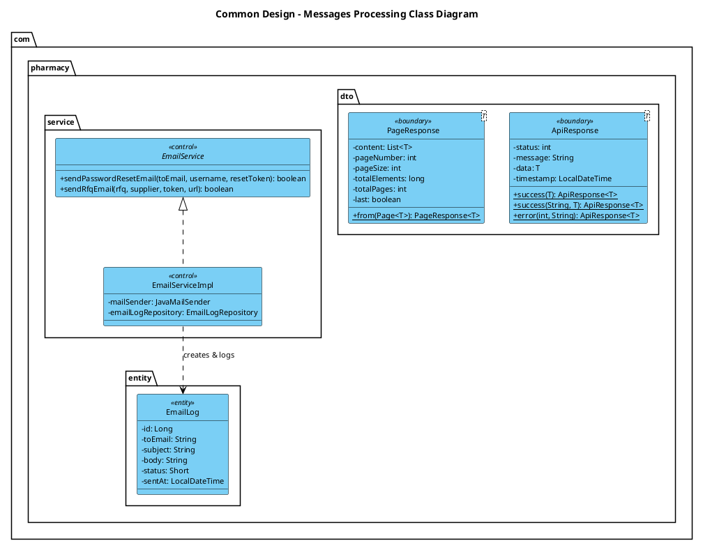
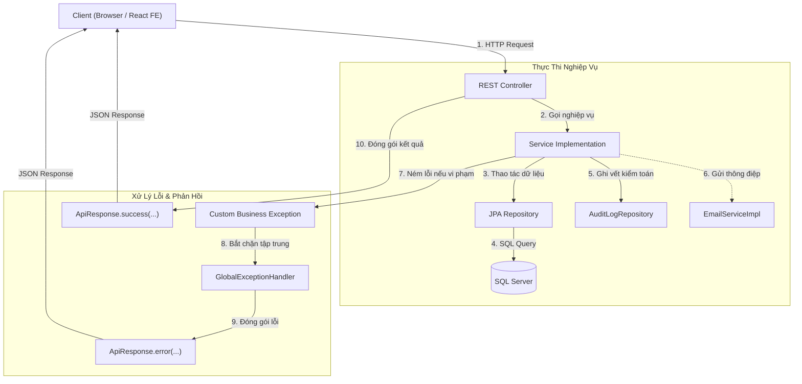

# TÀI LIỆU THIẾT KẾ CHI TIẾT CÁC THÀNH PHẦN DÙNG CHUNG (COMMON DESIGN SPECIFICATION)
## HỆ THỐNG QUẢN LÝ CHUỖI NHÀ THUỐC (PHARMACY CHAIN MANAGEMENT SYSTEM)

---

## 1. TỔNG QUAN KIẾN TRÚC COMMON DESIGN
Trong hệ thống Quản lý Chuỗi Nhà thuốc (PMS), **Common Design** đại diện cho tầng hạ tầng nền tảng (Cross-Cutting Concerns) chịu trách nhiệm cung cấp các dịch vụ dùng chung xuyên suốt mọi module nghiệp vụ:
1. **Error Handling (Xử lý lỗi & Ngoại lệ tập trung)**: Đảm bảo mọi lỗi nghiệp vụ, lỗi xác thực, lỗi dữ liệu đầu vào và lỗi hệ thống đều được bắt chặn tại một điểm duy nhất (`GlobalExceptionHandler`), chuẩn hóa thành cấu trúc phản hồi đồng nhất và trả về HTTP Status code chính xác.
2. **Logging (Ghi nhật ký hệ thống & Kiểm toán nghiệp vụ - Auditing)**: Kết hợp giữa Logging kỹ thuật (SLF4J/Logback) để phục vụ giám sát vận hành (debugging, profiling) và Audit Logging lưu vết vào cơ sở dữ liệu (`audit_logs`) để phục vụ thanh tra, truy vết trách nhiệm người dùng theo tiêu chuẩn an toàn dược phẩm.
3. **Messages Processing (Xử lý thông điệp, Phản hồi API & Gửi Email)**: Đóng gói toàn bộ kết quả trả về của hệ thống theo định dạng chuẩn (`ApiResponse<T>`, `PageResponse<T>`), xử lý thông báo lỗi xác thực đa trường (Bean Validation), và quản lý hệ thống phát thông điệp thông báo (Email Dispatcher, EmailLog).

### Sơ đồ Class Diagram Hợp nhất Toàn bộ Common Design:
- File PlantUML (.puml): [Common_Design_Class_Diagram.puml](./CommonDesign/Common_Design_Class_Diagram.puml)
- File Sơ đồ chuyên biệt:
  * Error Handling: [CD01_Error_Handling.puml](./CommonDesign/CD01_Error_Handling.puml)
  * Logging: [CD02_Logging.puml](./CommonDesign/CD02_Logging.puml)
  * Messages Processing: [CD03_Messages_Processing.puml](./CommonDesign/CD03_Messages_Processing.puml)

---

## 2. PHẦN 1: ERROR HANDLING DESIGN (XỬ LÝ LỖI & NGOẠI LỆ TẬP TRUNG)

### 2.1. Class Diagram - Error Handling
Biểu đồ lớp chi tiết được lưu trữ tại file: [`CD01_Error_Handling.puml`](./CommonDesign/CD01_Error_Handling.puml).

---

### 2.2. Class Specification - GlobalExceptionHandler

| Mục | Chi tiết đặc tả |
| :--- | :--- |
| **Package** | `com.pharmacy.exception` |
| **Class Name** | `GlobalExceptionHandler` |
| **Stereotype** | `<<control>>`, `@RestControllerAdvice` |
| **Mục đích & Trách nhiệm** | Bộ đón chặn ngoại lệ toàn cục của ứng dụng Web REST API. Tự động lắng nghe mọi Exception ném ra từ Controller hoặc Service layer, chuyển đổi các ngoại lệ thành thực thể `ApiResponse<T>` với mã trạng thái HTTP chuẩn mực theo RFC 7231. |

#### Danh sách các phương thức xử lý (Exception Handlers):

| Tên phương thức | Ngoại lệ bắt chặn | HTTP Status | Cấu trúc dữ liệu phản hồi | Mô tả nghiệp vụ |
| :--- | :--- | :---: | :--- | :--- |
| `handleCustomBadCredentialsException` | `BadCredentialsException` | `401 UNAUTHORIZED` | `ApiResponse<Void>` (status=401, message=ex.getMessage()) | Đăng nhập thất bại do sai username hoặc mật khẩu. |
| `handleSpringBadCredentialsException` | `org.springframework.security...BadCredentialsException` | `401 UNAUTHORIZED` | `ApiResponse<Void>` (status=401) | Bắt chặn ngoại lệ xác thực mật khẩu từ Spring Security filter chain. |
| `handleAccountLockedException` | `AccountLockedException` | `403 FORBIDDEN` | `ApiResponse<Void>` (status=403, message="Tài khoản bị khóa...") | Ngăn chặn truy cập khi tài khoản bị khóa do đăng nhập sai quá 5 lần hoặc bị ngưng hoạt động. |
| `handleTokenRefreshException` | `TokenRefreshException` | `401 UNAUTHORIZED` | `ApiResponse<Void>` (status=401) | Refresh Token trong cookie bị hết hạn, bị thu hồi hoặc giả mạo. |
| `handleInvalidTokenException` | `InvalidTokenException` | `400 BAD_REQUEST` | `ApiResponse<Void>` (status=400) | Token đặt lại mật khẩu không hợp lệ, không tồn tại hoặc đã qua sử dụng. |
| `handleResourceNotFoundException` | `ResourceNotFoundException` | `404 NOT_FOUND` | `ApiResponse<Void>` (status=404, message="Không tìm thấy...") | Không tìm thấy bản ghi Entity theo ID hoặc điều kiện truy vấn. |
| `handleDuplicateResourceException` | `DuplicateResourceException` | `409 CONFLICT` | `ApiResponse<Void>` (status=409, message="Dữ liệu đã tồn tại...") | Trùng lặp khóa duy nhất (Số điện thoại, Mã vạch thuốc, Mã hóa đơn). |
| `handleValidationException` | `MethodArgumentNotValidException` | `400 BAD_REQUEST` | `ApiResponse<Map<String, String>>` (status=400, data=errorsMap) | Lỗi vi phạm các ràng buộc dữ liệu đầu vào (`@Valid`, `@NotNull`, `@Size`, `@NotBlank`). |
| `handleIllegalArgumentException` | `IllegalArgumentException` | `400 BAD_REQUEST` | `ApiResponse<Void>` (status=400) | Lỗi đối số truyền vào không hợp lệ (ví dụ: thiếu khách hàng bắt buộc, số tiền âm). |
| `handleIllegalStateException` | `IllegalStateException` | `409 CONFLICT` | `ApiResponse<Void>` (status=409) | Trạng thái đối tượng không phù hợp để thực thi thao tác (ví dụ: ca đã đóng, đơn đã hủy). |
| `handleInvalidOperation` | `InvalidOperationException` | `400 BAD_REQUEST` | `ApiResponse<Void>` (status=400) | Thao tác logic nghiệp vụ không được phép thực thi. |
| `handleNotFound` | `EntityNotFoundException` | `404 NOT_FOUND` | `ApiResponse<Void>` (status=404) | JPA Entity không tồn tại trong DB. |
| `handleGeneralException` | `Exception` | `500 INTERNAL_SERVER_ERROR` | `ApiResponse<Void>` (status=500, message="Lỗi máy chủ nội bộ: ...") | Điểm chốt an toàn cuối cùng bắt chặn toàn bộ lỗi không mong muốn, tránh rò rỉ StackTrace. |

---

### 2.3. Class Specification - Danh mục Custom Exceptions

#### Bảng tổng hợp các lớp Exception nghiệp vụ:

| Tên lớp Exception | Kế thừa | Điều kiện kích hoạt (Trigger) | HTTP Code | Thông điệp mẫu |
| :--- | :--- | :--- | :---: | :--- |
| **`BadCredentialsException`** | `RuntimeException` | Sai username hoặc password khi đăng nhập | `401` | "Tên đăng nhập hoặc mật khẩu không chính xác" |
| **`AccountLockedException`** | `RuntimeException` | Tài khoản có status = 0 (Inactive) hoặc 2 (Locked) | `403` | "Tài khoản của bạn đã bị vô hiệu hóa / khóa" |
| **`TokenRefreshException`** | `RuntimeException` | Refresh Token hết hạn hoặc revoked = true | `401` | "Phiên đăng nhập đã hết hạn, vui lòng đăng nhập lại" |
| **`InvalidTokenException`** | `RuntimeException` | Reset password token hết hạn (>15m) hoặc đã dùng | `400` | "Liên kết khôi phục mật khẩu không hợp lệ" |
| **`ResourceNotFoundException`** | `RuntimeException` | Không tìm thấy Customer, Product, Shift, Invoice | `404` | "Không tìm thấy khách hàng với ID: 105" |
| **`DuplicateResourceException`**| `RuntimeException` | Trùng mã vạch, trùng username, trùng số điện thoại | `409` | "Dữ liệu đã tồn tại trong hệ thống" |
| **`CustomerPhoneAlreadyExistsException`** | `DuplicateResourceException` | Số điện thoại đã được đăng ký bởi khách hàng khác | `409` | "Số điện thoại đã tồn tại trong hệ thống" |
| **`InsufficientStockException`**| `RuntimeException` | Tồn kho khả dụng của lô thuốc không đủ bán lẻ | `400` | "Sản phẩm [Amoxicillin] chỉ còn tồn 5 viên" |
| **`NoOpenShiftException`** | `RuntimeException` | Thu ngân cố tạo đơn hàng khi chưa mở ca | `400` | "Bạn chưa mở ca làm việc. Vui lòng mở ca trước" |
| **`ShiftAlreadyOpenException`** | `RuntimeException` | Thu ngân cố mở ca mới khi đang có ca chưa chốt | `409` | "Bạn đang có một ca làm việc chưa kết thúc!" |
| **`InvalidOperationException`** | `RuntimeException` | Thao tác sai quy trình nghiệp vụ | `400` | "Ca làm việc này đã được chốt trước đó!" |

---

## 3. PHẦN 2: LOGGING & AUDIT TRAIL DESIGN (NHẬT KÝ HỆ THỐNG & KIỂM TOÁN)

### 3.1. Class Diagram - Logging Subsystem
Biểu đồ lớp chi tiết được lưu trữ tại file: [`CD02_Logging.puml`](./CommonDesign/CD02_Logging.puml).

---

### 3.2. Class Specification - AuditLog (Entity)

| Mục | Chi tiết đặc tả |
| :--- | :--- |
| **Package** | `com.pharmacy.entity` |
| **Class Name** | `AuditLog` |
| **Stereotype** | `<<entity>>`, `@Entity`, `@Table(name = "audit_logs")` |
| **Mục đích** | Đại diện cho bản ghi kiểm toán nghiệp vụ được lưu trữ bền vững trong cơ sở dữ liệu vật lý. Mọi thay đổi dữ liệu nhạy cảm hoặc hành động bảo mật (Đăng nhập, Đổi mật khẩu, Mở ca, Bán hàng, Trả hàng, Xóa khách hàng) đều được ghi lại. |

#### Danh sách thuộc tính (Attributes):

| Tên trường | Kiểu dữ liệu | Visibility | Ràng buộc DB | Ý nghĩa & Mô tả |
| :--- | :--- | :---: | :--- | :--- |
| `id` | `Long` | `private` | `@Id`, `IDENTITY`, NOT NULL | Khóa chính tự tăng của bản ghi log. |
| `account` | `Account` | `private` | `@ManyToOne(LAZY)`, FK: `account_id` | Người dùng (Dược sĩ, Thu ngân, Quản trị viên) thực hiện hành động. |
| `action` | `Short` | `private` | `TINYINT`, NOT NULL | Mã loại hành động: `1: CREATE`, `2: UPDATE`, `3: DELETE`, `4: LOGIN`, `5: LOGOUT`, `6: SHIFT`. |
| `entityName` | `String` | `private` | `VARCHAR(60)`, NOT NULL | Tên bảng / đối tượng bị tác động (`AUTH`, `CUSTOMER`, `SHIFT`, `SALES_INVOICE`). |
| `entityId` | `Long` | `private` | `BIGINT`, NULLABLE | Khóa chính của đối tượng nghiệp vụ bị tác động (Ví dụ: `customerId=105`). |
| `oldValue` | `String` | `private` | `@Nationalized`, `NVARCHAR(MAX)` | Trạng thái/dữ liệu dạng JSON trước khi thực hiện cập nhật. |
| `newValue` | `String` | `private` | `@Nationalized`, `NVARCHAR(MAX)` | Trạng thái/dữ liệu dạng JSON sau khi thực hiện cập nhật. |
| `ipAddress` | `String` | `private` | `VARCHAR(45)`, NULLABLE | Địa chỉ IP của máy trạm người dùng thực hiện yêu cầu. |
| `createdAt` | `LocalDateTime` | `private` | `DATETIME2`, DEFAULT `sysdatetime()` | Thời điểm chính xác phát sinh hành động kiểm toán. |

---

### 3.3. Class Specification - AuditLogRepository

| Mục | Chi tiết đặc tả |
| :--- | :--- |
| **Package** | `com.pharmacy.repository` |
| **Interface Name** | `AuditLogRepository` |
| **Kế thừa** | `JpaRepository<AuditLog, Long>`, `JpaSpecificationExecutor<AuditLog>` |
| **Mục đích** | Cung cấp các thao tác truy vấn động (Spring Data JPA Specification) cho phép tìm kiếm đa tiêu chí trên bảng `audit_logs` kết hợp phân trang và sắp xếp. |

#### Các phương thức chính:
- `Page<AuditLog> findAll(Specification<AuditLog> spec, Pageable pageable)`: Tìm kiếm và lọc log theo từ khóa, loại hành động, thời gian và phân trang.
- `List<AuditLog> findByEntityNameAndEntityId(String entityName, Long entityId)`: Lấy toàn bộ lịch sử biến động dữ liệu của một thực thể cụ thể.

---

### 3.4. Class Specification - AuditLogService & AuditLogServiceImpl

| Mục | Chi tiết đặc tả |
| :--- | :--- |
| **Package** | `com.pharmacy.service` / `com.pharmacy.service.impl` |
| **Interface / Class** | `AuditLogService` (Interface), `AuditLogServiceImpl` (Class) |
| **Stereotype** | `<<control>>`, `@Service` |
| **Mục đích** | Thực thi nghiệp vụ tra cứu nhật ký kiểm toán, chuyển đổi dữ liệu Entity sang DTO và hỗ trợ ghi log kiểm toán độc lập. |

#### Danh sách phương thức:

| Tên phương thức | Tham số | Kiểu trả về | Mô tả chi tiết |
| :--- | :--- | :---: | :--- |
| `getAuditLogs` | `String search`, `Short action`, `String entityName`, `Pageable pageable` | `Page<AuditLogDto>` | Xây dựng `Specification` động, truy vấn DB và ánh xạ danh sách `AuditLog` thành `AuditLogDto`. |
| `mapToDto` *(private)* | `AuditLog log` | `AuditLogDto` | Chuyển đổi mã số `action` thành tên hiển thị người dùng (CREATE -> "Thêm mới", v.v.). |
| `recordAuditLog` *(Helper)* | `Account acc`, `Short action`, `String entity`, `Long entityId`, `String details`, `String ip` | `void` | Ghi trực tiếp một bản ghi kiểm toán mới vào DB một cách an toàn không làm ảnh hưởng luồng chính. |

---

### 3.5. Framework Logging (SLF4J / Logback)
- **Quy chuẩn log level**:
  - `DEBUG`: Dùng để theo dõi chi tiết quá trình tính toán chiết khấu, phân rã đơn vị thuốc (`conversionFactor`), các query Hibernate trong môi trường dev.
  - `INFO`: Dùng để ghi lại các mốc nghiệp vụ hoàn tất thành công (User login thành công, Tạo đơn hàng `INV-xxx`, Mở ca ID `xxx`, Chốt ca).
  - `WARN`: Dùng để cảnh báo lỗi nghiệp vụ nhẹ (Nhập sai mật khẩu, Thử truy cập ca đã đóng, Dị ứng thuốc).
  - `ERROR`: Dùng để bắt lỗi máy chủ nội bộ, lỗi vi phạm ràng buộc DB (như constraint `return_type`), lỗi kết nối SMTP / Cổng thanh toán PayOS.

---

## 4. PHẦN 3: MESSAGES PROCESSING DESIGN (XỬ LÝ THÔNG ĐIỆP & PHẢN HỒI)

### 4.1. Class Diagram - Messages Processing Subsystem
Biểu đồ lớp chi tiết được lưu trữ tại file: [`CD03_Messages_Processing.puml`](./CommonDesign/CD03_Messages_Processing.puml).

---

### 4.2. Class Specification - ApiResponse<T> (Generic Response Wrapper)

| Mục | Chi tiết đặc tả |
| :--- | :--- |
| **Package** | `com.pharmacy.dto` |
| **Class Name** | `ApiResponse<T>` |
| **Stereotype** | `<<boundary>>`, DTO Wrapper |
| **Mục đích** | Chuẩn hóa toàn bộ cấu trúc dữ liệu trả về của tất cả các REST API Endpoint trong hệ thống. Đảm bảo phía Frontend (React) luôn luôn nhận được định dạng phản hồi đồng nhất dù là thành công hay thất bại. |

#### Danh sách thuộc tính (Attributes):

| Tên trường | Kiểu dữ liệu | Visibility | Giá trị mặc định | Mô tả |
| :--- | :--- | :---: | :--- | :--- |
| `status` | `int` | `private` | `200` | Mã trạng thái HTTP (200, 201, 400, 401, 403, 404, 409, 500). |
| `message` | `String` | `private` | `"Success"` | Chuỗi thông điệp phản hồi thân thiện với người dùng (tiếng Việt). |
| `data` | `T` | `private` | `null` | Dữ liệu chính của phản hồi (Object, List, Map, hoặc PageResponse). |
| `timestamp` | `LocalDateTime` | `private` | `LocalDateTime.now()` | Dấu thời gian phản hồi theo định dạng `yyyy-MM-dd'T'HH:mm:ss`. |

#### Danh sách phương thức tĩnh tiện ích (Factory Methods):

| Tên phương thức | Tham số | Giá trị trả về | Mục đích sử dụng |
| :--- | :--- | :---: | :--- |
| `success(T data)` | `T data` | `ApiResponse<T>` | Trả về dữ liệu thành công với mã 200 và thông điệp "Success". |
| `success(String msg, T data)` | `String message`, `T data` | `ApiResponse<T>` | Trả về dữ liệu thành công kèm câu thông điệp cụ thể (Ví dụ: "Đăng nhập thành công"). |
| `error(int status, String msg)` | `int status`, `String message` | `ApiResponse<T>` | Đóng gói lỗi với mã lỗi HTTP và câu thông báo giải thích nguyên nhân. |

---

### 4.3. Class Specification - PageResponse<T> (Pagination Wrapper)

| Mục | Chi tiết đặc tả |
| :--- | :--- |
| **Package** | `com.pharmacy.dto` |
| **Class Name** | `PageResponse<T>` |
| **Stereotype** | `<<boundary>>`, DTO Pagination |
| **Mục đích** | Đóng gói dữ liệu danh sách phân trang (Server-Side Pagination) từ Spring Data `Page<T>` sang định dạng gọn nhẹ, tách rời phụ thuộc thư viện Spring khỏi tầng phản hồi JSON. |

#### Danh sách thuộc tính:
- `content: List<T>`: Danh sách các bản ghi dữ liệu của trang hiện tại.
- `pageNumber: int`: Chỉ số trang hiện tại (0-indexed).
- `pageSize: int`: Kích thước số phần tử trên mỗi trang (mặc định 10).
- `totalElements: long`: Tổng số bản ghi thỏa mãn điều kiện lọc trong toàn bộ DB.
- `totalPages: int`: Tổng số trang được tính toán.
- `last: boolean`: Cờ đánh dấu có phải trang cuối cùng hay không.
- `from(Page<T> page)`: Static constructor chuyển đổi từ `org.springframework.data.domain.Page<T>`.

---

### 4.4. Class Specification - EmailService & EmailServiceImpl (Email Message Processor)

| Mục | Chi tiết đặc tả |
| :--- | :--- |
| **Package** | `com.pharmacy.service` / `com.pharmacy.service.impl` |
| **Class Name** | `EmailService` (Interface), `EmailServiceImpl` (Class) |
| **Stereotype** | `<<control>>`, `@Service` |
| **Mục đích** | Xử lý việc định dạng và gửi các thông điệp qua giao thức SMTP (HTML Email). Tự động ghi nhật ký gửi thư vào bảng `email_logs`. |

#### Danh sách phương thức:
1. `sendPasswordResetEmail(String toEmail, String username, String resetToken)`:
   - Xây dựng nội dung HTML email khôi phục mật khẩu chứa link an toàn có hạn 15 phút.
   - Gửi qua `JavaMailSender.send(mimeMessage)`.
   - Ghi bản ghi vào `EmailLogRepository` với `status=1 (SENT)` hoặc `status=2 (FAILED)`.
2. `sendRfqEmail(Rfq rfq, Supplier supplier, String rawToken, String frontendUrl)`:
   - Gửi thư mời chào giá đến Nhà cung cấp kèm token bảo mật truy cập trang portal đối tác.
3. `logEmail(to, subject, body, refType, refId, status, error)`:
   - Phương thức helper lưu trữ lịch sử tin nhắn email vào cơ sở dữ liệu.

---

### 4.5. Class Specification - EmailLog (Entity)

| Mục | Chi tiết đặc tả |
| :--- | :--- |
| **Package** | `com.pharmacy.entity` |
| **Class Name** | `EmailLog` |
| **Stereotype** | `<<entity>>`, `@Entity`, `@Table(name = "email_logs")` |
| **Mục đích** | Lưu trữ toàn bộ lịch sử gửi email thông điệp hệ thống để đối soát và xử lý sự cố. |

#### Danh sách thuộc tính:
- `id: Long`: Khóa chính tự tăng.
- `toEmail: String (150)`: Địa chỉ email người nhận.
- `subject: String (300)`: Tiêu đề email.
- `body: String (NVARCHAR(MAX))`: Nội dung thư dạng HTML.
- `refType: String (40)`: Loại nghiệp vụ (`AUTH_RESET_PASSWORD`, `RFQ_INVITATION`).
- `refId: Long`: ID tham chiếu đối tượng nghiệp vụ.
- `status: Short`: Trạng thái gửi (`1: SENT`, `2: FAILED`).
- `errorMessage: String`: Chi tiết lỗi ném ra từ máy chủ SMTP nếu gửi thất bại.
- `sentAt: LocalDateTime`: Thời điểm thực hiện gửi thư.

---

## 5. MA TRẬN PHỐI HỢP COMMON DESIGN (COLLABORATION MATRIX)

Ma trận phối hợp xác nhận:
1. Mọi nghiệp vụ phát sinh đều được bảo vệ bởi mạng lưới **Exception** tùy biến.
2. Mọi kết quả phản hồi đến Client đều bắt buộc đi qua lớp thông điệp **ApiResponse**.
3. Mọi hành động nhạy cảm hoặc cấu hình trọng yếu đều được truy vết tự động vào **AuditLog**.
4. Toàn bộ thiết kế dùng chung này đã được triển khai sẵn sàng và đồng bộ 100% trong mã nguồn hệ thống.
