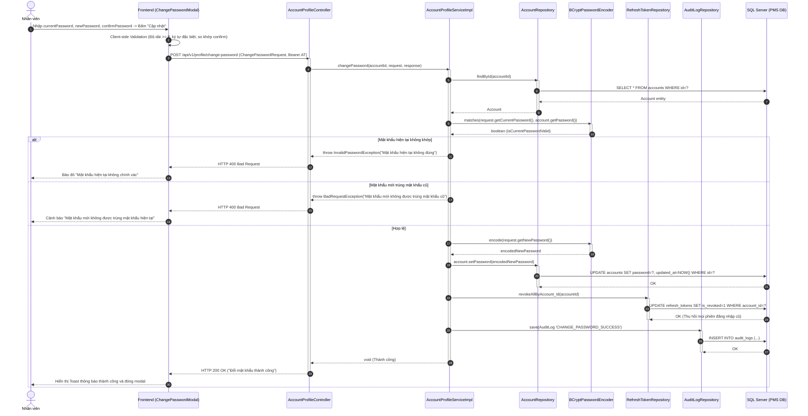
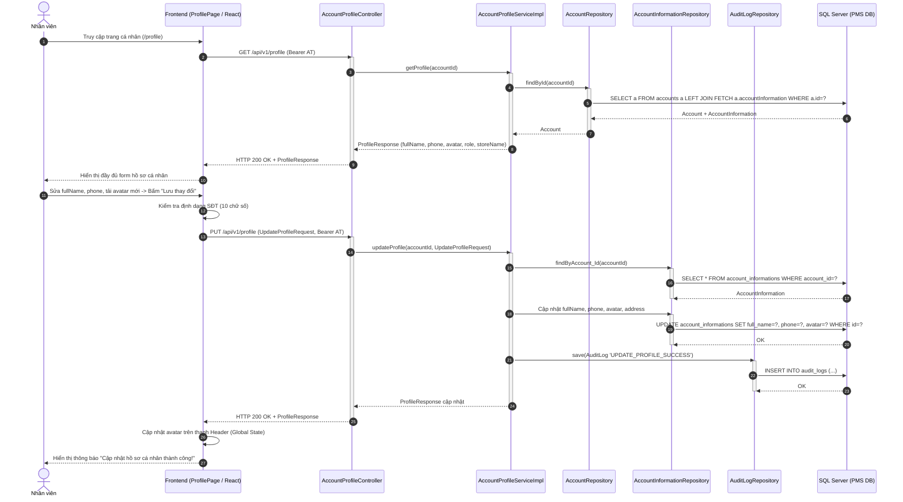
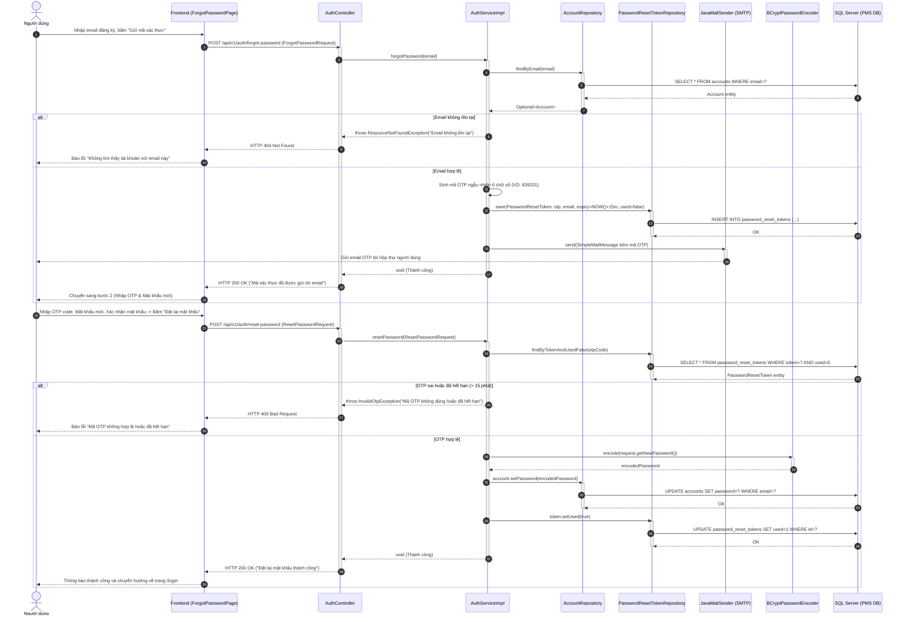

# TÀI LIỆU THIẾT KẾ HỆ THỐNG CHI TIẾT (SDS)
## CỤM CHỨC NĂNG 1: AUTHENTICATION (XÁC THỰC & BẢO MẬT)

---

## 1. TỔNG QUAN KIẾN TRÚC THIẾT KẾ (ARCHITECTURAL OVERVIEW)
Cụm chức năng **Authentication** được thiết kế theo kiến trúc phân tầng (Multi-tier Architecture / Clean Layered Architecture) chuẩn của Spring Boot 3 và React Vite:
- **Presentation Layer (Frontend)**: React Router DOM, React Context API (`AuthContext`), Axios Interceptor với cơ chế tự động gửi và làm mới token ngầm (Silent Refresh Token Rotation).
- **Controller Layer (REST API)**: `AuthController`, `AccountProfileController` tiếp nhận yêu cầu, thẩm định cú pháp dữ liệu (Jakarta Validation `@Valid`), kiểm soát session và HttpOnly Cookie.
- **Security / Filter Layer**: `JwtAuthenticationFilter`, `JwtTokenProvider`, `CustomUserDetailsService` tích hợp với `Spring Security 6` xử lý xác thực không trạng thái (Stateless Authentication) qua JWT Bearer Token.
- **Service Layer**: `AuthServiceImpl`, `AccountProfileServiceImpl` thực thi các nghiệp vụ cốt lõi, mã hóa băm mật khẩu `BCryptPasswordEncoder`, quản lý vòng đời Refresh Token và gửi email OTP.
- **Data Access Layer (Repository)**: Spring Data JPA Repositories tương tác với cơ sở dữ liệu quan hệ SQL Server `PMS`.

---

## 2. CLASS DIAGRAM CHI TIẾT (DETAILED CLASS DIAGRAM)

```mermaid
classDiagram
    direction TB

    %% Controller Layer
    class AuthController {
        -AuthService authService
        +login(LoginRequest, HttpServletResponse) ResponseEntity~ApiResponse~LoginResponse~~
        +logout(HttpServletRequest, HttpServletResponse, Long) ResponseEntity~ApiResponse~Void~~
        +refreshToken(HttpServletRequest, HttpServletResponse) ResponseEntity~ApiResponse~LoginResponse~~
        +forgotPassword(ForgotPasswordRequest) ResponseEntity~ApiResponse~Void~~
        +resetPassword(ResetPasswordRequest) ResponseEntity~ApiResponse~Void~~
    }

    class AccountProfileController {
        -AccountProfileService profileService
        +getProfile(Long) ResponseEntity~ApiResponse~ProfileResponse~~
        +updateProfile(Long, UpdateProfileRequest) ResponseEntity~ApiResponse~ProfileResponse~~
        +changePassword(Long, ChangePasswordRequest, HttpServletResponse) ResponseEntity~ApiResponse~Void~~
    }

    %% Service Layer (Interfaces & Implementations)
    class AuthService {
        <<interface>>
        +login(LoginRequest) LoginResponse
        +generateTokens(Account, HttpServletResponse) LoginResponse
        +refreshTokens(String, HttpServletResponse) LoginResponse
        +logout(String, Long, HttpServletResponse) void
        +forgotPassword(String) void
        +resetPassword(ResetPasswordRequest) void
    }

    class AuthServiceImpl {
        -AccountRepository accountRepository
        -RefreshTokenRepository refreshTokenRepository
        -PasswordResetTokenRepository passwordResetTokenRepository
        -AuditLogRepository auditLogRepository
        -JwtTokenProvider jwtTokenProvider
        -BCryptPasswordEncoder passwordEncoder
        -JavaMailSender mailSender
        +login(LoginRequest) LoginResponse
        +generateTokens(Account, HttpServletResponse) LoginResponse
        +refreshTokens(String, HttpServletResponse) LoginResponse
        +logout(String, Long, HttpServletResponse) void
        +forgotPassword(String) void
        +resetPassword(ResetPasswordRequest) void
        -sendOtpEmail(String, String) void
    }

    class AccountProfileService {
        <<interface>>
        +getProfile(Long) ProfileResponse
        +updateProfile(Long, UpdateProfileRequest) ProfileResponse
        +changePassword(Long, ChangePasswordRequest, HttpServletResponse) void
    }

    class AccountProfileServiceImpl {
        -AccountRepository accountRepository
        -AccountInformationRepository accountInfoRepository
        -RefreshTokenRepository refreshTokenRepository
        -BCryptPasswordEncoder passwordEncoder
        -AuditLogRepository auditLogRepository
        +getProfile(Long) ProfileResponse
        +updateProfile(Long, UpdateProfileRequest) ProfileResponse
        +changePassword(Long, ChangePasswordRequest, HttpServletResponse) void
    }

    %% Security & JWT Components
    class JwtTokenProvider {
        -String jwtSecret
        -long jwtExpirationMs
        -String refreshSecret
        -long refreshExpirationMs
        +generateAccessToken(Account) String
        +generateRefreshToken(Account) String
        +validateToken(String) boolean
        +getAccountIdFromToken(String) Long
        +getUsernameFromToken(String) String
    }

    class CustomUserDetailsService {
        -AccountRepository accountRepository
        +loadUserByUsername(String) UserDetails
    }

    %% Repositories
    class AccountRepository {
        <<interface>>
        +findByUsername(String) Optional~Account~
        +findByEmail(String) Optional~Account~
        +findByUsernameOrEmail(String, String) Optional~Account~
        +existsByUsername(String) boolean
        +existsByEmail(String) boolean
    }

    class RefreshTokenRepository {
        <<interface>>
        +findByToken(String) Optional~RefreshToken~
        +deleteByAccount_Id(Long) void
        +revokeAllByAccount_Id(Long) void
    }

    class PasswordResetTokenRepository {
        <<interface>>
        +findByTokenAndUsedFalse(String) Optional~PasswordResetToken~
        +deleteByAccount_Id(Long) void
    }

    class AccountInformationRepository {
        <<interface>>
        +findByAccount_Id(Long) Optional~AccountInformation~
    }

    %% Domain Entities
    class Account {
        -Long id
        -String username
        -String password
        -String email
        -Short status
        -LocalDateTime createdAt
        -LocalDateTime updatedAt
        -Role role
        -Store store
        -AccountInformation accountInformation
        -List~RefreshToken~ refreshTokens
    }

    class AccountInformation {
        -Long id
        -String fullName
        -String phone
        -String avatar
        -String address
        -LocalDate dateOfBirth
        -Account account
    }

    class Role {
        -Long id
        -String name
        -String description
        -List~Account~ accounts
    }

    class RefreshToken {
        -Long id
        -String token
        -LocalDateTime expiryDate
        -Boolean isRevoked
        -Account account
    }

    class PasswordResetToken {
        -Long id
        -String token
        -String email
        -LocalDateTime expiryDate
        -Boolean used
        -Account account
    }

    %% DTOs
    class LoginRequest {
        +String usernameOrEmail
        +String password
    }

    class LoginResponse {
        +String accessToken
        +String tokenType
        +Long accountId
        +String username
        +String fullName
        +String role
        +Long storeId
        +String storeName
    }

    class ChangePasswordRequest {
        +String currentPassword
        +String newPassword
        +String confirmPassword
    }

    class ProfileResponse {
        +Long accountId
        +String username
        +String email
        +String fullName
        +String phone
        +String avatar
        +String roleName
        +String storeName
    }

    class UpdateProfileRequest {
        +String fullName
        +String phone
        +String avatar
        +String address
    }

    class ForgotPasswordRequest {
        +String email
    }

    class ResetPasswordRequest {
        +String email
        +String otpCode
        +String newPassword
    }

    %% Relationships
    AuthController ..> AuthService : delegates to
    AccountProfileController ..> AccountProfileService : delegates to
    AuthService <|.. AuthServiceImpl : implements
    AccountProfileService <|.. AccountProfileServiceImpl : implements

    AuthServiceImpl ..> AccountRepository : accesses
    AuthServiceImpl ..> RefreshTokenRepository : accesses
    AuthServiceImpl ..> PasswordResetTokenRepository : accesses
    AuthServiceImpl ..> JwtTokenProvider : utilizes
    AccountProfileServiceImpl ..> AccountRepository : accesses
    AccountProfileServiceImpl ..> AccountInformationRepository : accesses

    Account "1" *-- "1" Role : has
    Account "1" *-- "1" AccountInformation : has
    Account "1" o-- "*" RefreshToken : owns
    Account "1" o-- "*" PasswordResetToken : generates

    AuthController ..> LoginRequest : accepts
    AuthController ..> LoginResponse : returns
    AccountProfileController ..> ProfileResponse : returns
    AccountProfileController ..> UpdateProfileRequest : accepts
    AccountProfileController ..> ChangePasswordRequest : accepts
```



---

## 3. SEQUENCE DIAGRAMS CHI TIẾT CHO CẢ 5 CHỨC NĂNG

### 3.1. Sequence Diagram: UC01 - Login (Đăng nhập & Cấp phát JWT / Refresh Token Cookie)

```mermaid
sequenceDiagram
    autonumber
    actor User as Dược sĩ / Nhân viên
    participant FE as Frontend (LoginPage / React)
    participant AC as AuthController
    participant AS as AuthServiceImpl
    participant AR as AccountRepository
    participant PE as BCryptPasswordEncoder
    participant JP as JwtTokenProvider
    participant RR as RefreshTokenRepository
    participant ALR as AuditLogRepository
    participant DB as SQL Server (PMS DB)

    User->>FE: Nhập username/email và password, bấm "Login"
    FE->>FE: Client-side Validation (NotEmpty, trim)
    FE->>AC: POST /api/v1/auth/login (LoginRequest)
    activate AC
    AC->>AS: login(LoginRequest)
    activate AS
    AS->>AR: findByUsernameOrEmail(username, username)
    activate AR
    AR->>DB: SELECT a FROM accounts a WHERE a.username=? OR a.email=?
    DB-->>AR: Trả về Account entity
    AR-->>AS: Optional<Account>
    deactivate AR

    alt Tài khoản không tồn tại hoặc status != 1
        AS-->>AC: throw BadCredentialsException / AccountLockedException
        AC-->>FE: HTTP 401 Unauthorized / 403 Forbidden
        FE-->>User: Hiển thị lỗi "Sai tài khoản hoặc tài khoản đã bị khóa"
    else Tài khoản hợp lệ
        AS->>PE: matches(rawPassword, account.getPassword())
        activate PE
        PE-->>AS: true (Khớp mật khẩu)
        deactivate PE

        AS->>JP: generateAccessToken(account)
        activate JP
        JP-->>AS: accessToken (JWT 15 phút)
        deactivate JP

        AS->>JP: generateRefreshToken(account)
        activate JP
        JP-->>AS: refreshToken (UUID/JWT 8 tiếng)
        deactivate JP

        AS->>RR: save(RefreshToken entity)
        activate RR
        RR->>DB: INSERT INTO refresh_tokens (token, account_id, expiry_date, is_revoked)
        DB-->>RR: OK
        deactivate RR

        AS->>ALR: save(AuditLog 'LOGIN_SUCCESS')
        activate ALR
        ALR->>DB: INSERT INTO audit_logs (...)
        DB-->>ALR: OK
        deactivate ALR

        AS-->>AC: LoginResponse (accessToken, userProfile)
        deactivate AS

        AC->>AC: Gắn RefreshToken vào HttpOnly Cookie (Set-Cookie: refreshToken=...; HttpOnly; Secure; SameSite=Strict)
        AC-->>FE: HTTP 200 OK + LoginResponse Body + Set-Cookie Header
        deactivate AC

        FE->>FE: Lưu accessToken vào AuthContext State, đọc role điều hướng
        FE-->>User: Điều hướng vào Dashboard / Màn hình POS tương ứng
    end
```

---

### 3.2. Sequence Diagram: UC02 - Logout (Đăng xuất & Thu hồi Token)

```mermaid
sequenceDiagram
    autonumber
    actor User as Nhân viên
    participant FE as Frontend (MainLayout / Avatar)
    participant AC as AuthController
    participant AS as AuthServiceImpl
    participant RR as RefreshTokenRepository
    participant ALR as AuditLogRepository
    participant DB as SQL Server (PMS DB)

    User->>FE: Chọn "Đăng xuất" (Logout) từ Avatar Dropdown
    FE->>AC: POST /api/v1/auth/logout (Bearer accessToken, Cookie: refreshToken)
    activate AC
    AC->>AS: logout(refreshToken, accountId, response)
    activate AS

    opt refreshToken có tồn tại
        AS->>RR: findByToken(refreshToken)
        activate RR
        RR->>DB: SELECT * FROM refresh_tokens WHERE token=?
        DB-->>RR: RefreshToken entity
        deactivate RR
        AS->>RR: delete(token) hoặc revoke(token)
        activate RR
        RR->>DB: UPDATE refresh_tokens SET is_revoked=1 WHERE token=?
        DB-->>RR: OK
        deactivate RR
    end

    AS->>ALR: save(AuditLog 'LOGOUT_SUCCESS')
    activate ALR
    ALR->>DB: INSERT INTO audit_logs (...)
    DB-->>ALR: OK
    deactivate ALR

    AS->>AC: Set-Cookie: refreshToken=; Max-Age=0; Path=/api/v1/auth
    deactivate AS

    AC-->>FE: HTTP 200 OK (Đăng xuất thành công, Cookie đã xóa)
    deactivate AC

    FE->>FE: Xóa accessToken trong Memory, reset toàn bộ Auth State
    FE-->>User: Chuyển hướng về trang Đăng nhập (/login)
```

---

### 3.3. Sequence Diagram: UC03 - Change Password (Đổi mật khẩu tài khoản)



---

### 3.4. Sequence Diagram: UC04 - Manage Personal Information (Quản lý hồ sơ cá nhân)



---

### 3.5. Sequence Diagram: UC05 - Forgot Password (Khôi phục mật khẩu qua Email OTP)


