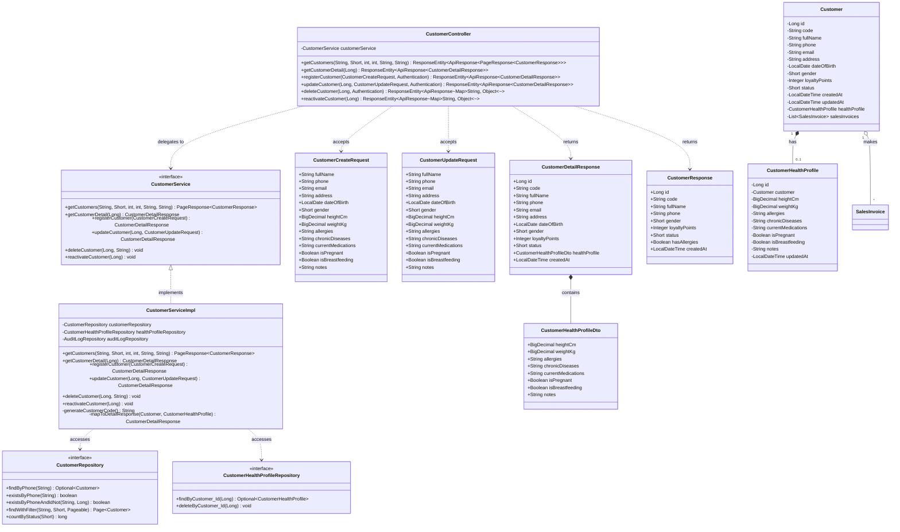
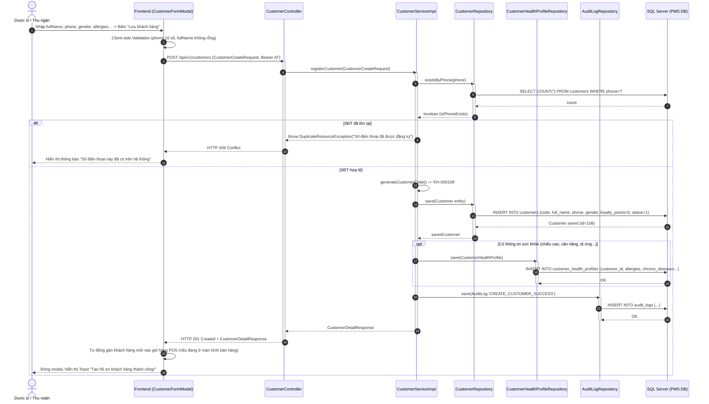
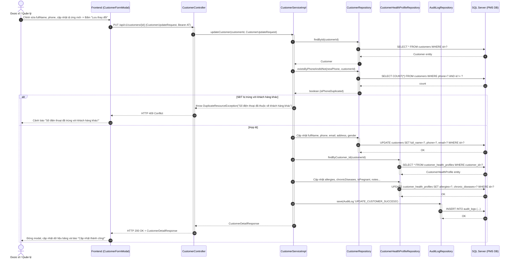
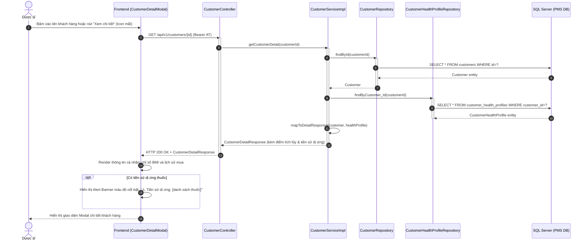
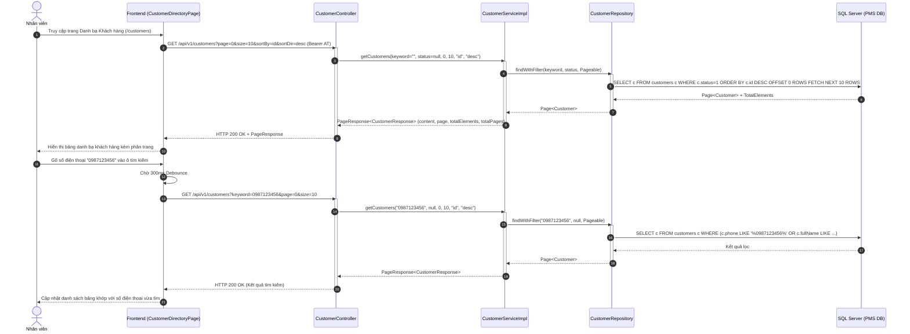
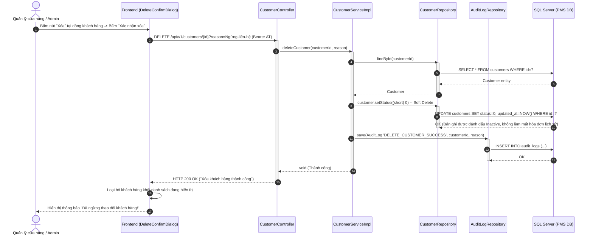

# TÀI LIỆU THIẾT KẾ HỆ THỐNG CHI TIẾT (SDS)
## CỤM CHỨC NĂNG 2: CUSTOMER MANAGEMENT (QUẢN LÝ KHÁCH HÀNG)

---

## 1. TỔNG QUAN KIẾN TRÚC THIẾT KẾ (ARCHITECTURAL OVERVIEW)
Cụm chức năng **Customer Management** được thiết kế để quản lý tập trung danh bạ khách hàng, hồ sơ sức khỏe cá nhân (Customer Health Profile) và lịch sử tích điểm thành viên:
- **Presentation Layer (Frontend)**: `CustomerDirectoryPage.jsx`, `CustomerFormModal.jsx`, `CustomerDetailModal.jsx`, `CustomerSelectModal.jsx` cung cấp giao diện tương tác nhanh, tìm kiếm debounce, cảnh báo trực quan các nguy cơ dị ứng thuốc.
- **Controller Layer (REST API)**: `CustomerController` tiếp nhận các endpoint `/api/v1/customers`, kiểm tra tính hợp lệ dữ liệu bằng Jakarta Bean Validation (`@Valid`).
- **Service Layer**: `CustomerServiceImpl` xử lý các quy tắc nghiệp vụ: sinh mã khách hàng tự động (`KH-xxxxxx`), kiểm tra chống trùng số điện thoại, quản lý Soft Delete (`status = 0`), tính toán điểm tích lũy và cập nhật hồ sơ bệnh lý lâm sàng.
- **Data Access Layer (Repository)**: `CustomerRepository`, `CustomerHealthProfileRepository` truy vấn dữ liệu từ bảng `customers` và `customer_health_profiles` trên cơ sở dữ liệu quan hệ SQL Server.

---

## 2. CLASS DIAGRAM CHI TIẾT (DETAILED CLASS DIAGRAM)

---

## 3. SEQUENCE DIAGRAMS CHI TIẾT CHO CẢ 5 CHỨC NĂNG

### 3.1. Sequence Diagram: UC29 - Register New Customer (Đăng ký khách hàng mới)

---

### 3.2. Sequence Diagram: UC30 - Edit Customer (Chỉnh sửa thông tin khách hàng)

---

### 3.3. Sequence Diagram: UC31 - View Customer Detail (Xem chi tiết hồ sơ & cảnh báo dị ứng)

---

### 3.4. Sequence Diagram: UC32 - View Customer List (Tra cứu danh bạ khách hàng)

---

### 3.5. Sequence Diagram: UC33 - Delete Customer (Xóa / Ngừng theo dõi khách hàng - Soft Delete)

