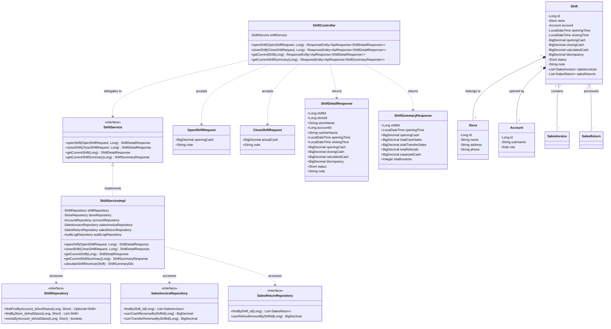
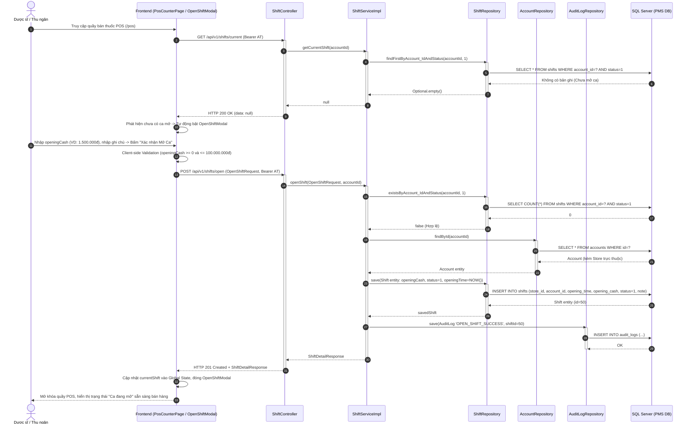
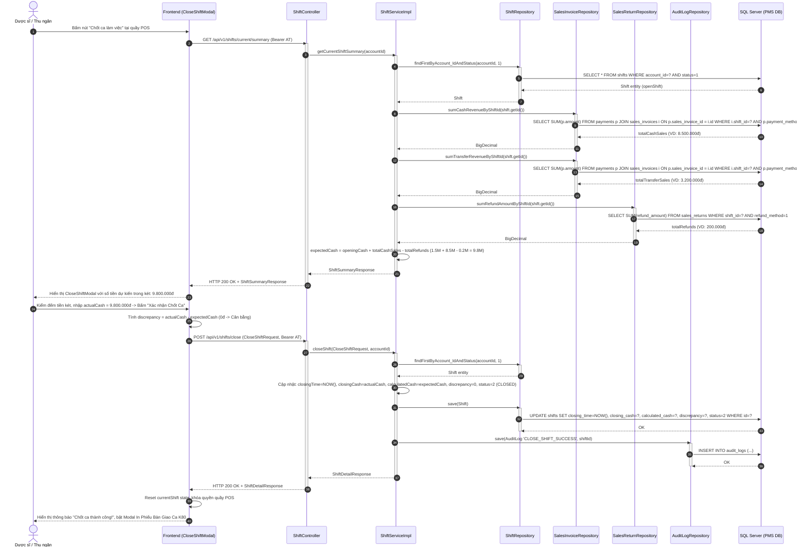

# TÀI LIỆU THIẾT KẾ HỆ THỐNG CHI TIẾT (SDS)
## CỤM CHỨC NĂNG 3: SHIFT MANAGEMENT (QUẢN LÝ CA LÀM VIỆC)

---

## 1. TỔNG QUAN KIẾN TRÚC THIẾT KẾ (ARCHITECTURAL OVERVIEW)
Cụm chức năng **Shift Management** quản lý vòng đời phiên bán hàng thực tế tại quầy thuốc POS:
- **Presentation Layer (Frontend)**: Hook tùy biến `useShift.js`, modal mở ca `OpenShiftModal.jsx`, modal chốt ca `CloseShiftModal.jsx` tích hợp chặt chẽ vào quầy bán lẻ `PosCounterPage.jsx`.
- **Controller Layer (REST API)**: `ShiftController` cung cấp các endpoint RESTful:
  * `POST /api/v1/shifts/open`: Khai báo tiền quỹ và mở ca.
  * `POST /api/v1/shifts/close`: Chốt ca, đối soát và bàn giao.
  * `GET /api/v1/shifts/current`: Lấy thông tin ca đang hoạt động của tài khoản.
  * `GET /api/v1/shifts/current/summary`: Lập báo cáo doanh thu tức thời phục vụ chốt ca.
- **Service Layer**: `ShiftServiceImpl` chịu trách nhiệm:
  * Đảm bảo tính duy nhất: 1 tài khoản chỉ có tối đa 1 ca mở (`status = 1`).
  * Tự động tổng hợp doanh thu tiền mặt, chuyển khoản và tiền hoàn trả từ các hóa đơn trong ca.
  * Tính toán công thức tiền lý thuyết và độ lệch chênh lệch két (`discrepancy`).
- **Data Access Layer (Repository)**: `ShiftRepository`, `SalesInvoiceRepository`, `SalesReturnRepository`.

---

## 2. CLASS DIAGRAM CHI TIẾT (DETAILED CLASS DIAGRAM)

---

## 3. SEQUENCE DIAGRAMS CHI TIẾT CHO CẢ 2 CHỨC NĂNG

### 3.1. Sequence Diagram: UC21 - Open Shift (Mở ca làm việc & Khai báo tiền quỹ đầu ca)

---

### 3.2. Sequence Diagram: UC22 - Close Shift (Chốt ca làm việc & Đối soát tiền két)

