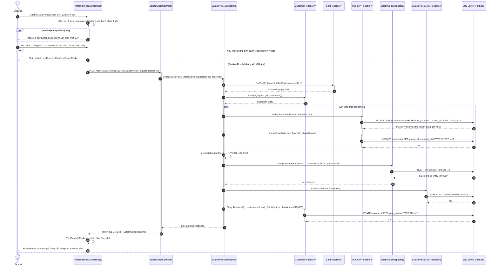
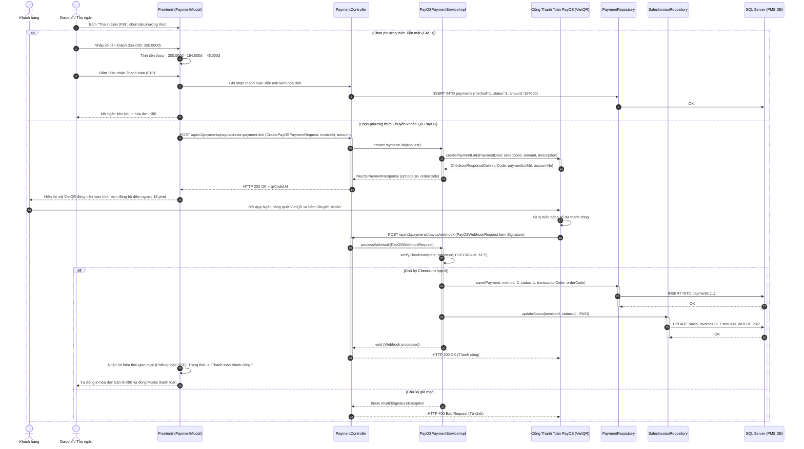
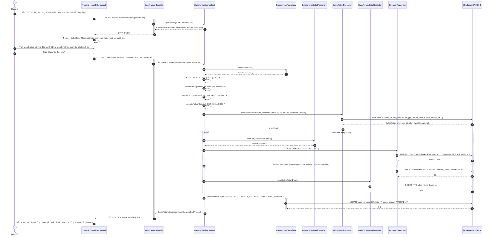
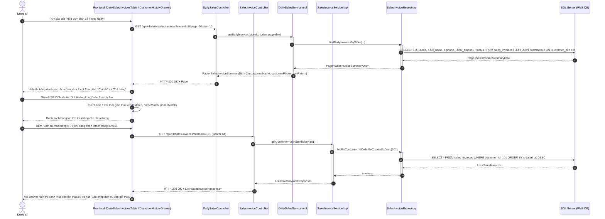

# TÀI LIỆU THIẾT KẾ HỆ THỐNG CHI TIẾT (SDS)
## CỤM CHỨC NĂNG 4: SALES MANAGEMENT (QUẢN LÝ BÁN LẺ & THANH TOÁN POS)

---

## 1. TỔNG QUAN KIẾN TRÚC THIẾT KẾ (ARCHITECTURAL OVERVIEW)
Cụm chức năng **Sales Management** là trung tâm nghiệp vụ xử lý giao dịch tại quầy bán lẻ của nhà thuốc:
- **Presentation Layer (Frontend)**: `PosCounterPage.jsx`, `PaymentModal.jsx`, `DailySalesInvoicesTable.jsx`, `SalesReturnModal.jsx`, `InvoiceDetailModal.jsx`, `InvoicePrintTemplate.jsx`. Hỗ trợ quét barcode, tự động kiểm tra dị ứng thuốc, hiển thị mã PayOS VietQR động và tiếp nhận trả hàng nhanh từ danh sách.
- **Controller Layer (REST API)**:
  * `SalesInvoiceController`: Quản lý lập hóa đơn bán lẻ (`POST /api/v1/sales-invoices`), tra cứu chi tiết, lịch sử mua hàng khách hàng và thực hiện đổi trả (`POST /api/v1/sales-invoices/return`).
  * `PaymentController`: Khởi tạo liên kết thanh toán PayOS VietQR (`POST /api/v1/payments/payos/create-payment-link`), tiếp nhận Webhook ngân hàng tự động (`POST /api/v1/payments/payos/webhook`), kiểm tra trạng thái (`GET /api/v1/payments/payos/status/{orderCode}`).
  * `DailySalesController`: Báo cáo tổng hợp doanh thu trong ngày và danh sách hóa đơn theo ca (`GET /api/v1/daily-sales/invoices`).
- **Service Layer**:
  * `SalesInvoiceServiceImpl`: Trừ kho tự động theo nguyên tắc FEFO, kiểm tra bắt buộc khách hàng, tính toán điểm thưởng thành viên, xử lý đổi trả hàng (tính toán `returnType` và hoàn nhập tồn kho).
  * `PayOSPaymentServiceImpl`: Kết nối SDK PayOS, thẩm định chữ ký bảo mật Checksum (`HMAC_SHA256`) và xác nhận thanh toán tự động qua Webhook.
  * `DailySalesServiceImpl`: Tổng hợp số liệu đối soát doanh thu chi nhánh.
- **Data Access Layer (Repository)**: `SalesInvoiceRepository`, `SalesInvoiceDetailRepository`, `PaymentRepository`, `SalesReturnRepository`, `SalesReturnDetailRepository`, `InventoryRepository`, `ProductBatchRepository`.

---

## 2. CLASS DIAGRAM CHI TIẾT (DETAILED CLASS DIAGRAM)

```mermaid
classDiagram
    direction TB

    %% Controllers
    class SalesInvoiceController {
        -SalesInvoiceService salesInvoiceService
        +createSalesInvoice(CreateSalesInvoiceRequest, AccountDetails) ResponseEntity~ApiResponse~SalesInvoiceResponse~~
        +getInvoice(String) ResponseEntity~ApiResponse~SalesInvoiceResponse~~
        +getInvoices(Long, Long, Long, String, Short, int, int) ResponseEntity~ApiResponse~PageResponse~SalesInvoiceResponse~~~
        +returnSalesInvoice(SalesReturnRequest, AccountDetails) ResponseEntity~ApiResponse~SalesReturnResponse~~
        +getCustomerPurchaseHistory(Long) ResponseEntity~ApiResponse~List~SalesInvoiceResponse~~~
    }

    class PaymentController {
        -PayOSPaymentService payOSPaymentService
        +createPaymentLink(CreatePayOSPaymentRequest) ResponseEntity~ApiResponse~PayOSPaymentResponse~~
        +handlePayOSWebhook(PayOSWebhookRequest) ResponseEntity~ApiResponse~Void~~
        +checkPaymentStatus(Long) ResponseEntity~ApiResponse~PayOSStatusResponse~~
    }

    class DailySalesController {
        -DailySalesService dailySalesService
        +getDailyInvoices(Long, LocalDate, int, int) ResponseEntity~ApiResponse~Page~SalesInvoiceSummaryDto~~~
        +getDailySalesOverview(Long, LocalDate) ResponseEntity~ApiResponse~DailySalesOverviewDto~~
    }

    %% Services
    class SalesInvoiceService {
        <<interface>>
        +createSalesInvoice(CreateSalesInvoiceRequest, Long) SalesInvoiceResponse
        +getInvoiceByCodeOrId(String) SalesInvoiceResponse
        +getInvoices(Long, Long, Long, String, Short, Pageable) PageResponse~SalesInvoiceResponse~
        +returnSalesInvoice(SalesReturnRequest, Long) SalesReturnResponse
        +getCustomerPurchaseHistory(Long) List~SalesInvoiceResponse~
    }

    class SalesInvoiceServiceImpl {
        -SalesInvoiceRepository salesInvoiceRepository
        -SalesInvoiceDetailRepository salesInvoiceDetailRepository
        -PaymentRepository paymentRepository
        -SalesReturnRepository salesReturnRepository
        -SalesReturnDetailRepository salesReturnDetailRepository
        -ShiftRepository shiftRepository
        -StoreRepository storeRepository
        -AccountRepository accountRepository
        -CustomerRepository customerRepository
        -ProductRepository productRepository
        -ProductBatchRepository productBatchRepository
        -InventoryRepository inventoryRepository
        -ProductUnitRepository productUnitRepository
        +createSalesInvoice(CreateSalesInvoiceRequest, Long) SalesInvoiceResponse
        +getInvoiceByCodeOrId(String) SalesInvoiceResponse
        +returnSalesInvoice(SalesReturnRequest, Long) SalesReturnResponse
        +getCustomerPurchaseHistory(Long) List~SalesInvoiceResponse~
        -generateInvoiceCode() String
        -generateReturnCode() String
        -applyFefoDeduction(Product, Integer, Store, List) void
    }

    class PayOSPaymentService {
        <<interface>>
        +createPaymentLink(CreatePayOSPaymentRequest) PayOSPaymentResponse
        +processWebhook(PayOSWebhookRequest) void
        +checkStatus(Long) PayOSStatusResponse
    }

    class PayOSPaymentServiceImpl {
        -PayOS payOS
        -PaymentRepository paymentRepository
        -SalesInvoiceRepository salesInvoiceRepository
        -PayOSChecksumUtil checksumUtil
        +createPaymentLink(CreatePayOSPaymentRequest) PayOSPaymentResponse
        +processWebhook(PayOSWebhookRequest) void
        +checkStatus(Long) PayOSStatusResponse
    }

    %% Repositories
    class SalesInvoiceRepository {
        <<interface>>
        +findByCode(String) Optional~SalesInvoice~
        +findByShift_Id(Long) List~SalesInvoice~
        +findByCustomer_IdOrderByCreatedAtDesc(Long) List~SalesInvoice~
    }

    class SalesInvoiceDetailRepository {
        <<interface>>
        +findBySalesInvoice_Id(Long) List~SalesInvoiceDetail~
    }

    class PaymentRepository {
        <<interface>>
        +findBySalesInvoice_Id(Long) Optional~Payment~
        +findByTransactionCode(String) Optional~Payment~
    }

    class SalesReturnRepository {
        <<interface>>
        +findBySalesInvoice_Id(Long) List~SalesReturn~
        +save(SalesReturn) SalesReturn
    }

    class SalesReturnDetailRepository {
        <<interface>>
        +save(SalesReturnDetail) SalesReturnDetail
    }

    class InventoryRepository {
        <<interface>>
        +findByStoreIdAndProductIdAndBatchId(Long, Long, Long) Optional~Inventory~
    }

    %% Entities
    class SalesInvoice {
        -Long id
        -String code
        -Store store
        -Shift shift
        -Account account
        -Customer customer
        -String prescriptionCode
        -BigDecimal totalAmount
        -BigDecimal discountAmount
        -BigDecimal finalAmount
        -Short status
        -String cancelReason
        -LocalDateTime createdAt
        -List~SalesInvoiceDetail~ details
        -Payment payment
        -List~SalesReturn~ returns
    }

    class SalesInvoiceDetail {
        -Long id
        -SalesInvoice salesInvoice
        -Product product
        -ProductBatch batch
        -ProductUnit unit
        -Integer quantity
        -Integer conversionFactor
        -BigDecimal unitPrice
        -BigDecimal lineTotal
        -String dosageInstruction
    }

    class Payment {
        -Long id
        -SalesInvoice salesInvoice
        -BigDecimal amount
        -Short paymentMethod
        -Short paymentStatus
        -String transactionCode
        -LocalDateTime paymentTime
    }

    class SalesReturn {
        -Long id
        -String code
        -SalesInvoice salesInvoice
        -Shift shift
        -Account processedBy
        -Short returnType
        -Short refundMethod
        -BigDecimal refundAmount
        -String reason
        -LocalDateTime createdAt
        -List~SalesReturnDetail~ details
    }

    class SalesReturnDetail {
        -Long id
        -SalesReturn salesReturn
        -SalesInvoiceDetail salesInvoiceDetail
        -Product product
        -ProductBatch batch
        -Integer quantity
        -BigDecimal unitPrice
    }

    class Inventory {
        -Long id
        -Store store
        -Product product
        -ProductBatch batch
        -Integer quantity
        -LocalDateTime updatedAt
    }

    %% DTOs
    class CreateSalesInvoiceRequest {
        +Long shiftId
        +Long customerId
        +String prescriptionCode
        +String orderNote
        +BigDecimal discountAmount
        +List~InvoiceItemRequest~ items
        +ProcessPaymentRequest payment
    }

    class InvoiceItemRequest {
        +Long productId
        +Long batchId
        +Long unitId
        +Integer quantity
        +BigDecimal unitPrice
        +String dosageInstruction
    }

    class ProcessPaymentRequest {
        +Short paymentMethod
        +BigDecimal paidAmount
        +String transactionCode
    }

    class SalesInvoiceResponse {
        +Long invoiceId
        +String invoiceCode
        +Long customerId
        +String customerName
        +BigDecimal totalAmount
        +BigDecimal discountAmount
        +BigDecimal finalAmount
        +String paymentMethod
        +Short statusCode
        +List~SalesInvoiceItemResponse~ items
    }

    class SalesReturnRequest {
        +Long invoiceId
        +String reason
        +Short refundMethod
        +List~ReturnItemRequest~ items
    }

    class SalesReturnResponse {
        +Long returnId
        +String returnCode
        +Long invoiceId
        +String invoiceCode
        +BigDecimal refundAmount
        +String refundMethod
        +String reason
        +LocalDateTime createdAt
    }

    %% Relationships
    SalesInvoiceController ..> SalesInvoiceService : delegates to
    PaymentController ..> PayOSPaymentService : delegates to
    SalesInvoiceService <|.. SalesInvoiceServiceImpl : implements
    PayOSPaymentService <|.. PayOSPaymentServiceImpl : implements

    SalesInvoice "1" *-- "*" SalesInvoiceDetail : contains
    SalesInvoice "1" *-- "0..1" Payment : settled by
    SalesInvoice "1" o-- "*" SalesReturn : has
    SalesReturn "1" *-- "*" SalesReturnDetail : contains

    SalesInvoiceServiceImpl ..> SalesInvoiceRepository : accesses
    SalesInvoiceServiceImpl ..> InventoryRepository : updates FEFO
    SalesInvoiceServiceImpl ..> SalesReturnRepository : saves return
    PayOSPaymentServiceImpl ..> PaymentRepository : updates webhook status
```

---

## 3. SEQUENCE DIAGRAMS CHI TIẾT CHO CẢ 4 CHỨC NĂNG

### 3.1. Sequence Diagram: UC23 - Create Sales Invoice (Lập hóa đơn bán lẻ thuốc tại quầy POS)

---

### 3.2. Sequence Diagram: UC24 - Process Payment (Thanh toán Tiền mặt & PayOS VietQR)

---

### 3.3. Sequence Diagram: UC25 - Cancel/Return Sales Invoice (Tiếp nhận trả hàng & Hoàn tiền)

---

### 3.4. Sequence Diagram: UC26 - View Customer Purchase History & Daily Invoices (Tra cứu lịch sử mua thuốc)

