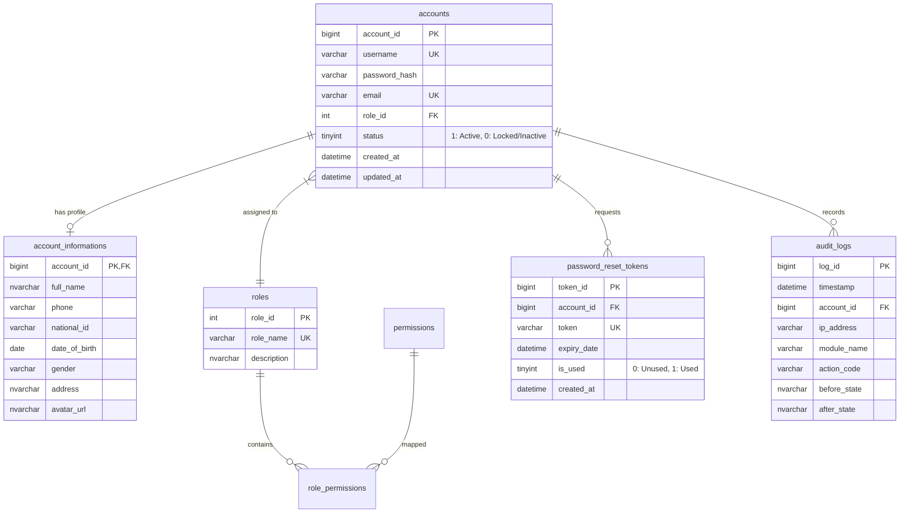
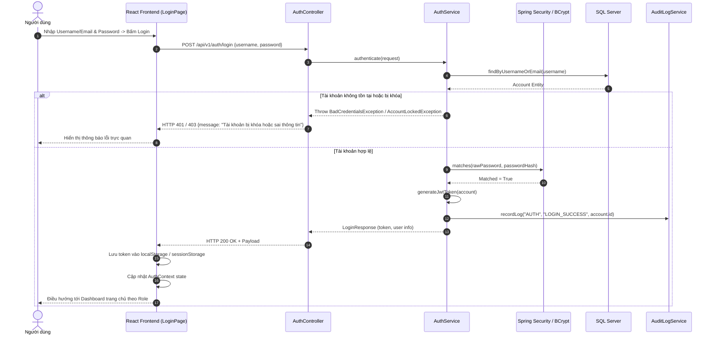

# Cụm Tính Năng: Authentication (Xác Thực & Quản Lý Danh Tính)

## 1. Tổng Quan Nghiệp Vụ & Mục Tiêu
Cụm tính năng **Authentication** chịu trách nhiệm quản lý định danh người dùng, kiểm soát truy cập và bảo mật toàn bộ hệ thống Chuỗi Quản lý Nhà thuốc (Pharmacy Chain Management System). 
Cụm này cung cấp cơ chế:
- Xác thực đăng nhập an toàn bằng JWT (JSON Web Token) cho tất cả các vai trò người dùng (`Admin`, `Store Manager`, `Pharmacist`, `Warehouse Staff`).
- Đăng xuất và vô hiệu hóa phiên làm việc (blacklist / client cleanup).
- Đổi mật khẩu định kỳ hoặc theo yêu cầu bảo mật.
- Quản lý và cập nhật thông tin hồ sơ cá nhân của người dùng đang đăng nhập.
- Khôi phục mật khẩu thông qua cơ chế gửi mã xác nhận/token một lần qua email.
- Ghi nhận nhật ký kiểm toán (`AuditLog`) cho mọi thao tác liên quan đến định danh và bảo mật.

---

## 2. Các Entity & Bảng Cơ Sở Dữ Liệu Liên Quan
Cụm tính năng này sử dụng trực tiếp các bảng trong schema `dbo` của SQL Server:

### Chi tiết các JPA Entity:
1. `com.pharmacy.entity.Account`: Lưu trữ thông tin tài khoản cốt lõi, trạng thái hoạt động và tham chiếu `Role`.
2. `com.pharmacy.entity.AccountInformation`: Thông tin chi tiết cá nhân (Họ tên, SĐT, CCCD, Ngày sinh, Địa chỉ, Avatar).
3. `com.pharmacy.entity.Role`: Vai trò hệ thống (`ROLE_ADMIN`, `ROLE_STORE_MANAGER`, `ROLE_PHARMACIST`, `ROLE_WAREHOUSE_STAFF`).
4. `com.pharmacy.entity.PasswordResetToken`: Mã token ngẫu nhiên có thời hạn phục vụ việc đặt lại mật khẩu.
5. `com.pharmacy.entity.AuditLog`: Ghi vết bảo mật (Đăng nhập, Đổi mật khẩu, Khóa tài khoản, IP, Thời gian).

---

## 3. Danh Mục Toàn Bộ File & Class Cần Triển Khai (Deliverables Inventory)

### 3.1. Phía Backend (Spring Boot 3 - Java 21)
| Phân loại | Tên File / Class | Package | Mục đích & Mô tả |
| :--- | :--- | :--- | :--- |
| **Controller** | `AuthController.java` | `com.pharmacy.controller` | REST API Controller tiếp nhận các yêu cầu `/api/v1/auth/*` |
| **Controller** | `AccountProfileController.java` | `com.pharmacy.controller` | Tiếp nhận yêu cầu xem/sửa hồ sơ `/api/v1/profile` |
| **Security** | `JwtTokenProvider.java` | `com.pharmacy.security` | Sinh JWT, giải mã, kiểm tra hạn token, trích xuất username/roles |
| **Security** | `JwtAuthenticationFilter.java` | `com.pharmacy.security` | Bộ lọc chặn HTTP Request để xác thực Header `Bearer <token>` |
| **Security** | `SecurityConfig.java` | `com.pharmacy.config` | Cấu hình phân quyền Spring Security, CORS, CSRF, PasswordEncoder |
| **Security** | `CustomUserDetails.java` | `com.pharmacy.security` | Triển khai `UserDetails` của Spring Security |
| **Security** | `CustomUserDetailsService.java` | `com.pharmacy.security` | Nạp user từ DB theo username hoặc email |
| **Service Interface** | `AuthService.java` | `com.pharmacy.service` | Khai báo các nghiệp vụ: login, logout, refresh, reset password |
| **Service Interface** | `ProfileService.java` | `com.pharmacy.service` | Khai báo các nghiệp vụ: get profile, update profile, change password |
| **Service Impl** | `AuthServiceImpl.java` | `com.pharmacy.service.impl` | Triển khai logic đăng nhập, xác thực BCrypt, tạo token, gửi mail reset |
| **Service Impl** | `ProfileServiceImpl.java` | `com.pharmacy.service.impl` | Triển khai logic cập nhật thông tin cá nhân và đổi mật khẩu |
| **Repository** | `AccountRepository.java` | `com.pharmacy.repository` | Truy vấn tài khoản theo username, email, ID |
| **Repository** | `AccountInformationRepository.java` | `com.pharmacy.repository` | Truy vấn và lưu trữ profile cá nhân |
| **Repository** | `PasswordResetTokenRepository.java` | `com.pharmacy.repository` | Quản lý token đặt lại mật khẩu và kiểm tra hết hạn |
| **Repository** | `AuditLogRepository.java` | `com.pharmacy.repository` | Lưu vết hoạt động đăng nhập/đổi mật khẩu |
| **DTO (Request)** | `LoginRequest.java` | `com.pharmacy.dto.auth` | Chứa `username` (hoặc email) và `password` |
| **DTO (Request)** | `ChangePasswordRequest.java` | `com.pharmacy.dto.auth` | Chứa `currentPassword`, `newPassword`, `confirmPassword` |
| **DTO (Request)** | `ForgotPasswordRequest.java` | `com.pharmacy.dto.auth` | Chứa `email` yêu cầu đặt lại mật khẩu |
| **DTO (Request)** | `ResetPasswordRequest.java` | `com.pharmacy.dto.auth` | Chứa `token`, `newPassword`, `confirmPassword` |
| **DTO (Request)** | `ProfileUpdateRequest.java` | `com.pharmacy.dto.auth` | Chứa `fullName`, `phone`, `dateOfBirth`, `gender`, `address`, `avatarUrl` |
| **DTO (Response)** | `LoginResponse.java` | `com.pharmacy.dto.auth` | Chứa `accessToken`, `tokenType`, `expiresIn`, `userSummary` |
| **DTO (Response)** | `UserProfileResponse.java` | `com.pharmacy.dto.auth` | Chứa toàn bộ thông tin tài khoản và profile cá nhân |
| **Exceptions** | `BadCredentialsException.java` | `com.pharmacy.exception` | Xử lý lỗi sai mật khẩu hoặc tài khoản không tồn tại |
| **Exceptions** | `AccountLockedException.java` | `com.pharmacy.exception` | Xử lý khi tài khoản bị khóa (`status = 0`) |
| **Exceptions** | `InvalidTokenException.java` | `com.pharmacy.exception` | Xử lý khi reset token không hợp lệ hoặc đã hết hạn |

### 3.2. Phía Frontend (React 18 - Vite)
| Phân loại | Tên File | Thư mục | Mục đích & Mô tả |
| :--- | :--- | :--- | :--- |
| **Page** | `LoginPage.jsx` | `src/page/auth/` | Màn hình đăng nhập chính thức của hệ thống |
| **Page** | `ForgotPasswordPage.jsx` | `src/page/auth/` | Màn hình nhập email để nhận mã khôi phục mật khẩu |
| **Page** | `ResetPasswordPage.jsx` | `src/page/auth/` | Màn hình đặt mật khẩu mới với token từ URL |
| **Page** | `ProfilePage.jsx` | `src/page/profile/` | Màn hình hiển thị và chỉnh sửa thông tin cá nhân |
| **Component** | `ChangePasswordModal.jsx` | `src/component/auth/` | Modal đổi mật khẩu nhanh khi đang trong phiên làm việc |
| **Component** | `ProtectedRoute.jsx` | `src/component/auth/` | Route bảo vệ, kiểm tra trạng thái login và role hợp lệ |
| **API Client** | `authApi.js` | `src/api/` | Gọi các API xác thực (`login`, `logout`, `forgotPassword`, `resetPassword`) |
| **API Client** | `profileApi.js` | `src/api/` | Gọi các API xem và sửa hồ sơ cá nhân, đổi mật khẩu |
| **Hook / Context**| `useAuth.js` & `AuthContext.jsx` | `src/hooks/` hoặc `src/context/` | Quản lý state đăng nhập toàn cục, lưu token, user info |

---

## 4. Kiến Trúc Luồng Xác Thực (Authentication Flow Diagram)

---

## 5. Danh Mục RESTful API Của Cụm Tính Năng
| STT | Phương thức | Đường dẫn API (Endpoint) | Quyền truy cập | Mô tả nghiệp vụ |
| :---: | :---: | :--- | :--- | :--- |
| 1 | `POST` | `/api/v1/auth/login` | Public (Không cần token) | Đăng nhập tài khoản, trả về JWT Access Token |
| 2 | `POST` | `/api/v1/auth/logout` | Authenticated (`ALL`) | Đăng xuất, hủy phiên làm việc, xóa client state |
| 3 | `POST` | `/api/v1/auth/change-password` | Authenticated (`ALL`) | Đổi mật khẩu tài khoản đang đăng nhập |
| 4 | `GET` | `/api/v1/profile` | Authenticated (`ALL`) | Lấy thông tin chi tiết hồ sơ tài khoản hiện tại |
| 5 | `PUT` | `/api/v1/profile` | Authenticated (`ALL`) | Cập nhật thông tin cá nhân (Họ tên, SĐT, Ngày sinh, Địa chỉ) |
| 6 | `POST` | `/api/v1/auth/forgot-password` | Public | Yêu cầu gửi email liên kết/token đặt lại mật khẩu |
| 7 | `POST` | `/api/v1/auth/reset-password` | Public | Đặt mật khẩu mới bằng token xác thực |

---

## 6. Danh Sách Các File Đặc Tả Chi Tiết Trong Cụm
1. [3.2.1 Login (Đăng nhập)](file:///c:/Users/AD/OneDrive/Desktop/FPT/Fall_2026/SBA301/FE_Project/PharmacyChainManagementSystem/doc/authentication/login.md)
2. [3.2.2 Logout (Đăng xuất)](file:///c:/Users/AD/OneDrive/Desktop/FPT/Fall_2026/SBA301/FE_Project/PharmacyChainManagementSystem/doc/authentication/logout.md)
3. [3.2.3 Change Password (Đổi mật khẩu)](file:///c:/Users/AD/OneDrive/Desktop/FPT/Fall_2026/SBA301/FE_Project/PharmacyChainManagementSystem/doc/authentication/change_password.md)
4. [3.2.4 Manage Personal Information (Quản lý thông tin cá nhân)](file:///c:/Users/AD/OneDrive/Desktop/FPT/Fall_2026/SBA301/FE_Project/PharmacyChainManagementSystem/doc/authentication/manage_personal_information.md)
5. [3.2.5 Forgot Password (Quên mật khẩu)](file:///c:/Users/AD/OneDrive/Desktop/FPT/Fall_2026/SBA301/FE_Project/PharmacyChainManagementSystem/doc/authentication/forgot_password.md)

