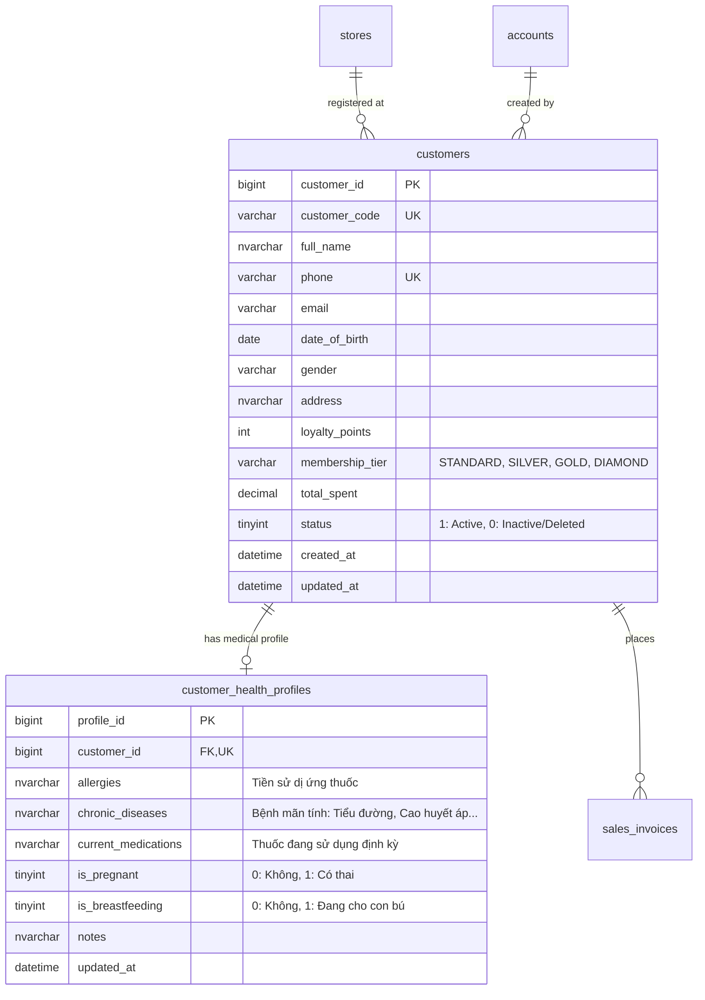
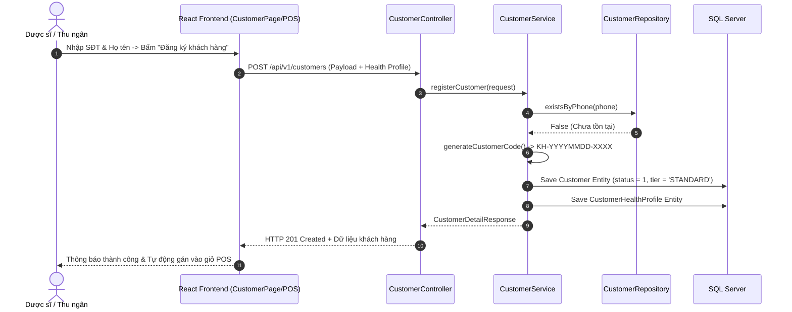

# Cụm Tính Năng: Customer Management (Quản Lý Khách Hàng & Hồ Sơ Y Tế)

## 1. Tổng Quan Nghiệp Vụ & Mục Tiêu
Cụm tính năng **Customer Management (CRM Nhà thuốc)** cung cấp giải pháp quản lý thông tin khách hàng toàn diện cho toàn bộ chuỗi nhà thuốc. Hệ thống không chỉ lưu trữ các thông tin định danh cơ bản phục vụ chăm sóc khách hàng và tích điểm thành viên, mà còn quản lý chuyên sâu **Hồ sơ sức khỏe y tế (`CustomerHealthProfile`)** nhằm hỗ trợ Dược sĩ tư vấn dùng thuốc an toàn, tránh tương tác thuốc và dị ứng nguy hiểm.

### Mục tiêu cốt lõi:
- **Đăng ký khách hàng mới nhanh chóng**: Hỗ trợ Dược sĩ tạo nhanh hồ sơ khách hàng ngay tại quầy POS chỉ với Số điện thoại và Họ tên trong vòng chưa đầy 15 giây.
- **Quản lý phân hạng hội viên (Membership Tier & Loyalty Points)**: Tự động tính toán điểm tích lũy dựa trên doanh số mua hàng, phân hạng khách hàng (`STANDARD`, `SILVER`, `GOLD`, `DIAMOND`) và áp dụng chính sách ưu đãi riêng biệt.
- **Hồ sơ sức khỏe & Cảnh báo an toàn y tế**: Ghi nhận các thông tin quan trọng như: Tiền sử dị ứng thuốc (Penicillin, Aspirin...), Bệnh lý nền mãn tính (Tiểu đường, Tăng huyết áp, Suy gan, Suy thận, Tim mạch), Phụ nữ mang thai / cho con bú.
- **Tra cứu và quản lý tập trung**: Tìm kiếm khách hàng theo SĐT, Họ tên, CCCD/CMND trên toàn chuỗi; hỗ trợ xem chi tiết hồ sơ bệnh án, lịch sử mua thuốc và cập nhật thông tin.
- **Quản lý vòng đời khách hàng & Xóa an toàn**: Thực hiện xóa mềm (`soft delete` hoặc vô hiệu hóa `status = 0`) nhằm bảo toàn lịch sử hóa đơn kế toán và nhật ký y khoa theo quy định của Bộ Y Tế.

---

## 2. Các Entity & Bảng Cơ Sở Dữ Liệu Liên Quan
Cụm tính năng này sử dụng trực tiếp các bảng trong schema `dbo` của SQL Server:

### Chi tiết các JPA Entity:
1. `com.pharmacy.entity.Customer`: Lưu trữ thông tin khách hàng, số điện thoại định danh duy nhất, điểm tích lũy và xếp hạng thành viên.
2. `com.pharmacy.entity.CustomerHealthProfile`: Lưu trữ tiền sử dị ứng, bệnh nền, thuốc đang dùng định kỳ.
3. `com.pharmacy.entity.SalesInvoice`: Liên kết tới các hóa đơn khách hàng đã mua để tính tổng chi tiêu (`total_spent`).

---

## 3. Danh Mục Toàn Bộ File & Class Cần Triển Khai (Deliverables Inventory)

### 3.1. Phía Backend (Spring Boot 3 - Java 21)
| Phân loại | Tên File / Class | Package | Mục đích & Mô tả |
| :--- | :--- | :--- | :--- |
| **Controller** | `CustomerController.java` | `com.pharmacy.controller` | Tiếp nhận tất cả các REST API `/api/v1/customers/*` |
| **Service Interface**| `CustomerService.java` | `com.pharmacy.service` | Khai báo các nghiệp vụ: tạo, sửa, xóa, tìm kiếm, cập nhật hồ sơ y tế |
| **Service Impl** | `CustomerServiceImpl.java` | `com.pharmacy.service.impl` | Triển khai logic nghiệp vụ khách hàng, tích điểm, kiểm tra trùng SĐT |
| **Repository** | `CustomerRepository.java` | `com.pharmacy.repository` | Truy vấn khách hàng theo SĐT, tên, phân trang, lọc theo trạng thái |
| **Repository** | `CustomerHealthProfileRepository.java`| `com.pharmacy.repository`| Quản lý lưu trữ hồ sơ dị ứng và bệnh lý của khách hàng |
| **DTO (Request)** | `CustomerCreateRequest.java` | `com.pharmacy.dto.customer` | Chứa thông tin tạo mới: họ tên, SĐT, giới tính, ngày sinh, địa chỉ, hồ sơ y tế ban đầu |
| **DTO (Request)** | `CustomerUpdateRequest.java` | `com.pharmacy.dto.customer` | Chứa thông tin chỉnh sửa khách hàng và hồ sơ sức khỏe |
| **DTO (Request)** | `CustomerFilterRequest.java` | `com.pharmacy.dto.customer` | Tham số tìm kiếm, phân trang và lọc theo hạng thẻ |
| **DTO (Response)**| `CustomerResponse.java` | `com.pharmacy.dto.customer` | Dữ liệu tóm tắt khách hàng dùng trong danh sách bảng |
| **DTO (Response)**| `CustomerDetailResponse.java` | `com.pharmacy.dto.customer` | Dữ liệu chi tiết đầy đủ gồm thông tin cá nhân và hồ sơ y tế |
| **DTO (Nested)** | `CustomerHealthProfileDto.java`| `com.pharmacy.dto.customer` | Thông tin dị ứng, bệnh mãn tính, mang thai, cho con bú |
| **Exceptions** | `CustomerPhoneAlreadyExistsException.java`| `com.pharmacy.exception`| Khi số điện thoại đăng ký đã tồn tại trong hệ thống |

### 3.2. Phía Frontend (React 18 - Vite)
| Phân loại | Tên File | Thư mục | Mục đích & Mô tả |
| :--- | :--- | :--- | :--- |
| **Page** | `CustomerDirectoryPage.jsx` | `src/page/customers/` | Màn hình danh sách khách hàng (tìm kiếm, bộ lọc hạng thẻ, phân trang) |
| **Component** | `CustomerTable.jsx` | `src/component/customers/` | Bảng danh sách hiển thị tên, SĐT, hạng thẻ, điểm, tổng chi tiêu, trạng thái |
| **Component** | `CustomerCreateModal.jsx` | `src/component/customers/` | Modal đăng ký khách hàng mới (hỗ trợ tạo nhanh tại quầy POS) |
| **Component** | `CustomerEditModal.jsx` | `src/component/customers/` | Modal chỉnh sửa thông tin khách hàng và cập nhật hồ sơ bệnh án |
| **Component** | `CustomerDetailDrawer.jsx` | `src/component/customers/` | Drawer trượt hiển thị chi tiết hồ sơ y tế, dị ứng thuốc và lịch sử mua |
| **Component** | `CustomerDeleteModal.jsx` | `src/component/customers/` | Modal xác nhận vô hiệu hóa / xóa tài khoản khách hàng |
| **API Client** | `customerApi.js` | `src/api/` | Gọi các API CRUD khách hàng và quản lý hồ sơ y tế |
| **Hook** | `useCustomers.js` | `src/hooks/` | Quản lý logic nạp danh sách, debounce tìm kiếm, phân trang |

---

## 4. Kiến Trúc Luồng Quản Lý Khách Hàng (Customer CRM Architecture)

---

## 5. Danh Mục RESTful API Của Cụm Customer Management
| STT | Phương thức | Đường dẫn API (Endpoint) | Quyền truy cập | Mô tả nghiệp vụ |
| :---: | :---: | :--- | :--- | :--- |
| 1 | `POST` | `/api/v1/customers` | `Pharmacist`, `Store Manager`, `Admin` | Đăng ký khách hàng mới kèm hồ sơ sức khỏe |
| 2 | `PUT` | `/api/v1/customers/{id}` | `Pharmacist`, `Store Manager`, `Admin` | Cập nhật thông tin và bệnh lý khách hàng |
| 3 | `GET` | `/api/v1/customers/{id}` | Authenticated (`ALL`) | Xem chi tiết thông tin và hồ sơ y tế khách hàng |
| 4 | `GET` | `/api/v1/customers` | Authenticated (`ALL`) | Lấy danh sách khách hàng (tìm kiếm, lọc, phân trang) |
| 5 | `DELETE`| `/api/v1/customers/{id}` | `Store Manager`, `Admin` | Vô hiệu hóa / Xóa mềm khách hàng khỏi hệ thống |
| 6 | `GET` | `/api/v1/customers/search-by-phone`| Authenticated (`ALL`) | Tra cứu nhanh khách hàng bằng SĐT tại quầy POS |

---

## 6. Danh Sách Các File Đặc Tả Chi Tiết Trong Cụm
1. [3.8.1 Register New Customer (Đăng ký khách hàng mới)](file:///c:/Users/AD/OneDrive/Desktop/FPT/Fall_2026/SBA301/FE_Project/PharmacyChainManagementSystem/doc/customer_management/register_new_customer.md)
2. [3.8.2 Edit Customer (Chỉnh sửa thông tin khách hàng)](file:///c:/Users/AD/OneDrive/Desktop/FPT/Fall_2026/SBA301/FE_Project/PharmacyChainManagementSystem/doc/customer_management/edit_customer.md)
3. [3.8.3 View Customer Detail (Xem chi tiết khách hàng & Hồ sơ y tế)](file:///c:/Users/AD/OneDrive/Desktop/FPT/Fall_2026/SBA301/FE_Project/PharmacyChainManagementSystem/doc/customer_management/view_customer_detail.md)
4. [3.8.4 View Customer List (Danh sách khách hàng, tìm kiếm & phân trang)](file:///c:/Users/AD/OneDrive/Desktop/FPT/Fall_2026/SBA301/FE_Project/PharmacyChainManagementSystem/doc/customer_management/view_customer_list.md)
5. [3.8.5 Delete Customer (Vô hiệu hóa / Xóa khách hàng)](file:///c:/Users/AD/OneDrive/Desktop/FPT/Fall_2026/SBA301/FE_Project/PharmacyChainManagementSystem/doc/customer_management/delete_customer.md)

