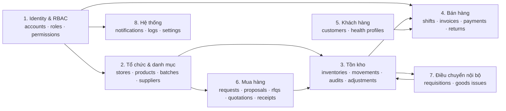
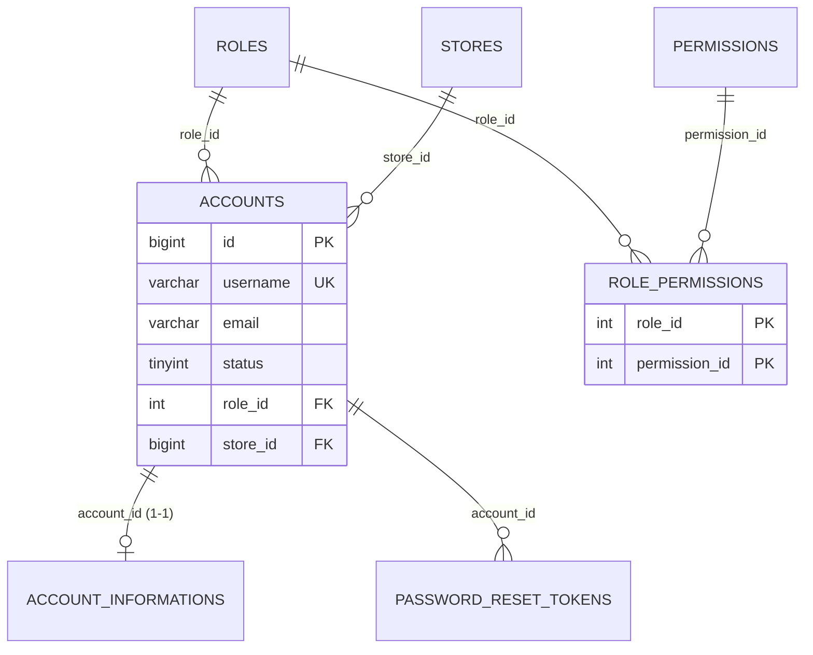
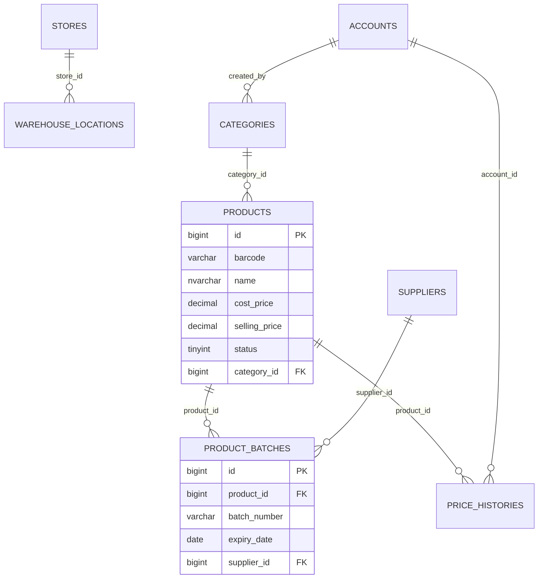
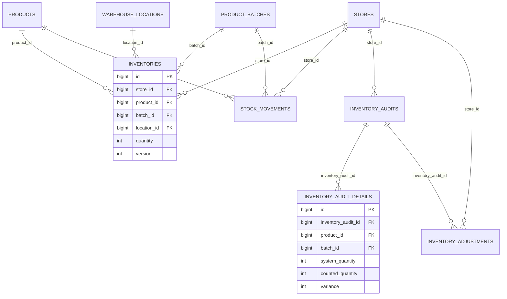
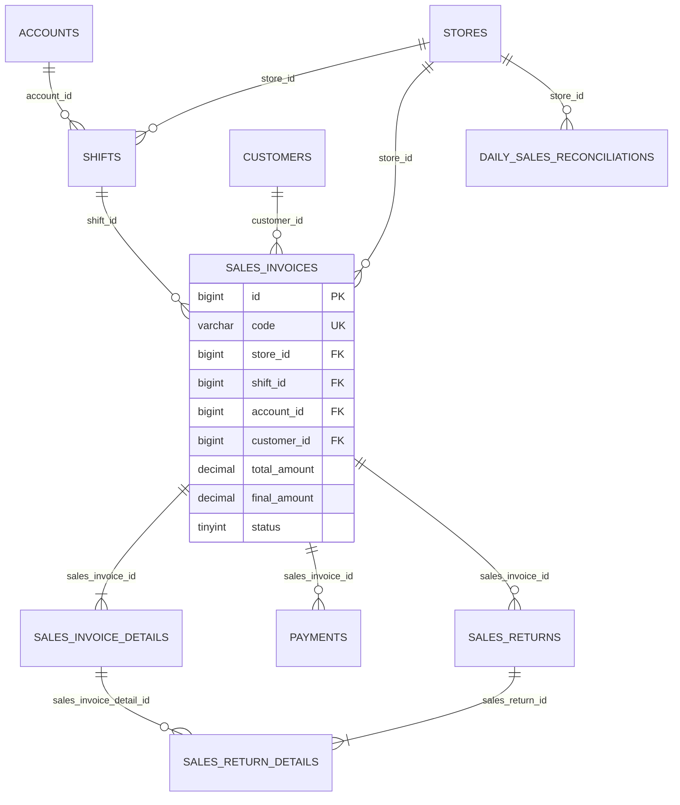
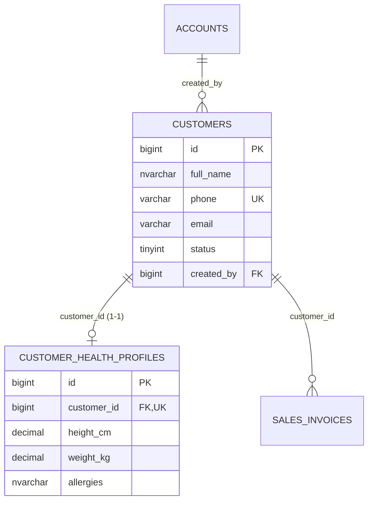
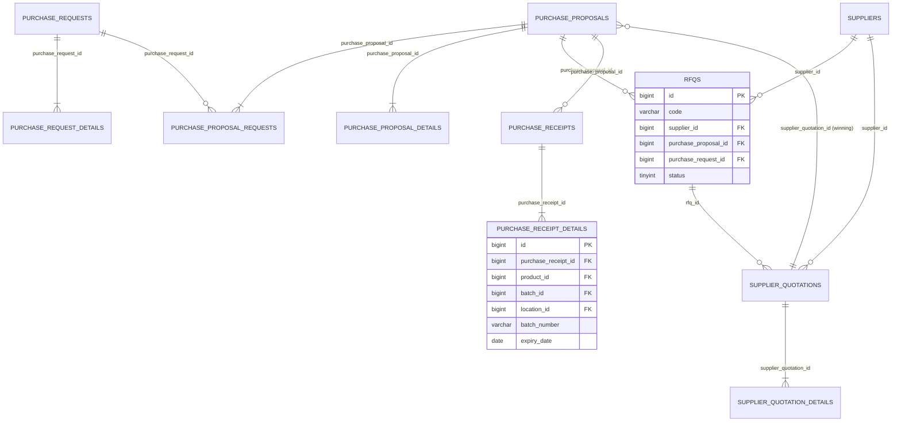
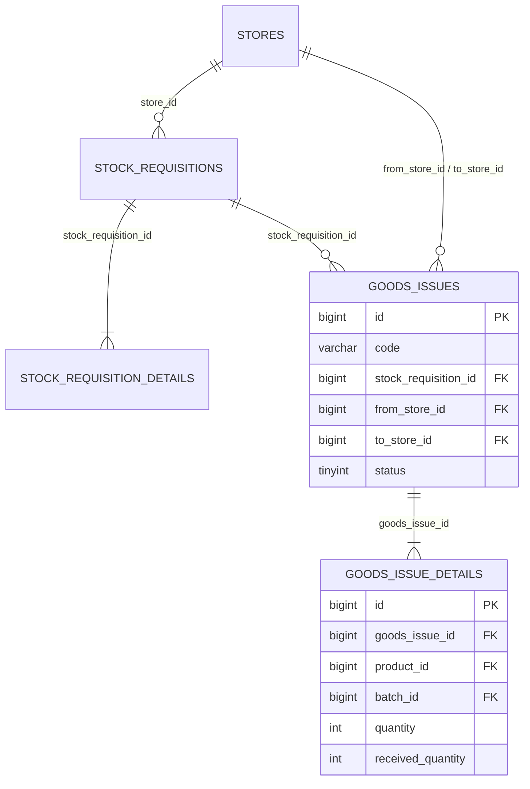

# PMS — Tài Liệu Entity & Quan Hệ Cơ Sở Dữ Liệu

> **Nguồn sự thật**: package `BE/sba/src/main/java/com/pharmacy/entity/` (46 file = 45 `@Entity` + 1 `@Embeddable`).
> **Đối chiếu**: `DB/pms_database.sql` (DDL computed columns + seed data) và các converter trong `entity/converter/`.
> **Cách đọc**: mỗi bảng dưới đây tương ứng 1 entity JPA — tên bảng lấy đúng từ `@Table(name = "...")`, không suy diễn.

---

## 1. Quy Ước

| Quy ước | Ý nghĩa |
|---|---|
| Tên bảng | `snake_case`, số nhiều (`sales_invoices`, `product_batches`) |
| Khóa chính | Hầu hết là `id` `BIGINT IDENTITY`; riêng `roles.id` / `permissions.id` là `INT`, `system_settings` dùng `setting_key` (String) |
| Enum ↔ cột | `tinyint` lưu `code` của enum (xem mục 6). Một số cột vẫn khai báo `Short` dù đã có enum — ghi rõ trong từng bảng |
| Chuỗi | `@Nationalized` → `NVARCHAR`; `@Lob` → `NVARCHAR(MAX)` |
| Thời gian | `LocalDateTime` → `DATETIME2(0)`, `LocalDate` → `DATE` |
| Khóa ngoại | `@ManyToOne(fetch = LAZY)` + `@JoinColumn`; `@OneToMany` chỉ khai báo ở phía cha với `cascade = ALL, orphanRemoval = true` |
| Cột computed | DB tính bằng `AS (...)` PERSISTED, JPA đánh `insertable = false, updatable = false` → **chỉ đọc** |

---

## 2. Danh Sách 45 Entity / Bảng

| # | Nhóm | Entity | Bảng | PK |
|---:|---|---|---|---|
| 1 | Identity & RBAC | `Account` | `accounts` | `id` BIGINT |
| 2 | Identity & RBAC | `AccountInformation` | `account_informations` | `id` BIGINT |
| 3 | Identity & RBAC | `Role` | `roles` | `id` INT |
| 4 | Identity & RBAC | `Permission` | `permissions` | `id` INT |
| 5 | Identity & RBAC | `RolePermission` | `role_permissions` | `(role_id, permission_id)` |
| 6 | Identity & RBAC | `PasswordResetToken` | `password_reset_tokens` | `id` BIGINT |
| 7 | Tổ chức | `Store` | `stores` | `id` BIGINT |
| 8 | Tổ chức | `WarehouseLocation` | `warehouse_locations` | `id` BIGINT |
| 9 | Danh mục | `Category` | `categories` | `id` BIGINT |
| 10 | Danh mục | `Product` | `products` | `id` BIGINT |
| 11 | Danh mục | `ProductBatch` | `product_batches` | `id` BIGINT |
| 12 | Danh mục | `PriceHistory` | `price_histories` | `id` BIGINT |
| 13 | Nhà cung cấp | `Supplier` | `suppliers` | `id` BIGINT |
| 14 | Tồn kho | `Inventory` | `inventories` | `id` BIGINT |
| 15 | Tồn kho | `StockMovement` | `stock_movements` | `id` BIGINT |
| 16 | Tồn kho | `InventoryAudit` | `inventory_audits` | `id` BIGINT |
| 17 | Tồn kho | `InventoryAuditDetail` | `inventory_audit_details` | `id` BIGINT |
| 18 | Tồn kho | `InventoryAdjustment` | `inventory_adjustments` | `id` BIGINT |
| 19 | Bán hàng | `Shift` | `shifts` | `id` BIGINT |
| 20 | Bán hàng | `SalesInvoice` | `sales_invoices` | `id` BIGINT |
| 21 | Bán hàng | `SalesInvoiceDetail` | `sales_invoice_details` | `id` BIGINT |
| 22 | Bán hàng | `Payment` | `payments` | `id` BIGINT |
| 23 | Bán hàng | `SalesReturn` | `sales_returns` | `id` BIGINT |
| 24 | Bán hàng | `SalesReturnDetail` | `sales_return_details` | `id` BIGINT |
| 25 | Bán hàng | `DailySalesReconciliation` | `daily_sales_reconciliations` | `id` BIGINT |
| 26 | Khách hàng | `Customer` | `customers` | `id` BIGINT |
| 27 | Khách hàng | `CustomerHealthProfile` | `customer_health_profiles` | `id` BIGINT |
| 28 | Mua hàng | `PurchaseRequest` | `purchase_requests` | `id` BIGINT |
| 29 | Mua hàng | `PurchaseRequestDetail` | `purchase_request_details` | `id` BIGINT |
| 30 | Mua hàng | `PurchaseProposal` | `purchase_proposals` | `id` BIGINT |
| 31 | Mua hàng | `PurchaseProposalRequest` | `purchase_proposal_requests` | `id` BIGINT |
| 32 | Mua hàng | `PurchaseProposalDetail` | `purchase_proposal_details` | `id` BIGINT |
| 33 | Mua hàng | `Rfq` | `rfqs` | `id` BIGINT |
| 34 | Mua hàng | `SupplierQuotation` | `supplier_quotations` | `id` BIGINT |
| 35 | Mua hàng | `SupplierQuotationDetail` | `supplier_quotation_details` | `id` BIGINT |
| 36 | Mua hàng | `PurchaseReceipt` | `purchase_receipts` | `id` BIGINT |
| 37 | Mua hàng | `PurchaseReceiptDetail` | `purchase_receipt_details` | `id` BIGINT |
| 38 | Điều chuyển | `StockRequisition` | `stock_requisitions` | `id` BIGINT |
| 39 | Điều chuyển | `StockRequisitionDetail` | `stock_requisition_details` | `id` BIGINT |
| 40 | Điều chuyển | `GoodsIssue` | `goods_issues` | `id` BIGINT |
| 41 | Điều chuyển | `GoodsIssueDetail` | `goods_issue_details` | `id` BIGINT |
| 42 | Hệ thống | `Notification` | `notifications` | `id` BIGINT |
| 43 | Hệ thống | `EmailLog` | `email_logs` | `id` BIGINT |
| 44 | Hệ thống | `AuditLog` | `audit_logs` | `id` BIGINT |
| 45 | Hệ thống | `SystemSetting` | `system_settings` | `setting_key` VARCHAR(60) |

> Không tồn tại entity/bảng `purchase_orders` trong tầng persistence, dù có `PurchaseOrderService` / `PurchaseOrderController`. Luồng PO hiện dùng `purchase_proposals` + `purchase_receipts`.

---

## 3. Sơ Đồ ERD

### 3.1 Bản đồ miền nghiệp vụ



### 3.2 Identity & RBAC



### 3.3 Tổ chức, danh mục & nhà cung cấp



### 3.4 Tồn kho



### 3.5 Bán hàng, ca & đối soát



### 3.6 Khách hàng



### 3.7 Mua hàng (procurement)



### 3.8 Điều chuyển nội bộ



---

## 4. Chi Tiết Từng Bảng

### 4.1 Identity & RBAC

#### `accounts` — `Account`

Tài khoản đăng nhập của nhân viên; mỗi tài khoản gắn 1 vai trò và 1 chi nhánh/kho.

| Cột | Kiểu | Null | Ghi chú |
|---|---|:--:|---|
| `id` | Long / BIGINT IDENTITY | ✗ | PK |
| `username` | String / VARCHAR(50) | ✗ | Duy nhất theo nghiệp vụ (merge key trong seed) |
| `email` | String / VARCHAR(150) | ✗ | |
| `phone` | String / VARCHAR(20) | ✓ | |
| `password` | String / VARCHAR(100) | ✗ | Hash BCrypt, không lưu plain text |
| `status` | `AccountStatus` / TINYINT | ✗ | DEFAULT 1 — `0 Disabled / 1 Active / 2 Locked` |
| `last_login_at` | LocalDateTime | ✓ | |
| `failed_login_count` | Integer | ✗ | DEFAULT 0, dùng cho logic khóa tài khoản |
| `created_at` | LocalDateTime | ✗ | DEFAULT `sysdatetime()` |
| `updated_at` | LocalDateTime | ✓ | |
| `role_id` | Role / INT (FK `roles.id`) | ✓ | JPA không đặt `optional = false` — nghiệp vụ bắt buộc |
| `store_id` | Store / BIGINT (FK `stores.id`) | ✓ | Chi nhánh/kho trực thuộc |

Quan hệ JPA: `@ManyToOne(LAZY)` → `Role`, `@ManyToOne(LAZY)` → `Store`; `@OneToOne(mappedBy = "account", cascade = ALL)` → `AccountInformation`.

#### `account_informations` — `AccountInformation`

Hồ sơ nhân viên 1-1 với tài khoản.

| Cột | Kiểu | Null | Ghi chú |
|---|---|:--:|---|
| `id` | Long / BIGINT IDENTITY | ✗ | PK |
| `account_id` | Account / BIGINT (FK `accounts.id`) | ✗ | `@OneToOne(optional = false)`, cần UNIQUE trên DB |
| `full_name` | String / NVARCHAR(150) | ✗ | |
| `date_of_birth` | LocalDate / DATE | ✓ | |
| `gender` | Short / TINYINT | ✓ | 1 nam / 2 nữ theo seed |
| `address` | String / NVARCHAR(500) | ✓ | |
| `avatar_url` | String / VARCHAR(500) | ✓ | |

#### `roles` — `Role`

| Cột | Kiểu | Null | Ghi chú |
|---|---|:--:|---|
| `id` | Integer / INT IDENTITY | ✗ | PK |
| `code` | String / VARCHAR(30) | ✗ | `ADMIN`, `STORE_MANAGER`, `PHARMACIST`, `WAREHOUSE_MANAGER`, `WAREHOUSE_STAFF`, `PURCHASING_STAFF`, `GENERAL_MANAGER` (theo seed) |
| `name` | String / NVARCHAR(100) | ✗ | |
| `description` | String / NVARCHAR(300) | ✓ | |

#### `permissions` — `Permission`

| Cột | Kiểu | Null | Ghi chú |
|---|---|:--:|---|
| `id` | Integer / INT IDENTITY | ✗ | PK |
| `code` | String / VARCHAR(50) | ✗ | Ví dụ `INVOICE_CREATE`, `WH_RECEIPT_CONFIRM` |
| `"module"` | String / VARCHAR(40) | ✗ | Tên cột có ngoặc kép vì `module` là từ khóa |
| `description` | String / NVARCHAR(200) | ✓ | |

#### `role_permissions` — `RolePermission` (+ `RolePermissionId`)

| Cột | Kiểu | Null | Ghi chú |
|---|---|:--:|---|
| `role_id` | Integer (FK `roles.id`) | ✗ | PK phức hợp, `@MapsId("roleId")` |
| `permission_id` | Integer (FK `permissions.id`) | ✗ | PK phức hợp, `@MapsId("permissionId")` |

`RolePermissionId` là `@Embeddable` với `equals/hashCode` dựa trên cả 2 cột (dùng `Hibernate.getClass`).

#### `password_reset_tokens` — `PasswordResetToken`

| Cột | Kiểu | Null | Ghi chú |
|---|---|:--:|---|
| `id` | Long / BIGINT IDENTITY | ✗ | PK |
| `account_id` | Account / BIGINT (FK `accounts.id`) | ✗ | |
| `token_hash` | String / VARCHAR(100) | ✗ | Chỉ lưu hash, không lưu token gốc |
| `expires_at` | LocalDateTime | ✗ | Thời hạn theo setting `PASSWORD_RESET_MINUTES` |
| `used_at` | LocalDateTime | ✓ | Khác null ⇒ token đã dùng, không cho tái sử dụng |
| `created_at` | LocalDateTime | ✗ | DEFAULT `sysdatetime()` |

---

### 4.2 Tổ Chức, Danh Mục & Nhà Cung Cấp

#### `stores` — `Store`

Chi nhánh bán lẻ, kho tổng hoặc trụ sở chính.

| Cột | Kiểu | Null | Ghi chú |
|---|---|:--:|---|
| `id` | Long / BIGINT IDENTITY | ✗ | PK |
| `code` | String / VARCHAR(20) | ✗ | `HQ`, `WH01`, `ST01`… |
| `name` | String / NVARCHAR(150) | ✗ | |
| `type` | Short / TINYINT | ✗ | DEFAULT 1 — `StoreType`: 0 Trụ sở, 1 Nhà thuốc, 2 Kho tổng (chưa map enum) |
| `address` | String / NVARCHAR(500) | ✓ | |
| `phone` | String / VARCHAR(20) | ✓ | |
| `status` | Short / TINYINT | ✗ | DEFAULT 1 — `StoreStatus`: 0 Tạm ngừng, 1 Hoạt động |
| `created_at` | LocalDateTime | ✗ | DEFAULT `sysdatetime()` |

#### `warehouse_locations` — `WarehouseLocation`

Vị trí ô kệ (aisle/shelf/bin) trong kho.

| Cột | Kiểu | Null | Ghi chú |
|---|---|:--:|---|
| `id` | Long / BIGINT IDENTITY | ✗ | PK |
| `store_id` | Store / BIGINT (FK `stores.id`) | ✓ | |
| `code` | String / VARCHAR(30) | ✗ | Nghiệp vụ: unique theo `(store_id, code)` — seed dùng cặp này làm khóa merge |
| `aisle` | String / VARCHAR(10) | ✓ | Dãy kệ |
| `shelf` | String / VARCHAR(10) | ✓ | Kệ |
| `bin` | String / VARCHAR(10) | ✓ | Ô |
| `status` | Short / TINYINT | ✗ | DEFAULT 1 |

#### `categories` — `Category`

Nhóm thuốc theo GSP.

| Cột | Kiểu | Null | Ghi chú |
|---|---|:--:|---|
| `id` | Long / BIGINT IDENTITY | ✗ | PK |
| `name` | String / NVARCHAR(150) | ✗ | Merge key trong seed |
| `description` | String / NVARCHAR(500) | ✓ | |
| `status` | `CategoryStatus` / TINYINT | ✗ | DEFAULT 1 — 0 Inactive, 1 Active |
| `created_by` | Account / BIGINT (FK `accounts.id`) | ✗ | |
| `created_at` | LocalDateTime | ✗ | DEFAULT `sysdatetime()` |

#### `products` — `Product`

Danh mục dược phẩm.

| Cột | Kiểu | Null | Ghi chú |
|---|---|:--:|---|
| `id` | Long / BIGINT IDENTITY | ✗ | PK |
| `barcode` | String / VARCHAR(50) | ✓ | Merge key trong seed |
| `name` | String / NVARCHAR(250) | ✗ | |
| `unit` | String / NVARCHAR(30) | ✗ | Hộp / Chai / Tuýp… |
| `active_ingredient` | String / NVARCHAR(250) | ✓ | Hoạt chất |
| `manufacturer` | String / NVARCHAR(200) | ✓ | |
| `is_prescription` | Boolean / BIT | ✗ | DEFAULT 0 — thuốc kê đơn (Rx) |
| `cost_price` | BigDecimal / DECIMAL(18,2) | ✗ | DEFAULT 0 |
| `selling_price` | BigDecimal / DECIMAL(18,2) | ✗ | DEFAULT 0 |
| `min_quantity` | Integer | ✗ | DEFAULT 20 — ngưỡng cảnh báo tồn thấp |
| `description` | String / NVARCHAR(MAX) (`@Lob`) | ✓ | |
| `image_url` | String / VARCHAR(500) | ✓ | |
| `status` | `ProductStatus` / TINYINT | ✗ | DEFAULT 1 — 0 Inactive, 1 Active, 2 Discontinued |
| `created_at` | LocalDateTime | ✗ | DEFAULT `sysdatetime()` |
| `updated_at` | LocalDateTime | ✓ | |
| `category_id` | Category / BIGINT (FK `categories.id`) | ✗ | |

#### `product_batches` — `ProductBatch`

Lô thuốc theo số lô + hạn dùng (cơ sở cho FEFO).

| Cột | Kiểu | Null | Ghi chú |
|---|---|:--:|---|
| `id` | Long / BIGINT IDENTITY | ✗ | PK |
| `product_id` | Product / BIGINT (FK `products.id`) | ✓ | Entity không đặt `optional = false` |
| `batch_number` | String / VARCHAR(50) | ✗ | |
| `manufacture_date` | LocalDate / DATE | ✓ | |
| `expiry_date` | LocalDate / DATE | ✗ | Dùng cho cảnh báo cận hạn/hết hạn |
| `supplier_id` | Supplier / BIGINT (FK `suppliers.id`) | ✓ | |
| `created_at` | LocalDateTime | ✗ | DEFAULT `sysdatetime()` |

#### `price_histories` — `PriceHistory`

Lịch sử thay đổi giá (audit trail của `products.cost_price` / `selling_price`).

| Cột | Kiểu | Null | Ghi chú |
|---|---|:--:|---|
| `id` | Long / BIGINT IDENTITY | ✗ | PK |
| `product_id` | Product / BIGINT (FK `products.id`) | ✗ | |
| `account_id` | Account / BIGINT (FK `accounts.id`) | ✗ | Người đổi giá |
| `cost_price` | BigDecimal / DECIMAL(18,2) | ✗ | |
| `selling_price` | BigDecimal / DECIMAL(18,2) | ✗ | |
| `effective_from` | LocalDateTime | ✗ | |
| `reason` | String / NVARCHAR(500) | ✓ | |
| `created_at` | LocalDateTime | ✗ | DEFAULT `sysdatetime()` |

#### `suppliers` — `Supplier`

| Cột | Kiểu | Null | Ghi chú |
|---|---|:--:|---|
| `id` | Long / BIGINT IDENTITY | ✗ | PK |
| `code` | String / VARCHAR(30) | ✗ | Merge key (`SUP-DHG`…) |
| `name` | String / NVARCHAR(250) | ✗ | |
| `contact_person` | String / NVARCHAR(150) | ✓ | |
| `phone` | String / VARCHAR(20) | ✓ | |
| `email` | String / VARCHAR(150) | ✓ | |
| `address` | String / NVARCHAR(500) | ✓ | |
| `tax_code` | String / VARCHAR(20) | ✓ | |
| `status` | `SupplierStatus` / TINYINT | ✗ | Mặc định `ACTIVE` — 1 Active, 2 Inactive, 3 Pending |
| `note` | String / NVARCHAR(1000) | ✓ | |
| `delete_reason` | String / NVARCHAR(500) | ✓ | Xóa mềm: lưu lý do thay vì DELETE |
| `created_at` | LocalDateTime | ✗ | `@CreationTimestamp`, DEFAULT `sysdatetime()` |

---

### 4.3 Tồn Kho

#### `inventories` — `Inventory`

Số lượng tồn theo bộ ba `(store, product, batch)`, kèm vị trí kệ.

| Cột | Kiểu | Null | Ghi chú |
|---|---|:--:|---|
| `id` | Long / BIGINT IDENTITY | ✗ | PK |
| `store_id` | Store / BIGINT (FK `stores.id`) | ✗ | |
| `product_id` | Product / BIGINT (FK `products.id`) | ✗ | |
| `batch_id` | ProductBatch / BIGINT (FK `product_batches.id`) | ✗ | |
| `location_id` | WarehouseLocation / BIGINT (FK `warehouse_locations.id`) | ✓ | |
| `quantity` | Integer | ✗ | DEFAULT 0 |
| `version` | Integer | ✗ | DEFAULT 0 — **không có `@Version`**, hiện chỉ là cột dữ liệu, chưa bật optimistic locking |
| `updated_at` | LocalDateTime | ✗ | DEFAULT `sysdatetime()` |

Quan hệ: 4 × `@ManyToOne(LAZY)`. Nghiệp vụ yêu cầu unique `(store_id, product_id, batch_id)` — seed dựa vào bộ ba này để chống trùng.

#### `stock_movements` — `StockMovement`

Thẻ kho: mọi biến động tăng/giảm tồn, tham chiếu đa hình tới chứng từ nguồn.

| Cột | Kiểu | Null | Ghi chú |
|---|---|:--:|---|
| `id` | Long / BIGINT IDENTITY | ✗ | PK |
| `store_id` | Store / BIGINT (FK `stores.id`) | ✗ | |
| `product_id` | Product / BIGINT (FK `products.id`) | ✗ | |
| `batch_id` | ProductBatch / BIGINT (FK `product_batches.id`) | ✗ | |
| `movement_type` | Short / TINYINT | ✗ | 1 nhập, 2 xuất (theo seed) |
| `quantity_change` | Integer | ✗ | Âm = xuất |
| `quantity_after` | Integer | ✗ | Số dư sau biến động |
| `reference_type` | String / VARCHAR(40) | ✗ | `INIT_STOCK`, `SALES_INVOICE`, `PURCHASE_RECEIPT`, `GOODS_ISSUE`… |
| `reference_id` | Long | ✗ | Khóa mềm tới chứng từ tương ứng `reference_type` |
| `created_by` | Account / BIGINT (FK `accounts.id`) | ✓ | |
| `created_at` | LocalDateTime | ✗ | DEFAULT `sysdatetime()` |
| `note` | String / NVARCHAR(500) | ✓ | |

#### `inventory_audits` — `InventoryAudit`

Phiếu kiểm kê kho (header).

| Cột | Kiểu | Null | Ghi chú |
|---|---|:--:|---|
| `id` | Long / BIGINT IDENTITY | ✗ | PK |
| `code` | String / VARCHAR(30) | ✗ | `AUD-...` |
| `store_id` | Store / BIGINT (FK `stores.id`) | ✓ | |
| `requested_by` | Account / BIGINT (FK `accounts.id`) | ✓ | Người lập |
| `counted_by` | Account / BIGINT (FK `accounts.id`) | ✓ | Người đếm |
| `reviewed_by` | Account / BIGINT (FK `accounts.id`) | ✓ | Người duyệt |
| `status` | Short / TINYINT | ✗ | DEFAULT 0 — `InventoryAuditStatus`: 0 Requested, 1 Approved/Counting, 2 Submitted, 3 Confirmed, 4 Rejected |
| `audit_date` | LocalDate / DATE | ✓ | |
| `review_note` | String / NVARCHAR(500) | ✓ | |
| `created_at` | LocalDateTime | ✗ | DEFAULT `sysdatetime()` |
| `reviewed_at` | LocalDateTime | ✓ | |

#### `inventory_audit_details` — `InventoryAuditDetail`

| Cột | Kiểu | Null | Ghi chú |
|---|---|:--:|---|
| `id` | Long / BIGINT IDENTITY | ✗ | PK |
| `inventory_audit_id` | InventoryAudit / BIGINT (FK, `ON DELETE CASCADE`) | ✗ | |
| `product_id` | Product / BIGINT (FK `products.id`) | ✗ | |
| `batch_id` | ProductBatch / BIGINT (FK `product_batches.id`) | ✗ | |
| `system_quantity` | Integer | ✗ | Số sổ sách tại thời điểm kiểm |
| `counted_quantity` | Integer | ✓ | Số đếm thực tế (null = chưa đếm) |
| `variance` | Integer | — | **Computed PERSISTED**: `counted_quantity - system_quantity`, JPA read-only |
| `note` | String / NVARCHAR(500) | ✓ | |

#### `inventory_adjustments` — `InventoryAdjustment`

Phiếu điều chỉnh tồn (hao hụt, hỏng, hết hạn…).

| Cột | Kiểu | Null | Ghi chú |
|---|---|:--:|---|
| `id` | Long / BIGINT IDENTITY | ✗ | PK |
| `store_id` | Store / BIGINT (FK `stores.id`) | ✗ | |
| `product_id` | Product / BIGINT (FK `products.id`) | ✗ | |
| `batch_id` | ProductBatch / BIGINT (FK `product_batches.id`) | ✗ | |
| `inventory_audit_id` | InventoryAudit / BIGINT (FK, nullable) | ✓ | Có khi điều chỉnh sinh ra từ kiểm kê |
| `created_by` | Account / BIGINT (FK `accounts.id`) | ✗ | |
| `approved_by` | Account / BIGINT (FK `accounts.id`) | ✓ | |
| `type` | Short / TINYINT | ✗ | `InventoryAdjustmentType`: 1 Chênh lệch kiểm kê, 2 Hư hỏng, 3 Vỡ nứt, 4 Hết hạn, 5 Khác |
| `status` | Short / TINYINT | ✗ | DEFAULT 0 — 0 Pending, 1 Approved, 2 Rejected |
| `quantity_before` | Integer | ✗ | |
| `quantity_after` | Integer | ✗ | |
| `difference` | Integer | — | **Computed**: `quantity_after - quantity_before` |
| `value_impact` | BigDecimal / DECIMAL(18,2) | ✓ | Giá trị ảnh hưởng (âm = giảm) |
| `reason` | String / NVARCHAR(500) | ✗ | |
| `created_at` | LocalDateTime | ✗ | DEFAULT `sysdatetime()` |
| `approved_at` | LocalDateTime | ✓ | |

---

### 4.4 Bán Hàng, Ca & Đối Soát

#### `shifts` — `Shift`

Ca làm việc tại quầy POS.

| Cột | Kiểu | Null | Ghi chú |
|---|---|:--:|---|
| `id` | Long / BIGINT IDENTITY | ✗ | PK |
| `store_id` | Store / BIGINT (FK `stores.id`) | ✗ | |
| `account_id` | Account / BIGINT (FK `accounts.id`) | ✗ | Nhân viên mở ca |
| `opened_at` | LocalDateTime | ✗ | DEFAULT `sysdatetime()` |
| `closed_at` | LocalDateTime | ✓ | |
| `opening_cash` | BigDecimal / DECIMAL(18,2) | ✗ | Tiền đầu ca |
| `closing_cash` | BigDecimal / DECIMAL(18,2) | ✓ | Tiền đếm thực tế cuối ca |
| `expected_cash` | BigDecimal / DECIMAL(18,2) | ✓ | Tiền hệ thống tính |
| `difference` | BigDecimal / DECIMAL(19,2) | — | **Computed**: `closing_cash - expected_cash` |
| `status` | Short / TINYINT | ✗ | DEFAULT 1 — `ShiftStatus`: 1 OPEN, 2 CLOSED, 3 RECONCILED |
| `note` | String / NVARCHAR(1000) | ✓ | Giải trình chênh lệch (ngưỡng `SHIFT_DIFF_NOTE_THRESHOLD`) |
| `reconciled_by` | Account / BIGINT (FK `accounts.id`) | ✓ | |
| `reconciled_at` | LocalDateTime | ✓ | |

#### `sales_invoices` — `SalesInvoice`

Hóa đơn bán lẻ (header).

| Cột | Kiểu | Null | Ghi chú |
|---|---|:--:|---|
| `id` | Long / BIGINT IDENTITY | ✗ | PK |
| `code` | String / VARCHAR(30) | ✗ | `INV-...` |
| `store_id` | Store / BIGINT (FK `stores.id`) | ✓ | |
| `shift_id` | Shift / BIGINT (FK `shifts.id`) | ✓ | |
| `account_id` | Account / BIGINT (FK `accounts.id`) | ✓ | Dược sĩ bán |
| `customer_id` | Customer / BIGINT (FK `customers.id`) | ✓ | Khách lẻ có thể null |
| `prescription_code` | String / NVARCHAR(50) | ✓ | Mã đơn thuốc (không có bảng prescriptions riêng) |
| `total_amount` | BigDecimal / DECIMAL(18,2) | ✗ | DEFAULT 0 |
| `discount` | BigDecimal / DECIMAL(18,2) | ✗ | DEFAULT 0 |
| `final_amount` | BigDecimal / DECIMAL(18,2) | ✗ | DEFAULT 0 |
| `status` | Short / TINYINT | ✗ | 0 Chờ thanh toán, 1 Đã thanh toán, 2 Đã hủy, 3 Trả một phần, 4 Trả toàn bộ |
| `cancel_reason` | String / NVARCHAR(500) | ✓ | |
| `created_at` | LocalDateTime | ✗ | DEFAULT `sysdatetime()` |
| `paid_at` | LocalDateTime | ✓ | |

Quan hệ: `@OneToMany(mappedBy = "salesInvoice", cascade = ALL, orphanRemoval = true)` → `details`, `payments` (setter tự clear + addAll để thay thế collection an toàn).

#### `sales_invoice_details` — `SalesInvoiceDetail`

| Cột | Kiểu | Null | Ghi chú |
|---|---|:--:|---|
| `id` | Long / BIGINT IDENTITY | ✗ | PK |
| `sales_invoice_id` | SalesInvoice / BIGINT (FK, `ON DELETE CASCADE`) | ✗ | |
| `product_id` | Product / BIGINT (FK `products.id`) | ✗ | |
| `batch_id` | ProductBatch / BIGINT (FK `product_batches.id`) | ✓ | Lô xuất bán (FEFO) |
| `quantity` | Integer | ✗ | |
| `unit_price` | BigDecimal / DECIMAL(18,2) | ✗ | Giá bán tại thời điểm bán |
| `unit_cost` | BigDecimal / DECIMAL(18,2) | ✗ | DEFAULT 0 — giá vốn để tính lợi nhuận |
| `sub_total` | BigDecimal / DECIMAL(18,2) | — | **Computed**: `quantity * unit_price` |
| `dosage_instruction` | String / NVARCHAR(300) | ✓ | Liều dùng dặn khách |

#### `payments` — `Payment`

| Cột | Kiểu | Null | Ghi chú |
|---|---|:--:|---|
| `id` | Long / BIGINT IDENTITY | ✗ | PK |
| `sales_invoice_id` | SalesInvoice / BIGINT (FK `sales_invoices.id`) | ✗ | |
| `method` | Short / TINYINT | ✗ | 1 Tiền mặt, 2 Chuyển khoản, 3 VNPay QR (không có enum class) |
| `amount` | BigDecimal / DECIMAL(18,2) | ✗ | |
| `status` | Short / TINYINT | ✗ | DEFAULT 0 — `PaymentStatus`: 0 Pending, 1 Success, 2 Failed, 3 Refunded, 4 Expired |
| `transaction_ref` | String / VARCHAR(100) | ✓ | Mã giao dịch cổng thanh toán |
| `gateway_response` | String / NVARCHAR(MAX) | ✓ | Payload thô từ VNPay/bank |
| `paid_at` | LocalDateTime | ✓ | |
| `created_at` | LocalDateTime | ✗ | DEFAULT `sysdatetime()` |

#### `sales_returns` — `SalesReturn`

Phiếu đổi/trả thuốc.

| Cột | Kiểu | Null | Ghi chú |
|---|---|:--:|---|
| `id` | Long / BIGINT IDENTITY | ✗ | PK |
| `code` | String / VARCHAR(30) | ✗ | `RET-...` |
| `sales_invoice_id` | SalesInvoice / BIGINT (FK `sales_invoices.id`) | ✗ | |
| `shift_id` | Shift / BIGINT (FK `shifts.id`) | ✗ | Ca xử lý trả |
| `processed_by` | Account / BIGINT (FK `accounts.id`) | ✗ | |
| `return_type` | Short / TINYINT | ✗ | 1 Trả toàn bộ, 2 Trả một phần |
| `refund_method` | Short / TINYINT | ✓ | 1 Tiền mặt, 2 Chuyển khoản, 3 VNPay |
| `refund_amount` | BigDecimal / DECIMAL(18,2) | ✗ | |
| `reason` | String / NVARCHAR(500) | ✗ | |
| `created_at` | LocalDateTime | ✗ | DEFAULT `sysdatetime()` |

#### `sales_return_details` — `SalesReturnDetail`

| Cột | Kiểu | Null | Ghi chú |
|---|---|:--:|---|
| `id` | Long / BIGINT IDENTITY | ✗ | PK |
| `sales_return_id` | SalesReturn / BIGINT (FK, `ON DELETE CASCADE`) | ✗ | |
| `sales_invoice_detail_id` | SalesInvoiceDetail / BIGINT (FK) | ✗ | Truy vết dòng bán gốc, chặn trả quá số lượng |
| `product_id` | Product / BIGINT (FK `products.id`) | ✗ | |
| `batch_id` | ProductBatch / BIGINT (FK `product_batches.id`) | ✓ | |
| `quantity` | Integer | ✗ | |
| `unit_price` | BigDecimal / DECIMAL(18,2) | ✗ | |
| `sub_total` | BigDecimal / DECIMAL(18,2) | — | **Computed**: `quantity * unit_price` |

#### `daily_sales_reconciliations` — `DailySalesReconciliation`

Đối soát doanh thu theo ngày của từng chi nhánh.

| Cột | Kiểu | Null | Ghi chú |
|---|---|:--:|---|
| `id` | Long / BIGINT IDENTITY | ✗ | PK |
| `store_id` | Store / BIGINT (FK `stores.id`) | ✗ | Unique cùng `business_date` (theo DDL) |
| `business_date` | LocalDate / DATE | ✗ | |
| `system_cash` | BigDecimal / DECIMAL(18,2) | ✗ | DEFAULT 0 |
| `system_bank` | BigDecimal / DECIMAL(18,2) | ✗ | DEFAULT 0 |
| `system_vnpay` | BigDecimal / DECIMAL(18,2) | ✗ | DEFAULT 0 |
| `system_total` | BigDecimal / DECIMAL(20,2) | — | **Computed**: tổng 3 nguồn hệ thống |
| `actual_cash` | BigDecimal / DECIMAL(18,2) | ✓ | Tiền mặt thực nộp |
| `difference` | BigDecimal / DECIMAL(19,2) | — | **Computed**: `actual_cash - system_cash` |
| `status` | Short / TINYINT | ✗ | DEFAULT 0 — 0 Open, 1 Reconciled, 2 Discrepancy noted |
| `note` | String / NVARCHAR(1000) | ✓ | |
| `reconciled_by` | Account / BIGINT (FK `accounts.id`) | ✓ | |
| `reconciled_at` | LocalDateTime | ✓ | |

---

### 4.5 Khách Hàng

#### `customers` — `Customer`

| Cột | Kiểu | Null | Ghi chú |
|---|---|:--:|---|
| `id` | Long / BIGINT IDENTITY | ✗ | PK |
| `full_name` | String / NVARCHAR(150) | ✗ | |
| `phone` | String / VARCHAR(20) | ✗ | Nghiệp vụ unique (seed tra theo `phone`) |
| `email` | String / VARCHAR(150) | ✓ | |
| `date_of_birth` | LocalDate / DATE | ✓ | |
| `gender` | Short / TINYINT | ✓ | 1 nam / 2 nữ theo seed |
| `address` | String / NVARCHAR(500) | ✓ | |
| `status` | Short / TINYINT | ✗ | DEFAULT 1 — `CustomerStatus`: 0 Đã khóa, 1 Đang hoạt động |
| `created_by` | Account / BIGINT (FK `accounts.id`) | ✓ | |
| `created_at` | LocalDateTime | ✗ | DEFAULT `sysdatetime()` |
| `updated_at` | LocalDateTime | ✓ | |

Quan hệ: `@OneToOne(mappedBy = "customer", cascade = ALL)` → `CustomerHealthProfile`.

#### `customer_health_profiles` — `CustomerHealthProfile`

Tiền sử bệnh/dị ứng — 1-1 với khách hàng.

| Cột | Kiểu | Null | Ghi chú |
|---|---|:--:|---|
| `id` | Long / BIGINT IDENTITY | ✗ | PK |
| `customer_id` | Customer / BIGINT (FK, `optional = false`) | ✗ | Cần UNIQUE trên DB |
| `height_cm` | BigDecimal / DECIMAL(5,1) | ✓ | |
| `weight_kg` | BigDecimal / DECIMAL(5,1) | ✓ | |
| `allergies` | String / NVARCHAR(1000) | ✓ | Dùng để cảnh báo khi bán thuốc |
| `medical_conditions` | String / NVARCHAR(1000) | ✓ | |
| `current_medications` | String / NVARCHAR(1000) | ✓ | |
| `note` | String / NVARCHAR(1000) | ✓ | |
| `updated_at` | LocalDateTime | ✓ | |

---

### 4.6 Mua Hàng (Procurement)

#### `purchase_requests` — `PurchaseRequest`

Yêu cầu mua hàng (header).

| Cột | Kiểu | Null | Ghi chú |
|---|---|:--:|---|
| `id` | Long / BIGINT IDENTITY | ✗ | PK |
| `code` | String / VARCHAR(30) | ✗ | `PR-...` |
| `created_by` | Account / BIGINT (FK `accounts.id`) | ✓ | |
| `status` | Short / TINYINT | ✗ | DEFAULT 0 — 0 Draft, 1 Submitted, 2 RFQ sent, 3 Proposal created, 4 Completed, 5 Cancelled |
| `reason` | String / NVARCHAR(500) | ✓ | |
| `created_at` | LocalDateTime | ✗ | DEFAULT `sysdatetime()` |
| `updated_at` | LocalDateTime | ✓ | |
| `approved_at` | LocalDateTime | ✓ | |
| `details` | `@OneToMany` | — | Cascade ALL, orphanRemoval |

> Script seed `DB/pms_database.sql` có chèn `store_id` cho bảng này, nhưng entity không map cột đó (xem mục 9).

#### `purchase_request_details` — `PurchaseRequestDetail`

| Cột | Kiểu | Null | Ghi chú |
|---|---|:--:|---|
| `id` | Long / BIGINT IDENTITY | ✗ | PK |
| `purchase_request_id` | PurchaseRequest / BIGINT (FK, CASCADE) | ✗ | |
| `product_id` | Product / BIGINT (FK `products.id`) | ✗ | |
| `requested_quantity` | Integer | ✗ | |
| `note` | String / NVARCHAR(500) | ✓ | |

#### `purchase_proposals` — `PurchaseProposal`

Đề xuất mua hàng — gom nhiều purchase request, chốt bằng 1 báo giá trúng thầu.

| Cột | Kiểu | Null | Ghi chú |
|---|---|:--:|---|
| `id` | Long / BIGINT IDENTITY | ✗ | PK |
| `code` | String / VARCHAR(30) | ✗ | `PP-...` |
| `supplier_quotation_id` | SupplierQuotation / BIGINT (FK, nullable) | ✓ | Chỉ set sau khi chọn báo giá trúng |
| `created_by` | Account / BIGINT (FK `accounts.id`) | ✗ | |
| `approved_by` | Account / BIGINT (FK `accounts.id`) | ✓ | |
| `status` | Short / TINYINT | ✗ | DEFAULT 0 — 0 Pending, 1 Approved (sẵn sàng RFQ), 2 Rejected, 3 Completed |
| `reject_reason` | String / NVARCHAR(500) | ✓ | |
| `total_amount` | BigDecimal / DECIMAL(18,2) | ✗ | DEFAULT 0 |
| `created_at` | LocalDateTime | ✗ | DEFAULT `sysdatetime()` |
| `approved_at` | LocalDateTime | ✓ | |

Quan hệ: `requests` (`PurchaseProposalRequest`), `details` (`PurchaseProposalDetail`) — cùng cascade ALL + orphanRemoval; `supplierQuotation` nhiều-1.

#### `purchase_proposal_requests` — `PurchaseProposalRequest`

Bảng nối N-N giữa đề xuất và các yêu cầu mua hàng được gom.

| Cột | Kiểu | Null | Ghi chú |
|---|---|:--:|---|
| `id` | Long / BIGINT IDENTITY | ✗ | PK |
| `purchase_proposal_id` | PurchaseProposal / BIGINT (FK) | ✗ | |
| `purchase_request_id` | PurchaseRequest / BIGINT (FK) | ✗ | |

#### `purchase_proposal_details` — `PurchaseProposalDetail`

Dòng hàng đã tổng hợp (snapshot) theo sản phẩm — nguồn dữ liệu cho RFQ.

| Cột | Kiểu | Null | Ghi chú |
|---|---|:--:|---|
| `id` | Long / BIGINT IDENTITY | ✗ | PK |
| `purchase_proposal_id` | PurchaseProposal / BIGINT (FK) | ✗ | |
| `product_id` | Product / BIGINT (FK `products.id`) | ✗ | |
| `quantity` | Integer | ✗ | Tổng `requested_quantity` của cùng sản phẩm |

#### `rfqs` — `Rfq`

Yêu cầu báo giá gửi nhà cung cấp qua email kèm token công khai.

| Cột | Kiểu | Null | Ghi chú |
|---|---|:--:|---|
| `id` | Long / BIGINT IDENTITY | ✗ | PK |
| `code` | String / VARCHAR(30) | ✗ | `RFQ-...` |
| `supplier_id` | Supplier / BIGINT (FK `suppliers.id`) | ✗ | |
| `purchase_request_id` | PurchaseRequest / BIGINT (FK, nullable) | ✓ | **Legacy**, chỉ set = PR đầu tiên của proposal |
| `purchase_proposal_id` | PurchaseProposal / BIGINT (FK, nullable) | ✓ | Nguồn chính thức của RFQ |
| `sent_by` | Account / BIGINT (FK `accounts.id`) | ✓ | |
| `token_hash` | String / VARCHAR(64) | ✓ | Token truy cập form báo giá công khai (SHA-256) |
| `expired_at` | LocalDateTime | ✓ | |
| `subject` | String / NVARCHAR(300) | ✓ | |
| `content` | String / NVARCHAR(MAX) | ✓ | Nội dung email |
| `status` | `RfqStatus` / TINYINT (`@Enumerated(ORDINAL)`) | ✗ | DEFAULT 0 — 0 Sent, 1 Responded, 2 Expired, 3 Cancelled |
| `sent_at` | LocalDateTime | ✓ | |
| `response_at` | LocalDateTime | ✓ | |
| `response_note` | String / NVARCHAR(1000) | ✓ | |
| `created_at` | LocalDateTime | ✗ | `@CreationTimestamp` |

#### `supplier_quotations` — `SupplierQuotation`

Báo giá nhà cung cấp trả về cho 1 RFQ.

| Cột | Kiểu | Null | Ghi chú |
|---|---|:--:|---|
| `id` | Long / BIGINT IDENTITY | ✗ | PK |
| `code` | String / VARCHAR(30) | ✗ | `QUO-...` |
| `rfq_id` | Rfq / BIGINT (FK `rfqs.id`) | ✗ | |
| `supplier_id` | Supplier / BIGINT (FK `suppliers.id`) | ✗ | |
| `account_id` | Account / BIGINT (FK `accounts.id`) | ✗ | Người tạo/ghi nhận báo giá |
| `quotation_date` | LocalDate / DATE | ✗ | |
| `valid_until` | LocalDate / DATE | ✓ | |
| `total_amount` | BigDecimal / DECIMAL(18,2) | ✗ | DEFAULT 0 |
| `status` | Short / TINYINT | ✗ | DEFAULT 0 — chưa có enum tương ứng; seed dùng 0/1 |
| `created_at` | LocalDateTime | ✗ | DEFAULT `sysdatetime()` |
| `details` | `@OneToMany(LAZY)` | — | `@JsonIgnore` để tránh vòng lặp serialize |

#### `supplier_quotation_details` — `SupplierQuotationDetail`

| Cột | Kiểu | Null | Ghi chú |
|---|---|:--:|---|
| `id` | Long / BIGINT IDENTITY | ✗ | PK |
| `supplier_quotation_id` | SupplierQuotation / BIGINT (FK, CASCADE) | ✗ | |
| `product_id` | Product / BIGINT (FK `products.id`) | ✗ | |
| `quantity` | Integer | ✗ | |
| `unit_price` | BigDecimal / DECIMAL(18,2) | ✗ | |
| `tax_rate` | BigDecimal / DECIMAL(5,2) | ✗ | DEFAULT 0 (0–100) |
| `subtotal` | BigDecimal / DECIMAL(18,2) | — | **Computed PERSISTED**: `quantity * unit_price * (1 + tax_rate/100)`; Hibernate `@Generated` INSERT/UPDATE |

Ràng buộc DDL: `UNIQUE (supplier_quotation_id, product_id)`, CHECK `quantity > 0`, `unit_price >= 0`, `0 <= tax_rate <= 100`.

#### `purchase_receipts` — `PurchaseReceipt`

Phiếu nhập kho mua hàng từ nhà cung cấp.

| Cột | Kiểu | Null | Ghi chú |
|---|---|:--:|---|
| `id` | Long / BIGINT IDENTITY | ✗ | PK |
| `code` | String / VARCHAR(30) | ✗ | `REC-...` |
| `purchase_proposal_id` | PurchaseProposal / BIGINT (FK) | ✓ | |
| `supplier_id` | Supplier / BIGINT (FK `suppliers.id`) | ✓ | |
| `store_id` | Store / BIGINT (FK `stores.id`) | ✓ | Kho nhận |
| `created_by` | Account / BIGINT (FK `accounts.id`) | ✓ | |
| `confirmed_by` | Account / BIGINT (FK `accounts.id`) | ✓ | Người xác nhận nhập kho |
| `delivery_type` | Short / TINYINT | ✗ | DEFAULT 1 — 1 Direct, 2 Freight |
| `status` | Short / TINYINT | ✗ | DEFAULT 0 — 0 Draft (chờ kiểm nhận), 1 Confirmed (đã nhập kho), 2 Cancelled |
| `total_amount` | BigDecimal / DECIMAL(18,2) | ✗ | DEFAULT 0 |
| `note` | String / NVARCHAR(1000) | ✓ | |
| `created_at` | LocalDateTime | ✗ | DEFAULT `sysdatetime()` |
| `confirmed_at` | LocalDateTime | ✓ | |

#### `purchase_receipt_details` — `PurchaseReceiptDetail`

| Cột | Kiểu | Null | Ghi chú |
|---|---|:--:|---|
| `id` | Long / BIGINT IDENTITY | ✗ | PK |
| `purchase_receipt_id` | PurchaseReceipt / BIGINT (FK, CASCADE) | ✗ | |
| `product_id` | Product / BIGINT (FK `products.id`) | ✗ | |
| `order_quantity` | Integer | ✗ | DEFAULT 0 — số đặt theo PO/đề xuất |
| `quantity` | Integer | ✗ | Số thực nhận |
| `unit_cost` | BigDecimal / DECIMAL(18,2) | ✗ | |
| `subtotal` | BigDecimal / DECIMAL(18,2) | ✓ | Không phải computed — service tự tính |
| `batch_number` | String / VARCHAR(50) | ✗ | Số lô in trên bao bì |
| `manufacture_date` | LocalDate / DATE | ✓ | |
| `expiry_date` | LocalDate / DATE | ✗ | |
| `location_id` | WarehouseLocation / BIGINT (FK) | ✓ | Vị trí kệ khi nhập kho |
| `batch_id` | ProductBatch / BIGINT (FK) | ✓ | Lô được tạo/khớp khi xác nhận nhập |

---

### 4.7 Điều Chuyển Nội Bộ (Branch Replenishment)

#### `stock_requisitions` — `StockRequisition`

Phiếu chi nhánh xin cấp phát hàng từ kho tổng.

| Cột | Kiểu | Null | Ghi chú |
|---|---|:--:|---|
| `id` | Long / BIGINT IDENTITY | ✗ | PK |
| `code` | String / VARCHAR(30) | ✗ | `REQ-...` |
| `store_id` | Store / BIGINT (FK `stores.id`) | ✗ | Chi nhánh yêu cầu |
| `created_by` | Account / BIGINT (FK `accounts.id`) | ✗ | |
| `approved_by` | Account / BIGINT (FK `accounts.id`) | ✓ | |
| `status` | Short / TINYINT | ✗ | DEFAULT 0 — 0 Draft, 1 Pending, 2 Approved, 3 Rejected, 4 Dispatched, 5 Received, 6 Cancelled, 7 Partially received |
| `reject_reason` | String / NVARCHAR(500) | ✓ | |
| `created_at` | LocalDateTime | ✗ | DEFAULT `sysdatetime()` |
| `approved_at` | LocalDateTime | ✓ | |
| `dispatched_at` | LocalDateTime | ✓ | |
| `received_at` | LocalDateTime | ✓ | |

#### `stock_requisition_details` — `StockRequisitionDetail`

| Cột | Kiểu | Null | Ghi chú |
|---|---|:--:|---|
| `id` | Long / BIGINT IDENTITY | ✗ | PK |
| `stock_requisition_id` | StockRequisition / BIGINT (FK, CASCADE) | ✗ | |
| `product_id` | Product / BIGINT (FK `products.id`) | ✗ | |
| `requested_qty` | Integer | ✗ | |
| `approved_qty` | Integer | ✓ | Kho tổng duyệt |
| `received_qty` | Integer | ✓ | Thực nhận — lệch ⇒ trạng thái `PARTIALLY_RECEIVED` |

#### `goods_issues` — `GoodsIssue`

Phiếu xuất kho điều chuyển (header).

| Cột | Kiểu | Null | Ghi chú |
|---|---|:--:|---|
| `id` | Long / BIGINT IDENTITY | ✗ | PK |
| `code` | String / VARCHAR(30) | ✗ | `GI-...` |
| `stock_requisition_id` | StockRequisition / BIGINT (FK) | ✓ | |
| `from_store_id` | Store / BIGINT (FK `stores.id`) | ✓ | Kho tổng |
| `to_store_id` | Store / BIGINT (FK `stores.id`) | ✓ | Chi nhánh nhận |
| `created_by` | Account / BIGINT (FK `accounts.id`) | ✓ | |
| `dispatched_by` | Account / BIGINT (FK `accounts.id`) | ✓ | |
| `received_by` | Account / BIGINT (FK `accounts.id`) | ✓ | |
| `status` | Short / TINYINT | ✗ | DEFAULT 0 — 0 Picking, 1 Dispatched, 2 Received, 3 Received with discrepancy, 4 Cancelled |
| `carrier` | String / NVARCHAR(150) | ✓ | Đơn vị vận chuyển |
| `note` | String / NVARCHAR(1000) | ✓ | |
| `created_at` | LocalDateTime | ✗ | DEFAULT `sysdatetime()` |
| `dispatched_at` | LocalDateTime | ✓ | |
| `received_at` | LocalDateTime | ✓ | |

#### `goods_issue_details` — `GoodsIssueDetail`

| Cột | Kiểu | Null | Ghi chú |
|---|---|:--:|---|
| `id` | Long / BIGINT IDENTITY | ✗ | PK |
| `goods_issue_id` | GoodsIssue / BIGINT (FK, CASCADE) | ✗ | |
| `product_id` | Product / BIGINT (FK `products.id`) | ✗ | |
| `batch_id` | ProductBatch / BIGINT (FK `product_batches.id`) | ✗ | Lô xuất theo FEFO |
| `quantity` | Integer | ✗ | Số xuất |
| `received_quantity` | Integer | ✓ | Số chi nhánh xác nhận nhận |

---

### 4.8 Hệ Thống

#### `notifications` — `Notification`

| Cột | Kiểu | Null | Ghi chú |
|---|---|:--:|---|
| `id` | Long / BIGINT IDENTITY | ✗ | PK |
| `account_id` | Account / BIGINT (FK `accounts.id`) | ✓ | Người nhận |
| `store_id` | Store / BIGINT (FK `stores.id`) | ✓ | Phạm vi chi nhánh |
| `type` | String / VARCHAR(30) | ✗ | `INFO`, `WARNING`, `DANGER`… |
| `title` | String / NVARCHAR(200) | ✗ | |
| `message` | String / NVARCHAR(1000) | ✓ | |
| `ref_type` | String / VARCHAR(40) | ✓ | Đa hình: `BATCH`, `REQUISITION`, `INVOICE`… |
| `ref_id` | Long | ✓ | |
| `is_read` | Boolean / BIT | ✗ | DEFAULT 0 |
| `created_at` | LocalDateTime | ✗ | DEFAULT `sysdatetime()` |

#### `email_logs` — `EmailLog`

| Cột | Kiểu | Null | Ghi chú |
|---|---|:--:|---|
| `id` | Long / BIGINT IDENTITY | ✗ | PK |
| `to_email` | String / VARCHAR(150) | ✗ | |
| `subject` | String / NVARCHAR(300) | ✗ | |
| `body` | String / NVARCHAR(MAX) | ✓ | |
| `ref_type` | String / VARCHAR(40) | ✓ | `RFQ`, `PASSWORD_RESET`… |
| `ref_id` | Long | ✓ | |
| `status` | Short / TINYINT | ✗ | DEFAULT 0 (0 chưa gửi/đang gửi, 1 thành công, 2 lỗi) |
| `error_message` | String / NVARCHAR(1000) | ✓ | |
| `created_at` | LocalDateTime | ✗ | DEFAULT `sysdatetime()` |
| `sent_at` | LocalDateTime | ✓ | |

#### `audit_logs` — `AuditLog`

Nhật ký thao tác nhạy cảm.

| Cột | Kiểu | Null | Ghi chú |
|---|---|:--:|---|
| `id` | Long / BIGINT IDENTITY | ✗ | PK |
| `account_id` | Account / BIGINT (FK `accounts.id`) | ✓ | |
| `"action"` | Short / TINYINT | ✗ | Tên cột có ngoặc kép vì `action` là từ khóa SQL |
| `entity_name` | String / VARCHAR(60) | ✗ | Tên bảng/entity bị tác động |
| `entity_id` | Long | ✓ | |
| `old_value` | String / NVARCHAR(MAX) | ✓ | JSON trước thay đổi |
| `new_value` | String / NVARCHAR(MAX) | ✓ | JSON sau thay đổi |
| `ip_address` | String / VARCHAR(45) | ✓ | IPv4/IPv6 |
| `created_at` | LocalDateTime | ✗ | DEFAULT `sysdatetime()` |

#### `system_settings` — `SystemSetting`

Cấu hình động (key-value).

| Cột | Kiểu | Null | Ghi chú |
|---|---|:--:|---|
| `setting_key` | String / VARCHAR(60) | ✗ | **PK** — không dùng IDENTITY |
| `setting_value` | String / NVARCHAR(500) | ✗ | |
| `description` | String / NVARCHAR(300) | ✓ | |
| `updated_by` | Account / BIGINT (FK `accounts.id`) | ✓ | |
| `updated_at` | LocalDateTime | ✗ | DEFAULT `sysdatetime()` |

Seed sẵn: `LOW_STOCK_DEFAULT_QTY`, `NEAR_EXPIRY_MONTHS`, `MIN_SHELF_LIFE_ON_RECEIPT`, `RETURN_WINDOW_HOURS`, `SHIFT_DIFF_NOTE_THRESHOLD`, `ADJUSTMENT_APPROVAL_VND`, `ALERT_JOB_CRON`, `PASSWORD_RESET_MINUTES`.

---

## 5. Ma Trận Khóa Ngoại (102 cột FK)

| Bảng nguồn | Cột FK | Bảng đích | Null | Ý nghĩa |
|---|---|:--:|---|
| `accounts` | `role_id` | `roles` | ✓ | Vai trò (1 tài khoản – 1 vai trò) |
| `accounts` | `store_id` | `stores` | ✓ | Chi nhánh/kho trực thuộc |
| `account_informations` | `account_id` | `accounts` | ✗ | 1-1 hồ sơ nhân viên |
| `role_permissions` | `role_id` | `roles` | ✗ | N-N role ↔ permission |
| `role_permissions` | `permission_id` | `permissions` | ✗ | |
| `password_reset_tokens` | `account_id` | `accounts` | ✗ | Token quên mật khẩu |
| `warehouse_locations` | `store_id` | `stores` | ✓ | Kệ thuộc kho |
| `categories` | `created_by` | `accounts` | ✗ | Người tạo nhóm |
| `products` | `category_id` | `categories` | ✗ | |
| `product_batches` | `product_id` | `products` | ✓ | |
| `product_batches` | `supplier_id` | `suppliers` | ✓ | NCC nhập lô |
| `price_histories` | `product_id` | `products` | ✗ | |
| `price_histories` | `account_id` | `accounts` | ✗ | Người đổi giá |
| `inventories` | `store_id` | `stores` | ✗ | |
| `inventories` | `product_id` | `products` | ✗ | |
| `inventories` | `batch_id` | `product_batches` | ✗ | |
| `inventories` | `location_id` | `warehouse_locations` | ✓ | |
| `stock_movements` | `store_id` | `stores` | ✗ | |
| `stock_movements` | `product_id` | `products` | ✗ | |
| `stock_movements` | `batch_id` | `product_batches` | ✗ | |
| `stock_movements` | `created_by` | `accounts` | ✓ | |
| `inventory_audits` | `store_id` | `stores` | ✓ | |
| `inventory_audits` | `requested_by` | `accounts` | ✓ | |
| `inventory_audits` | `counted_by` | `accounts` | ✓ | |
| `inventory_audits` | `reviewed_by` | `accounts` | ✓ | |
| `inventory_audit_details` | `inventory_audit_id` | `inventory_audits` | ✗ | Cascade |
| `inventory_audit_details` | `product_id` | `products` | ✗ | |
| `inventory_audit_details` | `batch_id` | `product_batches` | ✗ | |
| `inventory_adjustments` | `store_id` | `stores` | ✗ | |
| `inventory_adjustments` | `product_id` | `products` | ✗ | |
| `inventory_adjustments` | `batch_id` | `product_batches` | ✗ | |
| `inventory_adjustments` | `inventory_audit_id` | `inventory_audits` | ✓ | |
| `inventory_adjustments` | `created_by` | `accounts` | ✗ | |
| `inventory_adjustments` | `approved_by` | `accounts` | ✓ | |
| `shifts` | `store_id` | `stores` | ✗ | |
| `shifts` | `account_id` | `accounts` | ✗ | Nhân viên mở ca |
| `shifts` | `reconciled_by` | `accounts` | ✓ | |
| `sales_invoices` | `store_id` | `stores` | ✓ | |
| `sales_invoices` | `shift_id` | `shifts` | ✓ | |
| `sales_invoices` | `account_id` | `accounts` | ✓ | |
| `sales_invoices` | `customer_id` | `customers` | ✓ | |
| `sales_invoice_details` | `sales_invoice_id` | `sales_invoices` | ✗ | Cascade |
| `sales_invoice_details` | `product_id` | `products` | ✗ | |
| `sales_invoice_details` | `batch_id` | `product_batches` | ✓ | |
| `payments` | `sales_invoice_id` | `sales_invoices` | ✗ | |
| `sales_returns` | `sales_invoice_id` | `sales_invoices` | ✗ | |
| `sales_returns` | `shift_id` | `shifts` | ✗ | |
| `sales_returns` | `processed_by` | `accounts` | ✗ | |
| `sales_return_details` | `sales_return_id` | `sales_returns` | ✗ | Cascade |
| `sales_return_details` | `sales_invoice_detail_id` | `sales_invoice_details` | ✗ | |
| `sales_return_details` | `product_id` | `products` | ✗ | |
| `sales_return_details` | `batch_id` | `product_batches` | ✓ | |
| `daily_sales_reconciliations` | `store_id` | `stores` | ✗ | |
| `daily_sales_reconciliations` | `reconciled_by` | `accounts` | ✓ | |
| `customers` | `created_by` | `accounts` | ✓ | |
| `customer_health_profiles` | `customer_id` | `customers` | ✗ | 1-1 |
| `purchase_requests` | `created_by` | `accounts` | ✓ | |
| `purchase_request_details` | `purchase_request_id` | `purchase_requests` | ✗ | Cascade |
| `purchase_request_details` | `product_id` | `products` | ✗ | |
| `purchase_proposals` | `supplier_quotation_id` | `supplier_quotations` | ✓ | Báo giá trúng thầu |
| `purchase_proposals` | `created_by` | `accounts` | ✗ | |
| `purchase_proposals` | `approved_by` | `accounts` | ✓ | |
| `purchase_proposal_requests` | `purchase_proposal_id` | `purchase_proposals` | ✗ | N-N gom PR |
| `purchase_proposal_requests` | `purchase_request_id` | `purchase_requests` | ✗ | |
| `purchase_proposal_details` | `purchase_proposal_id` | `purchase_proposals` | ✗ | |
| `purchase_proposal_details` | `product_id` | `products` | ✗ | |
| `rfqs` | `supplier_id` | `suppliers` | ✗ | |
| `rfqs` | `purchase_request_id` | `purchase_requests` | ✓ | Legacy |
| `rfqs` | `purchase_proposal_id` | `purchase_proposals` | ✓ | |
| `rfqs` | `sent_by` | `accounts` | ✓ | |
| `supplier_quotations` | `rfq_id` | `rfqs` | ✗ | |
| `supplier_quotations` | `supplier_id` | `suppliers` | ✗ | |
| `supplier_quotations` | `account_id` | `accounts` | ✗ | |
| `supplier_quotation_details` | `supplier_quotation_id` | `supplier_quotations` | ✗ | Cascade |
| `supplier_quotation_details` | `product_id` | `products` | ✗ | |
| `purchase_receipts` | `purchase_proposal_id` | `purchase_proposals` | ✓ | |
| `purchase_receipts` | `supplier_id` | `suppliers` | ✓ | |
| `purchase_receipts` | `store_id` | `stores` | ✓ | |
| `purchase_receipts` | `created_by` | `accounts` | ✓ | |
| `purchase_receipts` | `confirmed_by` | `accounts` | ✓ | |
| `purchase_receipt_details` | `purchase_receipt_id` | `purchase_receipts` | ✗ | Cascade |
| `purchase_receipt_details` | `product_id` | `products` | ✗ | |
| `purchase_receipt_details` | `location_id` | `warehouse_locations` | ✓ | |
| `purchase_receipt_details` | `batch_id` | `product_batches` | ✓ | |
| `stock_requisitions` | `store_id` | `stores` | ✗ | |
| `stock_requisitions` | `created_by` | `accounts` | ✗ | |
| `stock_requisitions` | `approved_by` | `accounts` | ✓ | |
| `stock_requisition_details` | `stock_requisition_id` | `stock_requisitions` | ✗ | Cascade |
| `stock_requisition_details` | `product_id` | `products` | ✗ | |
| `goods_issues` | `stock_requisition_id` | `stock_requisitions` | ✓ | |
| `goods_issues` | `from_store_id` | `stores` | ✓ | |
| `goods_issues` | `to_store_id` | `stores` | ✓ | |
| `goods_issues` | `created_by` | `accounts` | ✓ | |
| `goods_issues` | `dispatched_by` | `accounts` | ✓ | |
| `goods_issues` | `received_by` | `accounts` | ✓ | |
| `goods_issue_details` | `goods_issue_id` | `goods_issues` | ✗ | Cascade |
| `goods_issue_details` | `product_id` | `products` | ✗ | |
| `goods_issue_details` | `batch_id` | `product_batches` | ✗ | |
| `notifications` | `account_id` | `accounts` | ✓ | |
| `notifications` | `store_id` | `stores` | ✓ | |
| `audit_logs` | `account_id` | `accounts` | ✓ | |
| `system_settings` | `updated_by` | `accounts` | ✓ | |

Ngoài FK vật lý, có 3 cột tham chiếu "mềm" (đa hình, không ràng buộc FK): `stock_movements.reference_type + reference_id`, `notifications.ref_type + ref_id`, `email_logs.ref_type + ref_id`.

---

## 6. Từ Điển Enum (24 enum trong `entity/enums/`)

### 6.1 Enum được map trực tiếp vào entity

| Enum | Giá trị (code → label) | Dùng ở |
|---|---|---|
| `AccountStatus` | 0 Disabled · 1 Active · 2 Locked | `accounts.status` |
| `CategoryStatus` | 0 Inactive · 1 Active | `categories.status` |
| `ProductStatus` | 0 Inactive · 1 Active · 2 Discontinued | `products.status` |
| `SupplierStatus` | 1 Active · 2 Inactive · 3 Pending | `suppliers.status` |
| `RfqStatus` | 0 Đã gửi · 1 Đã nhận báo giá · 2 Hết hạn · 3 Đã hủy | `rfqs.status` (`@Enumerated(ORDINAL)`) |

### 6.2 Enum dùng để giải mã cột `tinyint` (entity đang lưu `Short`)

| Enum | Giá trị (code → label) | Cột |
|---|---|---|
| `StoreType` | 0 Trụ sở chính · 1 Nhà thuốc chi nhánh · 2 Kho tổng | `stores.type` |
| `StoreStatus` | 0 Tạm ngừng · 1 Đang hoạt động | `stores.status` |
| `CustomerStatus` | 0 Đã khóa · 1 Đang hoạt động | `customers.status` |
| `ShiftStatus` | 1 Đang mở · 2 Đã đóng · 3 Đã kết toán | `shifts.status` |
| `SalesInvoiceStatus` | 0 Chờ thanh toán · 1 Hoàn thành · 2 Đã hủy · 3 Trả một phần · 4 Đã trả toàn bộ | `sales_invoices.status` |
| `PaymentStatus` | 0 Chờ thanh toán · 1 Thành công · 2 Thất bại · 3 Đã hoàn tiền · 4 Hết hạn | `payments.status` |
| `DailySalesReconciliationStatus` | 0 Đang mở · 1 Đã đối soát · 2 Có chênh lệch | `daily_sales_reconciliations.status` |
| `InventoryAuditStatus` | 0 Requested · 1 Approved/Counting · 2 Submitted for review · 3 Confirmed · 4 Rejected/Recount | `inventory_audits.status` |
| `InventoryAdjustmentType` | 1 Chênh lệch kiểm kê · 2 Hư hỏng/hao hụt · 3 Vỡ nứt · 4 Hết hạn/tiêu hủy · 5 Khác | `inventory_adjustments.type` |
| `InventoryAdjustmentStatus` | 0 Chờ xét duyệt · 1 Đã duyệt · 2 Đã từ chối | `inventory_adjustments.status` |
| `PurchaseDeliveryType` | 1 Giao hàng trực tiếp · 2 Vận chuyển hàng hóa | `purchase_receipts.delivery_type` |
| `PurchaseReceiptStatus` | 0 Chờ kiểm nhận · 1 Đã nhập kho · 2 Đã hủy | `purchase_receipts.status` |
| `PurchaseRequestStatus` | 0 Bản nháp · 1 Đã gửi duyệt · 2 Đang chào giá RFQ · 3 Đã lập đề xuất · 4 Hoàn tất · 5 Đã hủy | `purchase_requests.status` |
| `PurchaseProposalStatus` | 0 Đã lập đề xuất · 1 Sẵn sàng tạo RFQ · 2 Đã từ chối · 3 Hoàn tất | `purchase_proposals.status` |
| `StockRequisitionStatus` | 0 Bản nháp · 1 Chờ xét duyệt · 2 Đã phê duyệt · 3 Đã từ chối · 4 Đã xuất kho/đang giao · 5 Đã nhận · 6 Đã hủy · 7 Nhận một phần | `stock_requisitions.status` |
| `GoodsIssueStatus` | 0 Đang soạn hàng · 1 Đang vận chuyển · 2 Đã nhận · 3 Nhận có chênh lệch · 4 Đã hủy | `goods_issues.status` |

### 6.3 Enum chỉ dùng cho tính toán/hiển thị (không lưu DB)

| Enum | Giá trị | Công dụng |
|---|---|---|
| `StockStatus` | `IN_STOCK` · `LOW_STOCK` · `OUT_OF_STOCK` | `fromQuantity(quantity, minQuantity)` cho cảnh báo tồn |
| `ExpiryStatus` | `SAFE` · `GOOD` · `EXPIRING_SOON` (≤ 90 ngày) · `EXPIRED` | Tính theo số ngày còn lại của lô |
| `StockWarningLevel` | `NORMAL` · `WARNING` · `DANGER` | Kết hợp `StockStatus` + `ExpiryStatus` |

> Các cột `tinyint` **chưa có enum tương ứng**: `payments.method` (1 cash / 2 bank / 3 VNPay), `sales_returns.return_type` (1 full / 2 partial) & `refund_method` (1 cash / 2 bank / 3 VNPay), `stock_movements.movement_type` (1 nhập / 2 xuất), `supplier_quotations.status`, `audit_logs.action`, `email_logs.status`.

Converter hiện có: `AccountStatusConverter`, `CategoryStatusConverter`, `ProductStatusConverter`, `SupplierStatusConverter` (kế thừa `BaseEnumConverter`, dựa trên interface `PersistenceEnum`).

---

## 7. Cột Computed (DB tính — JPA chỉ đọc)

| Bảng | Cột | Công thức | Kiểu |
|---|---|---|---|
| `sales_invoice_details` | `sub_total` | `quantity * unit_price` | DECIMAL(18,2) |
| `sales_return_details` | `sub_total` | `quantity * unit_price` | DECIMAL(18,2) |
| `supplier_quotation_details` | `subtotal` | `quantity * unit_price * (1 + tax_rate/100)` | DECIMAL(18,2), PERSISTED |
| `inventory_audit_details` | `variance` | `counted_quantity - system_quantity` | INT, PERSISTED |
| `inventory_adjustments` | `difference` | `quantity_after - quantity_before` | INT, PERSISTED |
| `daily_sales_reconciliations` | `system_total` | `system_cash + system_bank + system_vnpay` | DECIMAL(20,2), PERSISTED |
| `daily_sales_reconciliations` | `difference` | `actual_cash - system_cash` | DECIMAL(19,2), PERSISTED |
| `shifts` | `difference` | `closing_cash - expected_cash` | DECIMAL(19,2), PERSISTED |

Hệ quả khi code service: **không** set các cột này trước khi `save`; sau khi persist, Hibernate có thể trả về giá trị null cho tới khi refresh/đọc lại (trừ `supplier_quotation_details.subtotal` có `@Generated`).

Ràng buộc DDL đáng chú ý khác: `supplier_quotation_details` UNIQUE `(supplier_quotation_id, product_id)`; `daily_sales_reconciliations` UNIQUE `(store_id, business_date)`; các CHECK `quantity > 0`, `unit_price >= 0`, `0 <= tax_rate <= 100`, `inventory_adjustments.type BETWEEN 1 AND 5`.

---

## 8. Luồng Nghiệp Vụ Xuyên Bảng

### 8.1 Bán hàng tại quầy (POS)

```
shifts (OPEN)
  └─ sales_invoices ─┬─ sales_invoice_details ─→ products + product_batches
                     ├─ payments
                     └─ sales_returns ── sales_return_details ─→ sales_invoice_details
                                              │
        inventories (trừ tồn) ← ──────────────┴─→ stock_movements (movement_type = 2)
  └─ shifts (CLOSED → RECONCILED) → daily_sales_reconciliations
```

1. Mở ca → `shifts` (`status = 1`).
2. Tạo hóa đơn → `sales_invoices` + `sales_invoice_details` (lưu `unit_cost` để tính lợi nhuận).
3. Thanh toán → `payments` (`status = 1`), hóa đơn chuyển `status = 1`.
4. Trừ tồn theo lô FEFO → cập nhật `inventories`, ghi `stock_movements` với `reference_type = 'SALES_INVOICE'`.
5. Đổi/trả → `sales_returns` + `sales_return_details`, hoàn tồn, hóa đơn `status = 3 | 4`.
6. Đóng ca → `shifts.closing_cash/expected_cash/difference`; đối soát ngày → `daily_sales_reconciliations`.

### 8.2 Nhập hàng từ nhà cung cấp

```
purchase_requests ─→ purchase_proposal_requests ─→ purchase_proposals
                                                      ├─ purchase_proposal_details
                                                      ├─ rfqs ─→ supplier_quotations ─→ supplier_quotation_details
                                                      └─ purchase_receipts ─→ purchase_receipt_details
                                                                                   ├─ product_batches (lô mới)
                                                                                   ├─ inventories (+ tồn)
                                                                                   └─ stock_movements (movement_type = 1)
```

`purchase_proposals.supplier_quotation_id` chỉ được gán sau khi chọn báo giá trúng → trạng thái `APPROVED` (sẵn sàng tạo RFQ/PO). Khi `purchase_receipts` được confirm: tạo/khớp `product_batches`, tăng `inventories` tại `store_id` + `location_id`, ghi `stock_movements`.

### 8.3 Điều chuyển nội bộ (kho tổng → chi nhánh)

```
stock_requisitions (store_id = chi nhánh)
  └─ stock_requisition_details
       └─ goods_issues (from_store_id = kho, to_store_id = chi nhánh)
            └─ goods_issue_details (batch theo FEFO)
                 ├─ inventories (giảm ở kho, tăng ở chi nhánh)
                 └─ stock_movements (2 bản ghi: xuất & nhập)
```

Trạng thái: `stock_requisitions.status` (0→7) phản ánh vòng đời duyệt → xuất → nhận; `goods_issues.status` (0→4) phản ánh vận chuyển và chênh lệch khi nhận (`received_quantity`).

### 8.4 Kiểm kê & điều chỉnh

```
inventory_audits ─→ inventory_audit_details (system_quantity vs counted_quantity → variance)
       └─ inventory_adjustments (type 1 = COUNT_VARIANCE) ─→ inventories + stock_movements
```

---

## 9. Ghi Chú Kỹ Thuật / Technical Debt

1. **Entity chưa map hết cột DB**: `DB/pms_database.sql` seed `purchase_requests.store_id` (§10.1) và `rfqs.created_by` (§10.3) nhưng entity không khai báo. Nếu chạy seed trên schema do Hibernate sinh, 2 câu INSERT này sẽ lỗi — cần xác nhận DB thực tế.
2. **Cột `tinyint` chưa dùng enum**: `Customer.status`, `Store.type/status`, `Payment.method/status`, `SalesInvoice.status`, `Shift.status`, `GoodsIssue.status`, `StockRequisition.status`, `PurchaseRequest.status`, `PurchaseProposal.status`, `PurchaseReceipt.status`, `InventoryAudit.status`, `InventoryAdjustment.type/status`, `DailySalesReconciliation.status` vẫn là `Short`. Enum tương ứng đã có nhưng chưa được gắn converter → dễ lệch nghĩa khi so sánh.
3. **`Rfq.status` map `@Enumerated(ORDINAL)`**: phụ thuộc thứ tự khai báo enum; thêm/bớt hằng số giữa chừng sẽ làm sai dữ liệu cũ. Nên chuyển sang converter theo `code`.
4. **`inventories.version` chưa phải khóa lạc quan**: có cột `version` nhưng thiếu `@Version`, nên chưa có optimistic locking thực sự.
5. **Quan hệ mềm**: `stock_movements` / `notifications` / `email_logs` dùng cặp `ref_type` + `ref_id` / `reference_type` + `reference_id`, không có FK — cần index và kiểm tra tính toàn vẹn ở tầng service.
6. **`rfqs.purchase_request_id` là legacy** (comment trong code): chỉ set = PR đầu tiên của proposal; nguồn chính thức là `purchase_proposal_id`.
7. **`purchase_proposals.supplier_quotation_id` nullable**: đề xuất được tạo trước khi có RFQ/báo giá.
8. **Xóa mềm nhà cung cấp**: `suppliers.delete_reason` thay cho DELETE; các query phải tự lọc `status`/`delete_reason`.
9. **`SupplierStatus` implements `PersistenceEnum<Integer>`** trong khi các enum khác dùng `Short` → cần chú ý khi so sánh/`switch`.
10. **Không có entity `purchase_orders`**: mặc dù có `PurchaseOrderService` và `PurchaseOrderController`, tầng DB chưa có bảng đơn đặt hàng riêng.
11. **`inventory_audits` / `inventory_adjustments` / `stock_movements`** đều là bảng nghiệp vụ quan trọng nhưng chưa có unique constraint ở mức entity (khác với `supplier_quotation_details`).

---

## 10. Cách Cập Nhật Tài Liệu

Khi thêm/sửa entity:

1. Cập nhật `@Table(name = ...)` → thêm/sửa dòng trong **mục 2** và **ERD** tương ứng (mục 3).
2. Thêm mới `@ManyToOne` / `@OneToMany` → cập nhật **ma trận FK** (mục 5).
3. Thêm enum hoặc đổi `code` → cập nhật **mục 6**.
4. Thêm cột `insertable = false, updatable = false` có công thức DB → cập nhật **mục 7**.
5. Chạy lại kiểm tra đối chiếu: `@Entity` / `@Table` trong `entity/*.java` phải bằng số dòng của mục 2 (hiện tại: **45**), và mọi tên bảng trong tài liệu phải xuất hiện trong annotation — không tự đặt tên bảng ngoài mã nguồn.
6. Nếu DDL trong `DB/pms_database.sql` khác entity, ghi nhận vào **mục 9** thay vì tự chọn một bên.
