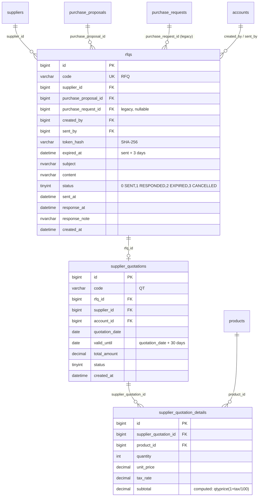

# Cụm Tính Năng: RFQ & Quotation Management (Yêu Cầu Báo Giá & Quản Lý Báo Giá)

## 1. Tổng Quan Nghiệp Vụ & Mục Tiêu
Cụm tính năng **RFQ & Quotation Management** là phân hệ thu mua (Procurement) cốt lõi của hệ thống Quản lý Chuỗi Nhà thuốc (Pharmacy Chain Management System), nối tiếp sau phân hệ Supplier Management. Cụm này số hóa toàn bộ quy trình mời thầu dược phẩm: từ việc phát hành Yêu cầu báo giá (RFQ) qua email cho nhà cung cấp, tiếp nhận báo giá trực tuyến qua cổng công khai bảo mật, cho tới thẩm định và so sánh báo giá để chọn nhà cung cấp tối ưu.

### Mục tiêu cốt lõi:
- **Phát hành RFQ tự động qua Email**: Sinh RFQ từ một Đề xuất mua hàng (Purchase Proposal) gộp nhiều Purchase Request, gửi email kèm **đường dẫn bảo mật (token)** cho nhà cung cấp được chọn.
- **Cổng phản hồi công khai không cần đăng nhập**: Nhà cung cấp điền báo giá trực tuyến qua link token (hiệu lực **3 ngày**), không cần tài khoản hệ thống.
- **Kiểm soát vòng đời RFQ**: Theo dõi trạng thái `SENT → RESPONDED → EXPIRED/CANCELLED`; tự động báo hết hạn khi quá deadline.
- **So sánh báo giá đa nhà cung cấp**: Ma trận so sánh giá từng mặt hàng giữa các nhà cung cấp cùng một đề xuất, đánh dấu giá thấp nhất, chốt nhà cung cấp thắng.
- **Bảo toàn tính toàn vẹn dữ liệu**: Báo giá được khóa lại khi đã vào Đề xuất mua hàng đã chốt/duyệt.

### Tác nhân (Actor) chính
- `Purchasing Staff` (Nhân viên thu mua): phát hành RFQ, theo dõi phản hồi, quản lý & so sánh báo giá, chọn nhà cung cấp.
- `Supplier` (Nhà cung cấp): truy cập cổng công khai qua token để xem RFQ và gửi báo giá.

---

## 2. Các Entity & Bảng Cơ Sở Dữ Liệu Liên Quan
Cụm này sử dụng ba bảng nòng cốt trong schema `dbo`:



### Chi tiết các JPA Entity:
1. `com.pharmacy.entity.Rfq` (bảng `rfqs`): lưu yêu cầu báo giá, gắn `Supplier` + `PurchaseProposal`; `status` dùng enum `RfqStatus` (`@Enumerated(ORDINAL)`).
2. `com.pharmacy.entity.SupplierQuotation` (bảng `supplier_quotations`): báo giá nhận được từ nhà cung cấp ứng với một RFQ.
3. `com.pharmacy.entity.SupplierQuotationDetail` (bảng `supplier_quotation_details`): dòng chi tiết báo giá (sản phẩm, số lượng, đơn giá, thuế, thành tiền `@Formula`).
4. `com.pharmacy.entity.enums.RfqStatus`: `SENT(0)`, `RESPONDED(1)`, `EXPIRED(2)`, `CANCELLED(3)`.

> Tham chiếu chi tiết cột: `doc/database/DATABASE_ENTITIES.md`.

---

## 3. Danh Mục Toàn Bộ File & Class Cần Triển Khai (Deliverables Inventory)

### 3.1. Phía Backend (Spring Boot 3 - Java 21)
| Phân loại | Tên File / Class | Package | Mục đích & Mô tả |
| :--- | :--- | :--- | :--- |
| **Controller** | `RfqController.java` | `com.pharmacy.controller` | REST nội bộ `/api/v1/rfq` (eligible, send, list, detail, quotation, compare) |
| **Controller** | `PublicRfqController.java` | `com.pharmacy.controller` | Cổng công khai `/api/public/rfq-portal` (get by token, submit) |
| **Service (Interface)** | `RfqService.java` | `com.pharmacy.service` | Khai báo nghiệp vụ RFQ |
| **Service (Impl)** | `RfqServiceImpl.java` | `com.pharmacy.service.impl` | Phát hành RFQ, lọc, chi tiết, so sánh |
| **Service (Interface)** | `PublicRfqService.java` | `com.pharmacy.service` | Nghiệp vụ cổng công khai |
| **Service (Impl)** | `PublicRfqServiceImpl.java` | `com.pharmacy.service.impl` | Xác thực token, tiếp nhận báo giá |
| **Repository** | `RfqRepository.java` | `com.pharmacy.repository` | Truy vấn RFQ + `findValidRfqByTokenHash` |
| **Repository** | `SupplierQuotationRepository.java` | `com.pharmacy.repository` | Truy vấn báo giá theo RFQ |
| **Entity** | `Rfq.java`, `SupplierQuotation.java`, `SupplierQuotationDetail.java` | `com.pharmacy.entity` | Ánh xạ bảng |
| **Enum** | `RfqStatus.java` | `com.pharmacy.entity.enums` | Trạng thái RFQ |
| **DTO** | `SendRfqRequest.java`, `RfqResponse.java` | `com.pharmacy.dto.rfq` | Payload gửi RFQ & phản hồi |
| **DTO** | `RfqQuotationResponse.java`, `CompareResponse.java` | `com.pharmacy.dto.rfq` | Chi tiết báo giá & ma trận so sánh |
| **DTO** | `PublicRfqResponse.java`, `SubmitQuotationRequest.java` | `com.pharmacy.dto.rfq` | Payload/phản hồi cổng công khai |
| **Tiện ích** | `SecurityUtils.java` | `com.pharmacy.util` | Băm token SHA-256 |
| **Email** | `EmailService.java` | `com.pharmacy.service` | Gửi email RFQ kèm link token |

### 3.2. Phía Frontend (React + Vite)
| Phân loại | Tên File / Component | Thư mục | Mục đích & Mô tả |
| :--- | :--- | :--- | :--- |
| **Page** | `RfqPage.jsx` | `src/page/rfq/` | Trang `/procurement/rfq` — Filters + Table + Pagination + Modals |
| **Component** | `RfqFilters.jsx` | `src/component/rfq/` | Ô tìm kiếm (mã RFQ/NCC) + lọc trạng thái + đếm tổng |
| **Component** | `RfqTable.jsx` | `src/component/rfq/` | Bảng RFQ, badge trạng thái, thao tác Xem/So sánh/Chọn NCC |
| **Component** | `RfqDetailModal.jsx` | `src/component/rfq/` | Modal chi tiết RFQ + bảng mặt hàng báo giá |
| **Component** | `QuotationCompareModal.jsx` | `src/component/rfq/` | Modal ma trận so sánh báo giá + nút "Chọn NCC" |
| **Component** | `SendRfqModal.jsx` | `src/component/supplier/` | Modal soạn & gửi RFQ qua email |
| **Page** | `RfqResponsePage.jsx` | `src/page/public/` | Trang công khai `/rfq-response` cho nhà cung cấp điền báo giá |
| **API Client** | `RfqAPI.js` | `src/api/` | Gọi API `/api/v1/rfq` |
| **API Client** | `PublicRfqAPI.js` | `src/api/` | Gọi API `/api/public/rfq-portal` |
| **Hook** | `useRfq.js` | `src/hooks/rfq/` | `useRfq`, `useRfqDetail`, `useCompareRfqs`, `useSendRfq`, `useRfqResponse` |

---

## 4. Kiến Trúc Luồng RFQ & Báo Giá (RFQ Lifecycle Architecture)

```mermaid
sequenceDiagram
    autonumber
    actor NVMua as Nhân viên thu mua
    actor NCC as Nhà cung cấp
    participant FE as RfqPage / SendRfqModal
    participant Ctrl as RfqController
    participant Svc as RfqServiceImpl
    participant Mail as EmailService
    participant Pub as PublicRfqController
    participant PSvc as PublicRfqServiceImpl
    participant DB as SQL Server

    NVMua->>FE: Gửi Yêu cầu báo giá (chọn NCC + Đề xuất)
    FE->>Ctrl: POST /api/v1/rfq/send (SendRfqRequest)
    Ctrl->>Svc: sendRfq(request)
    Svc->>DB: INSERT rfqs (status=SENT, token_hash, expired_at=+3d)
    Svc->>Mail: sendRfqEmail(rfq, supplier, rawToken)
    Mail-->>NCC: Email kèm link /rfq-response?token=...
    Ctrl-->>FE: HTTP 201 Created

    NCC->>Pub: GET /api/public/rfq-portal?token=...
    Pub->>PSvc: getRfqDetails(rawToken)
    PSvc->>DB: findValidRfqByTokenHash(hash, now)
    PSvc-->>NCC: PublicRfqResponse (mặt hàng + deadline)

    NCC->>Pub: POST /api/public/rfq-portal/submit?token=... (đơn giá)
    Pub->>PSvc: submitQuotation(rawToken, request)
    PSvc->>DB: INSERT supplier_quotations + details; rfqs.status=RESPONDED
    PSvc-->>NCC: Quotation submitted successfully

    NVMua->>Ctrl: GET /api/v1/rfq/compare?ids=...
    Ctrl->>Svc: compareRfqs(ids)
    Svc-->>FE: CompareResponse (ma trận + tổng + giá thấp nhất)
```

---

## 5. Danh Mục RESTful API Của Cụm RFQ & Quotation Management

### 5.1. API nội bộ — Base URL: `http://localhost:8080/api/v1/rfq`
| STT | Phương thức | Đường dẫn API (Endpoint) | Quyền truy cập | Mô tả nghiệp vụ |
| :---: | :---: | :--- | :--- | :--- |
| 1 | `GET` | `/api/v1/rfq/proposals/eligible` | `Purchasing Staff` | Lấy đề xuất đủ điều kiện gửi RFQ (trạng thái `DRAFT`) |
| 2 | `POST` | `/api/v1/rfq/send` | `Purchasing Staff` | Phát hành RFQ + gửi email cho nhà cung cấp (HTTP 201) |
| 3 | `GET` | `/api/v1/rfq` | `Purchasing Staff` | Danh sách RFQ (search, status, supplierId, purchaseProposalId, phân trang) |
| 4 | `GET` | `/api/v1/rfq/{id}` | `Purchasing Staff` | Xem chi tiết RFQ theo ID |
| 5 | `GET` | `/api/v1/rfq/supplier/{supplierId}` | `Purchasing Staff` | Danh sách RFQ theo nhà cung cấp (phân trang) |
| 6 | `GET` | `/api/v1/rfq/{id}/quotation` | `Purchasing Staff` | Chi tiết RFQ kèm báo giá + mặt hàng |
| 7 | `GET` | `/api/v1/rfq/compare?ids=` | `Purchasing Staff` | So sánh nhiều báo giá (≥ 2 RFQ cùng một đề xuất) |

### 5.2. API cổng công khai — Base URL: `http://localhost:8080/api/public/rfq-portal`
| STT | Phương thức | Đường dẫn API (Endpoint) | Quyền truy cập | Mô tả nghiệp vụ |
| :---: | :---: | :--- | :--- | :--- |
| 1 | `GET` | `/api/public/rfq-portal?token=` | Public (qua token) | Xem RFQ theo token hợp lệ & chưa hết hạn |
| 2 | `POST` | `/api/public/rfq-portal/submit?token=` | Public (qua token) | Nhà cung cấp gửi báo giá |

> **Xử lý ngoại lệ**: `RfqController.compareRfqs` bắt `IllegalArgumentException` → **HTTP 400**, `EntityNotFoundException` → **HTTP 404**, còn lại → **HTTP 500**.

---

## 6. Danh Sách Các File Đặc Tả Chi Tiết Trong Cụm
1. [3.14.1 Send RFQ via Email to Supplier (Gửi Yêu Cầu Báo Giá qua Email)](./send_rfq_via_email.md)
2. [3.14.2 View RFQ and Supplier Response (Xem RFQ & Phản hồi Nhà cung cấp)](./view_rfq_and_supplier_response.md)
3. [3.14.3 Manage Supplier Quotation (Quản lý Báo giá Nhà cung cấp)](./manage_supplier_quotation.md)
4. [3.14.4 Compare Supplier Quotations (So sánh Báo giá Nhà cung cấp)](./compare_supplier_quotations.md)


