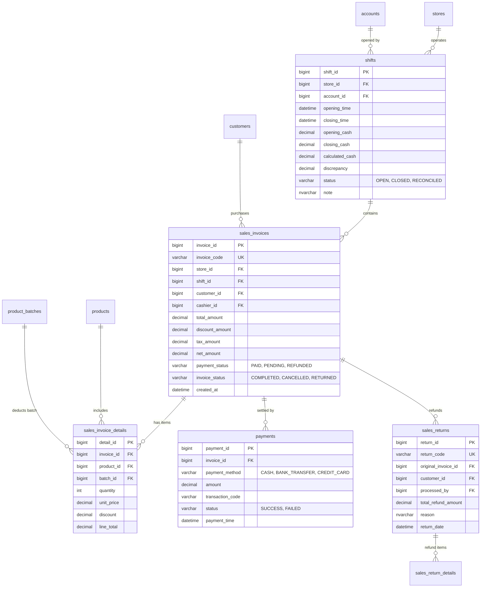

# Cụm Tính Năng: Sales Management (Bán Hàng POS & Quản Lý Ca Làm Việc)

## 1. Tổng Quan Nghiệp Vụ & Mục Tiêu
Cụm tính năng **Sales Management** là trái tim vận hành của hệ thống Quản lý Chuỗi Nhà thuốc (Pharmacy Chain Management System), kết hợp chặt chẽ giữa quy trình **Quản lý Ca làm việc (Shift Management)** và **Bán hàng tại quầy (Point of Sale - POS)**.

### Mục tiêu cốt lõi:
- **Kiểm soát dòng tiền mặt chặt chẽ**: Mỗi Dược sĩ / Thu ngân khi bắt đầu bán hàng bắt buộc phải mở ca (`Open Shift`) với số tiền đầu ca (`opening_cash`), và khi kết thúc phải kết ca (`Close Shift`), khai báo số tiền thực tế trong két để hệ thống tự động đối soát chênh lệch thừa/thiếu (`discrepancy`).
- **Giao dịch bán lẻ siêu tốc tại quầy (POS)**: Tìm kiếm thuốc bằng mã vạch/tên, hỗ trợ bán thuốc theo đơn (Prescription) hoặc không theo đơn (OTC), tự động trừ tồn kho theo lô hạn dùng (FEFO/FIFO), áp dụng điểm tích lũy thành viên.
- **Thanh toán linh hoạt đa kênh**: Hỗ trợ tiền mặt, chuyển khoản ngân hàng qua mã VietQR động, quẹt thẻ POS.
- **Hủy hóa đơn & Đổi trả thuốc minh bạch**: Xử lý trả hàng/hoàn tiền theo hóa đơn cũ, tự động hoàn trả số lượng vào tồn kho chi nhánh và ghi nhận phiếu hoàn hàng (`SalesReturn`).
- **Tra cứu lịch sử mua hàng**: Dược sĩ nhanh chóng xem lại các đơn thuốc và sản phẩm khách hàng đã từng mua để tư vấn tương tác thuốc an toàn và chăm sóc sức khỏe.

---

## 2. Các Entity & Bảng Cơ Sở Dữ Liệu Liên Quan
Cụm tính năng này liên kết với nhiều bảng nòng cốt trong schema `dbo` của SQL Server:



### Chi tiết các JPA Entity:
1. `com.pharmacy.entity.Shift`: Đại diện cho ca làm việc của nhân viên thu ngân tại một chi nhánh nhà thuốc.
2. `com.pharmacy.entity.SalesInvoice`: Hóa đơn bán lẻ phát hành tại quầy POS.
3. `com.pharmacy.entity.SalesInvoiceDetail`: Chi tiết từng dòng thuốc/sản phẩm được bán ra (gắn với lô cụ thể `ProductBatch`).
4. `com.pharmacy.entity.Payment`: Bản ghi giao dịch thanh toán của hóa đơn.
5. `com.pharmacy.entity.SalesReturn` & `SalesReturnDetail`: Ghi nhận phiếu đổi trả thuốc và hoàn tiền.
6. `com.pharmacy.entity.Inventory` & `ProductBatch`: Quản lý trừ tồn kho tức thời tại chi nhánh khi xuất hóa đơn.
7. `com.pharmacy.entity.Customer`: Liên kết tích điểm và lịch sử mua thuốc của khách hàng.

---

## 3. Danh Mục Toàn Bộ File & Class Cần Triển Khai (Deliverables Inventory)

### 3.1. Phía Backend (Spring Boot 3 - Java 21)
| Phân loại | Tên File / Class | Package | Mục đích & Mô tả |
| :--- | :--- | :--- | :--- |
| **Controller** | `ShiftController.java` | `com.pharmacy.controller` | REST API quản lý mở ca, chốt ca, kiểm tra ca hiện tại |
| **Controller** | `SalesInvoiceController.java` | `com.pharmacy.controller` | REST API tạo hóa đơn POS, tìm kiếm, in ấn, hủy/trả hàng |
| **Controller** | `PaymentController.java` | `com.pharmacy.controller` | REST API xử lý thanh toán (tiền mặt, tạo mã QR VietQR) |
| **Controller** | `CustomerPurchaseHistoryController.java`| `com.pharmacy.controller` | REST API tra cứu lịch sử mua hàng của khách hàng theo SĐT/ID |
| **Service Interface** | `ShiftService.java` | `com.pharmacy.service` | Nghiệp vụ: Mở ca, chốt ca, tính toán doanh thu ca, kiểm tra ca mở |
| **Service Interface** | `SalesInvoiceService.java` | `com.pharmacy.service` | Nghiệp vụ: Tạo hóa đơn, kiểm tra trừ tồn kho, tính thuế/chiết khấu |
| **Service Interface** | `PaymentService.java` | `com.pharmacy.service` | Nghiệp vụ: Xác nhận tiền mặt, tích hợp cổng thanh toán / QR VietQR |
| **Service Interface** | `SalesReturnService.java` | `com.pharmacy.service` | Nghiệp vụ: Hủy hóa đơn, xử lý trả hàng hoàn tiền, nhập lại kho |
| **Service Impl** | `ShiftServiceImpl.java` | `com.pharmacy.service.impl` | Triển khai logic nghiệp vụ ca bán hàng và tính toán tiền chênh lệch |
| **Service Impl** | `SalesInvoiceServiceImpl.java` | `com.pharmacy.service.impl` | Triển khai trừ kho FEFO, sinh mã hóa đơn, tích lũy điểm khách hàng |
| **Service Impl** | `PaymentServiceImpl.java` | `com.pharmacy.service.impl` | Triển khai logic lưu giao dịch thanh toán |
| **Service Impl** | `SalesReturnServiceImpl.java` | `com.pharmacy.service.impl` | Triển khai hoàn tiền và cộng lại số lượng vào bảng `Inventory` |
| **Repository** | `ShiftRepository.java` | `com.pharmacy.repository` | Truy vấn ca theo `store_id`, `account_id`, tìm ca đang mở (`status = 'OPEN'`) |
| **Repository** | `SalesInvoiceRepository.java` | `com.pharmacy.repository` | Lưu và tìm hóa đơn theo mã, theo khách hàng, theo ngày |
| **Repository** | `SalesInvoiceDetailRepository.java` | `com.pharmacy.repository` | Quản lý các dòng sản phẩm trong hóa đơn |
| **Repository** | `PaymentRepository.java` | `com.pharmacy.repository` | Quản lý các lượt thanh toán của đơn hàng |
| **Repository** | `SalesReturnRepository.java` | `com.pharmacy.repository` | Quản lý phiếu hoàn trả và chi tiết hoàn trả |
| **Repository** | `InventoryRepository.java` | `com.pharmacy.repository` | Kiểm tra tồn kho khả dụng và trừ tồn kho chi nhánh |
| **Repository** | `ProductBatchRepository.java` | `com.pharmacy.repository` | Truy vấn các lô thuốc còn hạn sử dụng (FEFO) |
| **DTO (Request)** | `OpenShiftRequest.java` | `com.pharmacy.dto.sales` | Chứa `storeId`, `openingCash`, `note` |
| **DTO (Request)** | `CloseShiftRequest.java` | `com.pharmacy.dto.sales` | Chứa `closingCashActual`, `note` |
| **DTO (Request)** | `CreateSalesInvoiceRequest.java`| `com.pharmacy.dto.sales` | Chứa `customerId`, danh sách mặt hàng (`items`), chiết khấu, hình thức trả |
| **DTO (Request)** | `InvoiceItemRequest.java` | `com.pharmacy.dto.sales` | Chứa `productId`, `batchId`, `quantity`, `unitPrice` |
| **DTO (Request)** | `ProcessPaymentRequest.java` | `com.pharmacy.dto.sales` | Chứa `invoiceId`, `paymentMethod`, `amountPaid`, `tenderedCash` |
| **DTO (Request)** | `SalesReturnRequest.java` | `com.pharmacy.dto.sales` | Chứa `invoiceId`, `reason`, danh sách mặt hàng trả lại |
| **DTO (Response)**| `ShiftDetailResponse.java` | `com.pharmacy.dto.sales` | Dữ liệu chi tiết ca làm việc và tổng kết doanh số |
| **DTO (Response)**| `SalesInvoiceResponse.java` | `com.pharmacy.dto.sales` | Chi tiết toàn bộ hóa đơn vừa thanh toán để in nhiệt K80 |
| **DTO (Response)**| `CustomerPurchaseHistoryDto.java`| `com.pharmacy.dto.sales` | Lịch sử các đơn hàng cũ của một khách hàng |
| **Exceptions** | `ShiftAlreadyOpenException.java` | `com.pharmacy.exception` | Khi nhân viên đã có ca đang mở |
| **Exceptions** | `NoOpenShiftException.java` | `com.pharmacy.exception` | Khi nhân viên cố tình bán hàng khi chưa mở ca |
| **Exceptions** | `InsufficientStockException.java`| `com.pharmacy.exception` | Khi số lượng tồn kho của lô thuốc không đủ bán |

### 3.2. Phía Frontend (React 18 - Vite)
| Phân loại | Tên File | Thư mục | Mục đích & Mô tả |
| :--- | :--- | :--- | :--- |
| **Page** | `PosCounterPage.jsx` | `src/page/sales/` | Màn hình bán hàng quầy POS chính thức (gồm giỏ hàng, tra cứu thuốc, thanh toán) |
| **Page** | `DailySalesPage.jsx` | `src/page/sales/` | Màn hình danh sách ca làm việc và danh sách hóa đơn theo ngày |
| **Component** | `OpenShiftModal.jsx` | `src/component/sales/` | Modal mở ca làm việc yêu cầu nhập tiền két đầu ca |
| **Component** | `CloseShiftModal.jsx` | `src/component/sales/` | Modal chốt ca, kiểm kê tiền mặt thực tế và hiển thị độ lệch |
| **Component** | `PosSearchBar.jsx` | `src/component/sales/` | Thanh tìm kiếm sản phẩm theo tên hoặc quét mã vạch Barcode scanner |
| **Component** | `PosCartTable.jsx` | `src/component/sales/` | Bảng giỏ hàng hiển thị tên thuốc, lô hạn dùng, đơn vị tính, số lượng, giá |
| **Component** | `CustomerSelectModal.jsx` | `src/component/sales/` | Popover tìm kiếm khách hàng bằng SĐT hoặc tạo nhanh khách hàng mới |
| **Component** | `PaymentModal.jsx` | `src/component/sales/` | Modal thanh toán đa phương thức (Tiền mặt, QR VietQR tự động, Thẻ) |
| **Component** | `InvoicePrintTemplate.jsx`| `src/component/sales/` | Mẫu in hóa đơn khổ 80mm (K80) cho máy in hóa đơn nhiệt |
| **Component** | `SalesReturnModal.jsx` | `src/component/sales/` | Modal trả hàng / hủy hóa đơn và tính số tiền hoàn lại |
| **Component** | `CustomerHistoryDrawer.jsx`| `src/component/sales/` | Drawer trượt bên phải hiển thị lịch sử mua thuốc của khách |
| **API Client** | `posApi.js` | `src/api/` | Gọi API tạo đơn, tính tiền, hủy đơn, in hóa đơn |
| **API Client** | `shiftApi.js` | `src/api/` | Gọi API kiểm tra ca, mở ca, đóng ca |
| **Hook** | `useShift.js` | `src/hooks/` | Quản lý trạng thái ca hiện tại của thu ngân trên máy |
| **Hook** | `usePosCart.js` | `src/hooks/` | Quản lý giỏ hàng POS, phím tắt (F2, F4, F8, F9, ESC) |

---

## 4. Kiến Trúc Luồng Bán Hàng & Quản Lý Ca (POS Workflow Diagram)

```mermaid
flowchart TD
    Start([Dược sĩ đăng nhập]) --> CheckShift{Đã mở ca làm việc chưa?}
    CheckShift -- Chưa có ca -->> OpenShiftModal[Hiển thị Modal Mở Ca]
    OpenShiftModal --> InputOpeningCash[Nhập tiền mặt đầu ca]
    InputOpeningCash --> CallOpenShiftAPI[API POST /api/v1/shifts/open]
    CallOpenShiftAPI --> PosReady[Ca OPEN: Sẵn sàng bán hàng tại quầy POS]
    
    CheckShift -- Đã có ca đang mở -->> PosReady

    subgraph POS_Counter [Quy Trình Bán Hàng Tại Quầy]
        PosReady --> SearchProduct[Quét mã vạch / Tìm kiếm thuốc]
        SearchProduct --> SelectBatch[Hệ thống tự chọn Lô gần hạn nhất - FEFO]
        SelectBatch --> AddToCart[Thêm vào giỏ hàng & kiểm tra tồn kho khả dụng]
        AddToCart --> InputCustomer[Nhập SĐT khách hàng - Tích điểm / Xem lịch sử đơn]
        InputCustomer --> PressPay[Bấm Thanh toán - F9]
        PressPay --> ChooseMethod{Chọn phương thức thanh toán}
        ChooseMethod -- Tiền mặt -->> CashPay[Nhập tiền khách đưa -> Tính tiền thừa]
        ChooseMethod -- Chuyển khoản QR -->> QRPay[Hiển thị mã VietQR động kèm số tiền chính xác]
        CashPay --> ConfirmPayment[Bấm Hoàn tất giao dịch]
        QRPay --> ConfirmPayment
        ConfirmPayment --> CallInvoiceAPI[API POST /api/v1/sales/invoices]
        CallInvoiceAPI --> DeductInventory[Trừ tồn kho chi nhánh & Lưu hóa đơn]
        DeductInventory --> PrintReceipt[In hóa đơn K80 & Đưa thuốc cho khách]
    end

    PrintReceipt --> ContinueSell{Tiếp tục bán hàng?}
    ContinueSell -- Có -->> PosReady
    ContinueSell -- Hết ca làm việc -->> CloseShiftModal[Bấm Chốt ca làm việc]
    CloseShiftModal --> CountDrawerCash[Đếm tiền mặt thực tế trong két]
    CountDrawerCash --> CallCloseShiftAPI[API POST /api/v1/shifts/close]
    CallCloseShiftAPI --> ShiftReport[Hiển thị phiếu bàn giao ca & Độ chênh lệch thừa/thiếu]
    ShiftReport --> End([Kết thúc ca làm việc])
```

---

## 5. Danh Mục RESTful API Của Cụm Sales Management
| STT | Phương thức | Đường dẫn API (Endpoint) | Quyền truy cập | Mô tả nghiệp vụ |
| :---: | :---: | :--- | :--- | :--- |
| 1 | `POST` | `/api/v1/shifts/open` | `Pharmacist`, `Store Manager` | Mở ca làm việc mới với số tiền đầu ca |
| 2 | `POST` | `/api/v1/shifts/close` | `Pharmacist`, `Store Manager` | Đóng ca làm việc hiện tại, khai báo tiền thực kiểm |
| 3 | `GET` | `/api/v1/shifts/current` | `Pharmacist`, `Store Manager` | Lấy thông tin ca làm việc đang mở của nhân viên hiện tại |
| 4 | `POST` | `/api/v1/sales/invoices` | `Pharmacist`, `Store Manager` | Tạo và thanh toán hóa đơn bán lẻ tại quầy POS |
| 5 | `GET` | `/api/v1/sales/invoices/{id}` | Authenticated | Lấy chi tiết hóa đơn theo ID (dùng để in hoặc kiểm tra) |
| 6 | `POST` | `/api/v1/sales/payments` | `Pharmacist`, `Store Manager` | Xử lý thanh toán cho hóa đơn (ghi nhận tiền mặt / QR) |
| 7 | `POST` | `/api/v1/sales/invoices/{id}/cancel` | `Store Manager` | Hủy hóa đơn bán hàng trong ngày chưa kết ca |
| 8 | `POST` | `/api/v1/sales/returns` | `Pharmacist`, `Store Manager` | Tạo phiếu đổi trả thuốc, hoàn tiền và nhập lại kho |
| 9 | `GET` | `/api/v1/customers/{id}/purchase-history`| Authenticated | Tra cứu toàn bộ lịch sử mua hàng của khách hàng |

---

## 6. Danh Sách Các File Đặc Tả Chi Tiết Trong Cụm
1. [3.6.1 Open Shift (Mở ca làm việc)](file:///c:/Users/AD/OneDrive/Desktop/FPT/Fall_2026/SBA301/FE_Project/PharmacyChainManagementSystem/doc/sales_management/open_shift.md)
2. [3.6.2 Close Shift (Chốt ca làm việc)](file:///c:/Users/AD/OneDrive/Desktop/FPT/Fall_2026/SBA301/FE_Project/PharmacyChainManagementSystem/doc/sales_management/close_shift.md)
3. [3.7.1 Create Sales Invoice (Tạo hóa đơn bán hàng POS)](file:///c:/Users/AD/OneDrive/Desktop/FPT/Fall_2026/SBA301/FE_Project/PharmacyChainManagementSystem/doc/sales_management/create_sales_invoice.md)
4. [3.7.2 Process Payment (Xử lý thanh toán)](file:///c:/Users/AD/OneDrive/Desktop/FPT/Fall_2026/SBA301/FE_Project/PharmacyChainManagementSystem/doc/sales_management/process_payment.md)
5. [3.7.3 Cancel/Return Sales Invoice (Hủy hóa đơn / Trả hàng hoàn tiền)](file:///c:/Users/AD/OneDrive/Desktop/FPT/Fall_2026/SBA301/FE_Project/PharmacyChainManagementSystem/doc/sales_management/cancel_return_sales_invoice.md)
6. [3.7.4 View Customer Purchase History (Tra cứu lịch sử mua hàng)](file:///c:/Users/AD/OneDrive/Desktop/FPT/Fall_2026/SBA301/FE_Project/PharmacyChainManagementSystem/doc/sales_management/view_customer_purchase_history.md)

