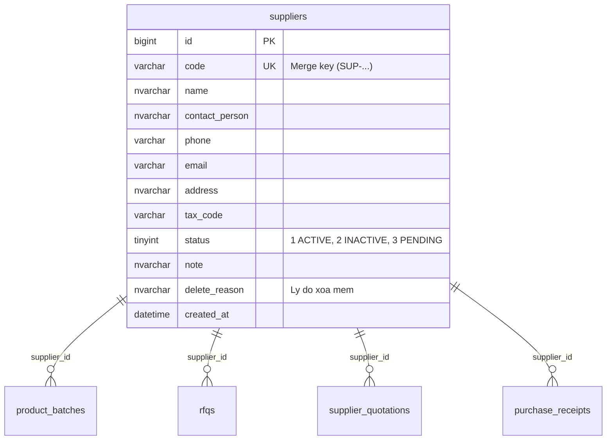
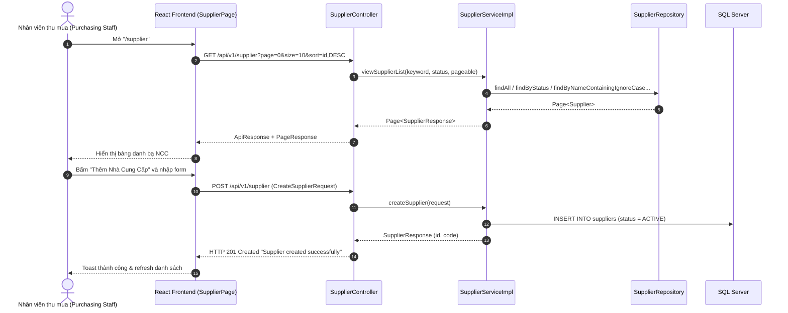

# Cụm Tính Năng: Supplier Management (Quản Lý Nhà Cung Cấp Dược Phẩm)

## 1. Tổng Quan Nghiệp Vụ & Mục Tiêu
Cụm tính năng **Supplier Management** là phân hệ quản lý danh bạ nhà cung cấp (NCC) dược phẩm của hệ thống Quản lý Chuỗi Nhà thuốc (Pharmacy Chain Management System). Đây là mắt xích đầu tiên trong chuỗi cung ứng: mọi hoạt động mua hàng (Purchase Request → RFQ → Báo giá → Đề xuất mua hàng → Đơn đặt hàng PO → Nhập kho) đều phải gắn với một nhà cung cấp hợp lệ đang hoạt động.

### Mục tiêu cốt lõi:
- **Quản lý hồ sơ pháp lý nhà cung cấp**: Lưu trữ Tên/Mã số thuế (Tax Code), Người liên hệ, Số điện thoại, Email, Địa chỉ trụ sở nhằm phục vụ đối chiếu hóa đơn GTGT và tuân thủ quy định dược.
- **Kiểm soát trùng lặp dữ liệu**: Mã nhà cung cấp (`code`) và Mã số thuế (`tax_code`) mang tính định danh; hệ thống kiểm tra sai định dạng (MST 10 hoặc 13 chữ số).
- **Tra cứu tập trung phục vụ thu mua**: Tìm kiếm NCC theo tên, mã, người liên hệ, SĐT; lọc theo trạng thái; xem hồ sơ chi tiết để ra quyết định mua hàng.
- **Quản lý vòng đời & Xóa mềm (Soft Delete)**: Ngừng hợp tác NCC bằng cách chuyển trạng thái sang `INACTIVE` và lưu `delete_reason`, bảo toàn toàn bộ lịch sử RFQ/Báo giá/Phiếu nhập kho theo quy định kiểm toán.

### Tác nhân (Actor) chính
- `Purchasing Staff` (Nhân viên thu mua): Người dùng có quyền thao tác CRUD trên danh mục nhà cung cấp. Phạm vi dữ liệu: toàn chuỗi (nghiệp vụ thu mua).

---

## 2. Các Entity & Bảng Cơ Sở Dữ Liệu Liên Quan
Cụm tính năng này sử dụng bảng `dbo.suppliers` và là bảng cha (Parent) được tham chiếu bởi nhiều bảng nghiệp vụ mua hàng.

### Chi tiết các JPA Entity:
1. `com.pharmacy.entity.Supplier` (bảng `dbo.suppliers`): Thực thể lõi lưu hồ sơ nhà cung cấp; trạng thái dùng enum `SupplierStatus`, xóa mềm lưu tại cột `delete_reason`.
2. `com.pharmacy.entity.enums.SupplierStatus`: Enum ánh xạ `TINYINT` qua `SupplierStatusConverter` (`ACTIVE = 1`, `INACTIVE = 2`, `PENDING = 3`).
3. Các entity phụ thuộc (khóa ngoại tới `suppliers`): `ProductBatch.supplier_id`, `Rfq.supplier_id`, `SupplierQuotation.supplier_id`, `PurchaseReceipt.supplier_id`.

> Tham chiếu chi tiết cột: `doc/database/DATABASE_ENTITIES.md` (mục 4.2 — bảng `suppliers`).

---

## 3. Danh Mục Toàn Bộ File & Class Cần Triển Khai (Deliverables Inventory)

### 3.1. Phía Backend (Spring Boot 3 - Java 21)
| Phân loại | Tên File / Class | Package | Mục đích & Mô tả |
| :--- | :--- | :--- | :--- |
| **Controller** | `SupplierController.java` | `com.pharmacy.controller` | Tiếp nhận toàn bộ REST API `/api/v1/supplier` (list, detail, statistics, create, update, delete) |
| **Service (Interface)** | `SupplierService.java` | `com.pharmacy.service` | Khai báo các nghiệp vụ CRUD nhà cung cấp + thống kê KPI |
| **Service (Impl)** | `SupplierServiceImpl.java` | `com.pharmacy.service.impl` | Cài đặt logic nghiệp vụ, tìm kiếm động, soft-delete, thống kê KPI |
| **Repository** | `SupplierRepository.java` | `com.pharmacy.repository` | `JpaRepository<Supplier, Long>` + tìm theo tên/trạng thái + `countByStatus`, `countWithTaxCode` |
| **Entity** | `Supplier.java` | `com.pharmacy.entity` | Ánh xạ bảng `suppliers` |
| **Enum** | `SupplierStatus.java` | `com.pharmacy.entity.enums` | Trạng thái: ACTIVE / INACTIVE / PENDING |
| **Converter** | `SupplierStatusConverter.java` | `com.pharmacy.entity.converter` | Chuyển đổi enum ↔ TINYINT |
| **DTO** | `CreateSupplierRequest.java` | `com.pharmacy.dto.supplier` | Payload tạo mới (record + Bean Validation) |
| **DTO** | `UpdateSupplierRequest.java` | `com.pharmacy.dto.supplier` | Payload cập nhật (record, không có `code`) |
| **DTO** | `SupplierResponse.java` | `com.pharmacy.dto.supplier` | Factory method: `fromEntityToList`, `fromEntityToDetail`, `fromEntityToCreate`, `fromEntityToUpdate`, `fromEntityToDelete` |
| **DTO** | `SupplierStatsResponse.java` | `com.pharmacy.dto.supplier` | Số liệu KPI: `total`, `active`, `inactive`, `pending`, `withTaxCode` |
| **DTO chung** | `ApiResponse.java`, `PageResponse.java` | `com.pharmacy.dto` | Bọc kết quả chuẩn & phân trang |

### 3.2. Phía Frontend (React + Vite)
| Phân loại | Tên File / Component | Thư mục | Mục đích & Mô tả |
| :--- | :--- | :--- | :--- |
| **Page** | `SupplierPage.jsx` | `src/page/supplier/` | Trang chính `/supplier` — Stats + Filters + Table + Pagination + Modals |
| **Component** | `SupplierStats.jsx` | `src/component/supplier/` | Thẻ KPI: Tổng NCC, Đang hợp tác, Tạm ngừng, Đầy đủ MST |
| **Component** | `SupplierFilters.jsx` | `src/component/supplier/` | Ô tìm kiếm + Bộ lọc trạng thái + Nút "Thêm Nhà Cung Cấp" |
| **Component** | `SupplierTable.jsx` | `src/component/supplier/` | Bảng danh sách NCC, badge trạng thái, thao tác Xem/Sửa/Xóa |
| **Component** | `SupplierDetailModal.jsx` | `src/component/supplier/` | Modal hồ sơ chi tiết NCC (nút Chỉnh sửa chỉ hiện khi đang hoạt động) |
| **Component** | `SupplierCreateModal.jsx` | `src/component/supplier/` | Modal dùng chung cho Tạo mới & Chỉnh sửa (`mode: 'create' \| 'edit'`) |
| **Component** | `SupplierDeleteModal.jsx` | `src/component/supplier/` | Modal xác nhận ngừng hoạt động NCC (nhập lý do) |
| **API Client** | `SupplierAPI.js` | `src/api/` | Gọi các API CRUD tới `http://localhost:8080/api/v1/supplier` |
| **Hook** | `useSuppliers.js` | `src/hooks/supplier/` | Quản lý state danh sách, phân trang, tìm kiếm, chi tiết & CRUD |

---

## 4. Kiến Trúc Luồng Quản Lý Nhà Cung Cấp (Supplier CRUD Architecture)

---

## 5. Danh Mục RESTful API Của Cụm Supplier Management
Base URL: `http://localhost:8080/api/v1/supplier`

| STT | Phương thức | Đường dẫn API (Endpoint) | Quyền truy cập | Mô tả nghiệp vụ |
| :---: | :---: | :--- | :--- | :--- |
| 1 | `GET` | `/api/v1/supplier` | `Purchasing Staff` | Lấy danh sách NCC (tìm kiếm `keyword`, lọc `status`, phân trang) |
| 2 | `GET` | `/api/v1/supplier/{id}` | `Purchasing Staff` | Xem chi tiết hồ sơ nhà cung cấp theo ID |
| 3 | `POST` | `/api/v1/supplier` | `Purchasing Staff` | Tạo mới nhà cung cấp (trả về HTTP 201) |
| 4 | `PATCH` | `/api/v1/supplier/{id}` | `Purchasing Staff` | Cập nhật thông tin nhà cung cấp |
| 5 | `DELETE` | `/api/v1/supplier/{id}?reason=` | `Purchasing Staff` | Ngừng hoạt động (xóa mềm) nhà cung cấp |
| 6 | `GET` | `/api/v1/supplier/stats` | `Purchasing Staff` | Số liệu KPI: tổng, đang hợp tác, tạm ngừng, chờ duyệt, đầy đủ MST |

> **Xử lý ngoại lệ tại Controller**: `SupplierController` có `@ExceptionHandler(EntityNotFoundException.class)` → **HTTP 404** và `@ExceptionHandler(IllegalArgumentException.class)` → **HTTP 400**.

---

## 6. Danh Sách Các File Đặc Tả Chi Tiết Trong Cụm
1. [3.13.1 Create Supplier (Đăng ký nhà cung cấp mới)](./create_supplier.md)
2. [3.13.2 View Supplier Information (Tra cứu danh bạ & hồ sơ nhà cung cấp)](./view_supplier_information.md)
3. [3.13.3 Update Supplier Information (Cập nhật nhà cung cấp)](./update_supplier_information.md)
4. [3.13.4 Delete Supplier (Ngừng hoạt động / Xóa mềm nhà cung cấp)](./delete_supplier.md)

