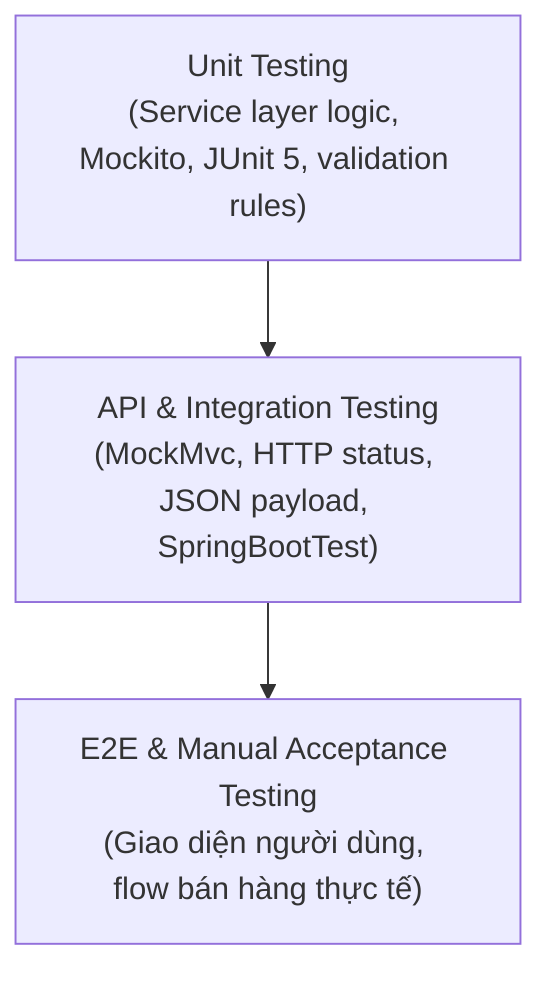

# GIAI ĐOẠN 4: QUY TRÌNH TẠO TEST VÀ NGHIỆM THU TÍNH NĂNG (TESTING & VERIFICATION)
### Thư mục: `doc/workflow/04_testing/`

## 1. Mục Đích
Đảm bảo tính năng sau khi triển khai thỏa mãn 100% các tiêu chí chất lượng, không có lỗi tiềm ẩn (zero regression), đáp ứng đúng các quy tắc nghiệp vụ (Business Rules) và sẵn sàng chuyển giao cho người dùng.

---

## 2. Các Tầng Kiểm Thử Bắt Buộc (Testing Pyramid)



### Bước 4.1: Thiết Kế Ma Trận Kịch Bản Kiểm Thử (Test Case Matrix)
Trước khi viết code test, lập bảng kịch bản kiểm thử theo mẫu [`BIEU_MAU_TEST_PLAN_VA_TEST_CASES.md`](./BIEU_MAU_TEST_PLAN_VA_TEST_CASES.md). Bao gồm 4 nhóm ca kiểm thử cốt lõi:
1. **Happy Path**: Kịch bản chạy chuẩn khi người dùng nhập đúng toàn bộ dữ liệu hợp lệ.
2. **Boundary / Validation Testing**: Kiểm thử các giá trị biên (chuỗi rỗng, vượt quá độ dài max, giá tiền âm, số lượng = 0).
3. **Negative / Exception Testing**: Kiểm thử các trường hợp lỗi nghiệp vụ (trùng mã vạch barcode, ID không tồn tại, danh mục không hợp lệ).
4. **Security & RBAC Testing**: Kiểm thử phân quyền truy cập (tài khoản không có quyền gọi API bị trả về HTTP 403 Forbidden).

### Bước 4.2: Triển Khai Unit Test (Backend Service Layer)
- Sử dụng **JUnit 5** (`@Test`, `@DisplayName`, `@ParameterizedTest`) và **Mockito** (`@Mock`, `@InjectMocks`, `when().thenReturn()`, `verify()`).
- Đặt file test trong `BE/sba/src/test/java/com/pharmacy/service/`.
- Cấu trúc bài test theo chuẩn **AAA (Arrange - Act - Assert)**:
  ```java
  @Test
  @DisplayName("Tạo sản phẩm thất bại khi mã vạch barcode đã tồn tại")
  void createProduct_ThrowsException_WhenBarcodeExists() {
      // Arrange
      ProductDTO dto = new ProductDTO();
      dto.setBarcode("8934567890123");
      when(productRepository.existsByBarcode("8934567890123")).thenReturn(true);

      // Act & Assert
      assertThrows(DuplicateResourceException.class, () -> productService.createProduct(dto));
      verify(productRepository, never()).save(any(Product.class));
  }
  ```

### Bước 4.3: Triển Khai Integration Test (Backend Controller Layer)
- Sử dụng `@SpringBootTest` hoặc `@WebMvcTest` kết hợp `MockMvc`.
- Kiểm thử các mã HTTP trả về:
  - `200 OK` / `201 Created` kèm payload JSON.
  - `400 Bad Request` khi vi phạm Bean Validation.
  - `401 Unauthorized` khi thiếu JWT token.
  - `403 Forbidden` khi sai quyền vai trò.
  - `404 Not Found` khi truy vấn tài nguyên không tồn tại.
  - `409 Conflict` khi vi phạm trùng khóa duy nhất.

### Bước 4.4: Kiểm Thử Giao Diện Người Dùng & Luồng Nghiệp Vụ (Frontend & Manual QA)
- Kiểm tra toàn bộ thao tác bằng chuột: Click thêm, sửa, xóa, lọc dữ liệu, chuyển trang.
- Kiểm tra hiển thị responsive trên các độ phân giải màn hình (Desktop 1920x1080, Laptop 1366x768).
- Kiểm tra các cảnh báo và thông báo lỗi hiển thị rõ ràng bằng tiếng Việt.

---

## 3. Lệnh Chạy Toàn Bộ Bộ Test Dự Án

### Chạy Backend Tests:
```powershell
mvn clean test -f BE/sba/pom.xml
```
*Yêu cầu: Kết quả phải đạt `BUILD SUCCESS`, 0 Failures, 0 Errors.*

### Chạy Frontend Build & Lint:
```powershell
npm run build --prefix FE/pharmaychain
```
*Yêu cầu: Build thành công không có lỗi JavaScript/CSS.*

---

## 4. Tiêu Chí Nghiệm Thu (Acceptance Sign-off)
Tính năng chỉ được coi là hoàn tất khi:
1. Toàn bộ Unit Tests và Integration Tests đều màu xanh (Pass).
2. Tài liệu báo cáo nghiệm thu [`BIEU_MAU_BAO_CAO_NGHIEM_THU.md`](./BIEU_MAU_BAO_CAO_NGHIEM_THU.md) đã được hoàn tất và ký nhận.
3. Nhánh tính năng sẵn sàng để mở Pull Request merge vào `main`.
