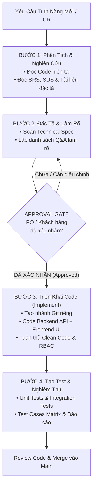

# QUY TRÌNH PHÁT TRIỂN TÍNH NĂNG CHUẨN (STANDARD ENGINEERING WORKFLOW)
### Dự Án: Hệ Thống Quản Lý Chuỗi Nhà Thuốc PharmaChain (PMS)

Tài liệu này quy định chuẩn mực quy trình phát triển tính năng từ khâu nhận yêu cầu, phân tích nghiệp vụ, lập đặc tả kỹ thuật, làm rõ yêu cầu, đến triển khai mã nguồn và kiểm thử nghiệm thu. Toàn bộ các tính năng mới trong dự án **BẮT BUỘC** phải tuân thủ nghiêm ngặt 4 giai đoạn nối tiếp dưới đây.

---

## 1. Sơ Đồ Tổng Quan Vòng Đời Tính Năng (End-to-End Workflow)

---

## 2. Chi Tiết 4 Giai Đoạn Trong Quy Trình

| Giai Đoạn | Thư Mục Tài Liệu | Mục Tiêu & Hành Động Chính | Đầu Ra Bắt Buộc (Artifacts) |
| :--- | :--- | :--- | :--- |
| **Giai đoạn 1** | [`01_analysis_srs_sds/`](./01_analysis_srs_sds/) | • Đọc và phân tích tài liệu SRS, SDS (`doc/SBA301_SRS_Group5 (3).docx`). • Rà soát cấu trúc code BE (Spring Boot) và FE (React) hiện tại. • Xác định Actors, Use Cases, tiền điều kiện và luồng nghiệp vụ. | Tài liệu Phân Tích Hiện Trạng & Yêu Cầu Tính Năng. |
| **Giai đoạn 2** | [`02_spec_and_clarification/`](./02_spec_and_clarification/) | • Soạn Technical Specification (DB schema, API specs, UI wireframes). • Xác định các điểm thiếu sót, mâu thuẫn hoặc chưa rõ ràng. • Lập bảng câu hỏi làm rõ (Clarification Q&A) gửi PO/Khách hàng. | 1. Bản Technical Spec chi tiết. 2. Bảng câu hỏi làm rõ (Q&A Matrix) & Biên bản xác nhận. |
| **Giai đoạn 3** | [`03_implementation/`](./03_implementation/) | • **CHỜ XÁC NHẬN** từ PO/Khách hàng trước khi viết code. • Tạo nhánh Git độc lập theo quy ước: `feature/<feature-name>`. • Lập checklist triển khai theo các lớp: DB -> Entity -> Service -> Controller -> FE. • Commit code với thông điệp chuẩn Conventional Commits. | 1. Mã nguồn hoàn chỉnh Backend & Frontend. 2. Checklist thực thi đã hoàn tất. 3. Seed data / migration liên quan. |
| **Giai đoạn 4** | [`04_testing/`](./04_testing/) | • Thiết kế ma trận kịch bản kiểm thử (Happy path, Edge case, Boundary, Security). • Viết Unit Test (JUnit 5 + Mockito), Integration Test (MockMvc). • Kiểm thử giao diện và luồng người dùng (E2E Manual Checklist). • Lập báo cáo kết quả kiểm thử và nghiệm thu. | 1. Bộ mã nguồn kiểm thử (Tests pass 100%). 2. Bảng Test Case Matrix & Test Report. |

---

## 3. Quy Tắc "Cổng Kiểm Soát Phê Duyệt" (Approval Gate)

> [!IMPORTANT]
> **Tuyệt đối KHÔNG triển khai code khi chưa có xác nhận từ PO / Khách hàng.**
> - Nếu phát hiện bất kỳ điểm nào chưa rõ trong SRS/SDS hoặc có phương án kỹ thuật thay thế tốt hơn, bắt buộc phải đưa vào **Bảng câu hỏi làm rõ (02_spec_and_clarification)**.
> - Chỉ bắt đầu chuyển sang Bước 3 (Implement) khi tất cả các câu hỏi làm rõ quan trọng đã được PO/Khách hàng phản hồi và "Đồng ý phương án" (Sign-off).

---

## 4. Danh Mục Biểu Mẫu Chuẩn Có Sẵn

Các biểu mẫu chuẩn sẵn sàng để sao chép và sử dụng cho từng tính năng mới:
1. [Biểu mẫu Phân Tích Nghiên Cứu Yêu Cầu](./01_analysis_srs_sds/BIEU_MAU_PHAN_TICH_YEU_CAU.md)
2. [Biểu mẫu Đặc Tả Kỹ Thuật (Technical Spec)](./02_spec_and_clarification/BIEU_MAU_TECHNICAL_SPEC.md)
3. [Biểu mẫu Bảng Hỏi Đáp Làm Rõ (Q&A Matrix)](./02_spec_and_clarification/BIEU_MAU_CAU_HOI_LAM_RO_QA.md)
4. [Biểu mẫu Kế Hoạch Triển Khai (Implementation Plan)](./03_implementation/BIEU_MAU_KE_HOACH_TRIEN_KHAI.md)
5. [Quy chuẩn Phân Nhánh Git & Commit Message](./03_implementation/QUY_CHUAN_GIT_BRANCH_VA_COMMIT.md)
6. [Biểu mẫu Ma Trận Kiểm Thử & Báo Cáo Test](./04_testing/BIEU_MAU_TEST_PLAN_VA_TEST_CASES.md)
