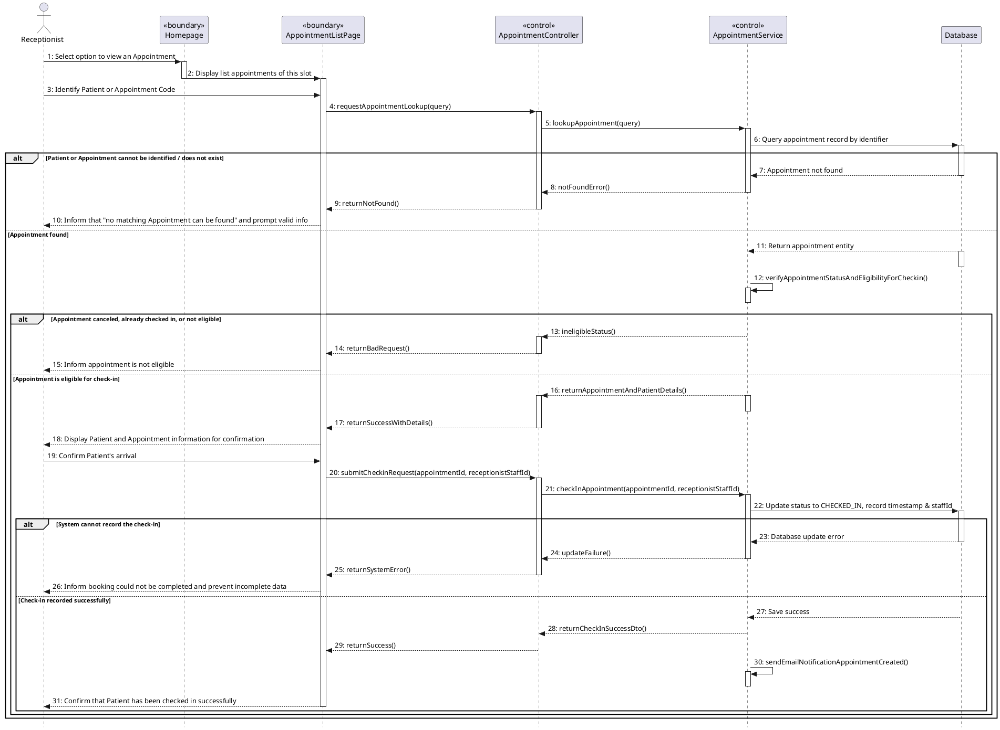

# HƯỚNG DẪN PROMPT DÀNH CHO AI: TẠO SEQUENCE DIAGRAM TỪ TÀI LIỆU ĐẶC TẢ

---

## I. MỤC TIÊU VÀ QUY TẮC BẮT BUỘC (CRITICAL RULES)

Bạn là một Kiến trúc sư Hệ thống (System Architect) chuyên nghiệp. Nhiệm vụ của bạn là đọc tài liệu đặc tả (file `.docx`) và phân tích mã nguồn hiện có để sinh ra mã PlantUML cho các **Sequence Diagram (Biểu đồ tuần tự)** tương ứng với các Use Case (UC) hệ thống.

### ⚠️ QUY TẮC TUYỆT ĐỐI (MUST FOLLOW):
1. **TUYỆT ĐỐI KHÔNG TỰ Ý SỬA CODE HỆ THỐNG**: AI chỉ đóng vai trò phân tích và tạo file biểu đồ `.puml`, không được chỉnh sửa bất kỳ dòng code logic nào của dự án.
2. **CẤU TRÚC THƯ MỤC LƯU TRỮ**:
   Tất cả các file PlantUML sinh ra phải được đặt đúng vào cấu trúc thư mục thuộc `gen-skill/` như sau:
   - `gen-skill/user/`: Chứa các file PlantUML cho Use Case Quản lý User.
   - `gen-skill/product/`: Chứa các file PlantUML cho Use Case Quản lý Product.
   - `gen-skill/category/`: Chứa các file PlantUML cho Use Case Quản lý Category.
3. **ĐÁNH SỐ THỨ TỰ CÁC BƯỚC LẦN LƯỢT CHÍNH XÁC**: 
   - Đánh số từng tin nhắn/bước (`1:`, `2:`, `3:`,...) liên tục theo đúng trình tự thời gian chảy từ trên xuống dưới.
   - Mọi số thứ tự bước phải ăn khớp 100% với trình tự mô tả trong tài liệu đặc tả `.docx`.
4. **MÔ HÌNH BẮT BUỘC TỪ FRONTEND ĐẾN DATABASE**:
   Mọi luồng xử lý phải đi qua các lớp (Lifelines) chuẩn sau:
   `Actor (User/Admin/Staff) -> Boundary (Page/UI) -> Control (Controller) -> Control (Service) -> Entity/Database (Repository/DB)`

---

## II. PHÂN TÍCH MẪU THAM CHIẾU (DEMO REFERENCE ANALYSIS)

> **Ghi chú dành cho AI:** Dưới đây là phân tích chi tiết từng bước (Step-by-Step) của ảnh mẫu `prototype.jpeg` (chứa đúng 31 bước). Bạn cần học thuộc tư duy phân tích này để áp dụng cho các Use Case Quản lý User, Product, và Category.

### Sơ đồ mẫu `prototype.jpeg`: Luồng Look-up và Check-in Lịch hẹn (31 Bước)

#### 1. Khởi tạo & Tìm kiếm Lịch hẹn (Steps 1 – 6)
* **Step 1:** `Receptionist` -> `Homepage`: Chọn tùy chọn xem lịch hẹn (`1: Select option to view an Appointment`).
* **Step 2:** `Homepage` -> `AppointmentListPage`: Chuyển hướng hiển thị danh sách lịch hẹn của khung giờ (`2: Display list appointments of this slot`).
* **Step 3:** `Receptionist` -> `AppointmentListPage`: Lễ tân nhập Mã bệnh nhân hoặc Mã lịch hẹn (`3: Identify Patient or Appointment Code`).
* **Step 4:** `AppointmentListPage` -> `AppointmentController`: Frontend gửi request tìm kiếm (`4: requestAppointmentLookup(query)`).
* **Step 5:** `AppointmentController` -> `AppointmentService`: Controller gọi hàm xử lý nghiệp vụ (`5: lookupAppointment(query)`).
* **Step 6:** `AppointmentService` -> `Database`: Service truy vấn bản ghi lịch hẹn trong DB (`6: Query appointment record by identifier`).

#### 2. Luồng Ngoại lệ 1: Không tìm thấy Lịch hẹn (Steps 7 – 10) [Khối `alt`]
* **Step 7:** `Database` -> `AppointmentService`: DB trả về thông báo không tìm thấy (`7: Appointment not found`).
* **Step 8:** `AppointmentService` -> `AppointmentController`: Service báo lỗi Not Found (`8: notFoundError()`).
* **Step 9:** `AppointmentController` -> `AppointmentListPage`: Controller trả phản hồi lỗi cho Frontend (`9: returnNotFound()`).
* **Step 10:** `AppointmentListPage` -> `Receptionist`: UI thông báo không tìm thấy và yêu cầu nhập lại thông tin (`10: Inform that "no matching Appointment can be found" and prompt valid info`).

#### 3. Luồng Kiểm tra Điều kiện Check-in (Steps 11 – 18)
* **Step 11:** `Database` -> `AppointmentService`: DB trả về đối tượng lịch hẹn nếu tìm thấy (`11: Return appointment entity`).
* **Step 12:** `AppointmentService` -> `AppointmentService`: Service tự kiểm tra trạng thái và điều kiện check-in (`12: verifyAppointmentStatusAndEligibilityForCheckin()`).

##### Sub-alt: Lịch hẹn không đủ điều kiện (Steps 13 – 15)
* **Step 13:** `AppointmentService` -> `AppointmentController`: Báo trạng thái không hợp lệ (`13: ineligibleStatus()`).
* **Step 14:** `AppointmentController` -> `AppointmentListPage`: Controller trả lỗi BadRequest (`14: returnBadRequest()`).
* **Step 15:** `AppointmentListPage` -> `Receptionist`: UI hiển thị thông báo lịch hẹn không hợp lệ (`15: Inform appointment is not eligible`).

##### Sub-alt: Lịch hẹn đủ điều kiện (Steps 16 – 18)
* **Step 16:** `AppointmentService` -> `AppointmentController`: Service trả về thông tin chi tiết lịch hẹn & bệnh nhân (`16: returnAppointmentAndPatientDetails()`).
* **Step 17:** `AppointmentController` -> `AppointmentListPage`: Controller gửi dữ liệu thành công (`17: returnSuccessWithDetails()`).
* **Step 18:** `AppointmentListPage` -> `Receptionist`: UI hiển thị thông tin bệnh nhân & lịch hẹn để xác nhận (`18: Display Patient and Appointment information for confirmation`).

#### 4. Thực hiện Thao tác Check-in (Steps 19 – 22)
* **Step 19:** `Receptionist` -> `AppointmentListPage`: Lễ tân ấn xác nhận bệnh nhân đã đến (`19: Confirm Patient's arrival`).
* **Step 20:** `AppointmentListPage` -> `AppointmentController`: Frontend gửi request check-in (`20: submitCheckInRequest(appointmentId, receptionistStaffId)`).
* **Step 21:** `AppointmentController` -> `AppointmentService`: Controller gọi Service thực hiện check-in (`21: checkInAppointment(appointmentId, receptionistStaffId)`).
* **Step 22:** `AppointmentService` -> `Database`: Service gửi câu lệnh update trạng thái `CHECKED_IN`, lưu timestamp & ID nhân viên (`22: Update status to CHECKED_IN, record timestamp & staffId`).

#### 5. Kết quả Check-in (Steps 23 – 31) [Khối `alt`]

##### Sub-alt: Lỗi ghi nhận Database (Steps 23 – 26)
* **Step 23:** `Database` -> `AppointmentService`: DB báo lỗi cập nhật (`23: Database update error`).
* **Step 24:** `AppointmentService` -> `AppointmentController`: Service thông báo thất bại (`24: updateFailure()`).
* **Step 25:** `AppointmentController` -> `AppointmentListPage`: Controller trả lỗi SystemError (`25: returnSystemError()`).
* **Step 26:** `AppointmentListPage` -> `Receptionist`: UI thông báo không thể hoàn tất check-in (`26: Inform booking could not be completed and prevent incomplete data`).

##### Sub-alt: Check-in Thành công (Steps 27 – 31)
* **Step 27:** `Database` -> `AppointmentService`: DB xác nhận lưu thành công (`27: Save success`).
* **Step 28:** `AppointmentService` -> `AppointmentController`: Service trả DTO thành công (`28: returnCheckInSuccessDto()`).
* **Step 29:** `AppointmentController` -> `AppointmentListPage`: Controller trả phản hồi thành công (`29: returnSuccess()`).
* **Step 30:** `AppointmentService` -> `AppointmentService`: Service gọi hàm bất đồng bộ gửi email thông báo (`30: sendEmailNotificationAppointmentCreated()`).
* **Step 31:** `AppointmentListPage` -> `Receptionist`: UI xác nhận với lễ tân là đã check-in thành công (`31: Confirm that Patient has been checked in successfully`).

---

## III. YÊU CẦU ĐẦU RA (OUTPUT DELIVERABLES)

Hãy đọc file tài liệu đặc tả `.docx` của dự án và tạo 3 cấu trúc file PlantUML sau (đặt chính xác trong thư mục `gen-skill/`):

1. **Thư mục Quản lý User:** `gen-skill/user/`
   - Tạo các file `.puml` tương ứng với từng UC trong tài liệu (VD: `UC_User_Management.puml`).
2. **Thư mục Quản lý Product:** `gen-skill/product/`
   - Tạo các file `.puml` tương ứng với từng UC trong tài liệu (VD: `UC_Product_Management.puml`).
3. **Thư mục Quản lý Category:** `gen-skill/category/`
   - Tạo các file `.puml` tương ứng với từng UC trong tài liệu (VD: `UC_Category_Management.puml`).

### Mẫu File PlantUML Chuẩn Ví Dụ:

---
*Vui lòng tuân thủ chính xác tất cả các quy định trên khi tạo mã PlantUML!*