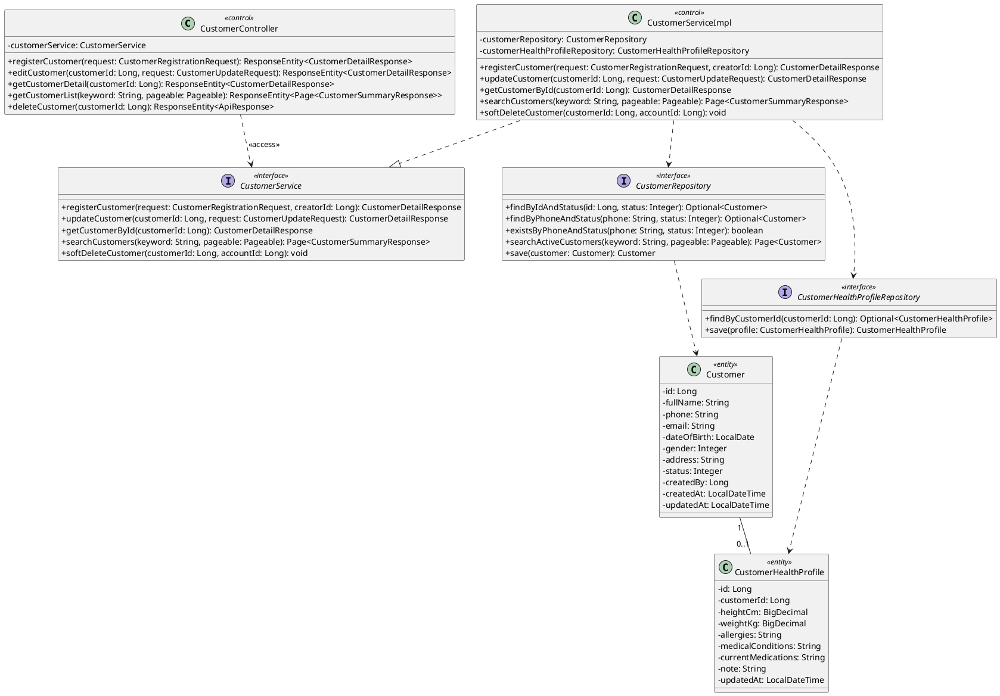

---

# HƯỚNG DẪN THIẾT KẾ CLASS DIAGRAM THEO PHƯƠNG PHÁP COMET

---

## 1. Yêu cầu đọc Code và Sequence Diagram

Đọc kỹ toàn bộ mã nguồn (source code) và các sơ đồ **Sequence Diagram** (biểu diễn dưới dạng tệp PlantUML) nằm trong 3 thư mục thuộc đường dẫn `gen-skill/`:

* **`gen-skill/user/`**: Quản lý thông tin người dùng, xác thực/phân quyền (User, Role, Permission) và nhật ký hệ thống (Audit Log).
* **`gen-skill/category/`**: Quản lý danh mục sản phẩm (Category).
* **`gen-skill/product/`**: Quản lý thông tin sản phẩm (Product) và bảng giá sản phẩm (Product Pricing).

---

## 2. Yêu cầu tạo Class Diagram (PlantUML) cho 3 Module chính

Tạo mã PlantUML Class Diagram chi tiết cho 3 module tương ứng với các thư mục trên:

1. **Module User (`gen-skill/user/`)**:
* Bao gồm các lớp xử lý quản lý Người dùng (`User`), Vai trò & Quyền hạn (`Role & Permission`), và Nhật ký kiểm toán (`Audit Log`).
* Phân chia đầy đủ theo phân tầng: Controller, Service/ServiceImpl, Repository, Entity/DTO.

2. **Module Category (`gen-skill/category/`)**:
* Bao gồm các lớp xử lý Danh mục sản phẩm (Category), danh mục cha-con (Parent/Child Category).
* Phân chia đầy đủ các tầng cấu trúc tương ứng.

3. **Module Product (`gen-skill/product/`)**:
* Bao gồm các lớp Quản lý Sản phẩm (`Product`), Biến thể sản phẩm (`Product Variant`), và Bảng giá (`Product Price/Pricing`).
* Thiết kế đầy đủ các tầng Controller, Service, Repository, Entity.

---

## 3. Hướng dẫn thiết kế Class Diagram theo phương pháp COMET *(Trích sao y nguyên tài liệu)*

> ### 5 – Class Diagram(s)
> 
> 
> #### 1. Khái niệm Class Diagram trong COMET
> 
> 
> Trong phương pháp COMET, Class Diagram được sử dụng trong giai đoạn Mô hình hóa Tĩnh (Static Modeling) để mô tả cấu trúc tĩnh của hệ thống.
> * **Mục đích:** Định nghĩa các Class (Lớp), thuộc tính (Attributes) của Class, quan hệ giữa các Class (Relationships) và các thao tác/hành vi (Operations) của từng Class.
> * **Đặc điểm cốt lõi:** Biểu diễn góc nhìn cấu trúc cố định, không thay đổi theo thời gian. Khác với mô hình chức năng, cấu trúc tĩnh được đánh giá là ít bị thay đổi hơn trong suốt vòng đời phát triển hệ thống.
> 
> 
> #### 2. Các Thành phần Chuẩn trong Class Diagram (theo COMET/UML)
> 
> 
> * **Class Box (Hộp Lớp):**
> * **Ký hiệu:** Hình chữ nhật chia làm 3 phần (Tên Lớp ở trên, Thuộc tính ở giữa, Thao tác/Phương thức ở dưới).
> * **Quy tắc:** Tên lớp viết theo chuẩn PascalCase (ví dụ: `Account`, `BankingSystem`).
> 
> 
> * **Visibility (Tầm nhìn / Mức độ truy cập):**
> * Ký hiệu `+` (Public): Truy cập được từ bên ngoài lớp.
> * Ký hiệu `-` (Private): Chỉ truy cập được trong nội bộ lớp định nghĩa nó.
> * Ký hiệu `#` (Protected): Truy cập được trong nội bộ lớp và các lớp con (Subclasses).
> 
> 
> * **Association (Mối quan hệ Hiệp hội):**
> * **Ký hiệu:** Đường nét liền nối 2 lớp.
> * Có thể kèm mũi tên nhỏ tô đen ($\blacktriangleright$) để chỉ hướng đọc tên mối quan hệ.
> * Có thể kèm mũi tên nét mảnh ($\rightarrow$) để chỉ hướng truy cập/dẫn đường (Navigability).
> 
> 
> * **Multiplicity (Bội số của mối quan hệ):**
> * Ký hiệu ghi ở hai đầu đường nối:
> * `1`: Đúng 1.
> * `0..1`: Tùy chọn (0 hoặc 1).
> * `*` hoặc `0..*`: Nhiều (0 hoặc nhiều).
> * `1..*`: Nhiều (1 hoặc nhiều).
> * `m..n`: Chỉ định khoảng cụ thể (ví dụ: `2`, `4`).
> 
> 
> 
> 
> * **Aggregation Hierarchy (Quan hệ Thu gom - Hollow Diamond):**
> * **Ký hiệu:** Đường nối có hình thoi rỗng ($\diamond$) nằm ở phía Lớp Toàn thể (Class Whole).
> * **Ý nghĩa:** Quan hệ Whole/Part dạng yếu. Các đối tượng thành phần (Part) có thể tồn tại độc lập, có thể thêm vào hoặc tách ra khỏi đối tượng toàn thể (Whole).
> 
> 
> * **Composition Hierarchy (Quan hệ Cấu thành - Black Diamond):**
> * **Ký hiệu:** Đường nối có hình thoi đặc ($\blacklozenge$) nằm ở phía Lớp Toàn thể (Class Whole).
> * **Ý nghĩa:** Quan hệ Whole/Part dạng mạnh. Các đối tượng thành phần cùng sinh ra và mất đi theo đối tượng toàn thể, không thể tồn tại độc lập.
> 
> 
> * **Generalization/Specialization Hierarchy (Quan hệ Kế thừa):**
> * **Ký hiệu:** Đường nối có mũi tên hình tam giác rỗng ($\Delta$) chỉ về phía Lớp Cha (Superclass).
> * **Ý nghĩa:** Quan hệ Is a giữa Lớp con (Subclass) và Lớp cha (Superclass).
> 
> 
> * **Constraints (Ràng buộc):**
> * **Ký hiệu:** Văn bản đặt trong cặp dấu ngoặc nhọn `{...}` nằm cạnh thuộc tính hoặc mối quan hệ (ví dụ: `{balance >= 0}`, `{ordered by time}`).
> 
> 
> * **Stereotypes (Kiểu mẫu phân loại):**
> * **Ký hiệu:** Đặt trong cặp dấu ngoặc góc `«...»` phía trên tên lớp (ví dụ: `«entity»`, `«external I/O device»`).
> 
> 
> 
> 
> #### 3. Quy trình 4 Bước Xây dựng Class Diagram cho 1 Use Case / Hệ thống
> 
> 
> * **Bước 1: Xác định các Lớp Khái niệm và Lớp Thực thể (Entity Classes)**
> * Trích xuất các danh từ từ mô tả Yêu cầu / Use Case Description (ví dụ: `Customer`, `Account`, `Bank`).
> * Phân loại các lớp thành các dạng chính trong COMET:
> * Physical Classes (Lớp vật lý: cảm biến, thiết bị I/O).
> * Entity Classes (Lớp thực thể dữ liệu: tài khoản, giao dịch, khách hàng).
> * External Classes (Lớp tác nhân/thiết bị bên ngoài hệ thống).
> 
> 
> 
> 
> * **Bước 2: Xác định thuộc tính (Attributes) và Tầm nhìn (Visibility)**
> * Gán các đặc tính dữ liệu tương ứng cho từng lớp (ví dụ: `Account` có `accountNumber: Integer`, `balance: Real`).
> * Đánh dấu các mức truy cập: `-` cho thuộc tính riêng tư, `+` cho các thao tác public.
> 
> 
> * **Bước 3: Xác định Mối quan hệ và Bội số (Multiplicity)**
> * Nối các lớp có tương tác/liên kết với nhau bằng đường Association.
> * Xác định chiều đọc tên quan hệ và chỉ định rõ bội số ở 2 đầu (`1`, `0..1`, `1..*`, `*`).
> * Nếu quan hệ mang bản chất Chứa/Thành phần (Whole/Part), chọn Aggregation ($\diamond$) hoặc Composition ($\blacklozenge$).
> * Nếu có các lớp chia sẻ thuộc tính chung, trừu tượng hóa thành Lớp Cha bằng quan hệ Kế thừa ($\Delta$).
> 
> 
> * **Bước 4: Thêm Ràng buộc (Constraints) và Chuẩn hóa Stereotypes**
> * Gán các ràng buộc nghiệp vụ bằng dấu `{...}` nếu có quy định về giá trị hoặc thứ tự.
> * Gán nhãn `«stereotype»` cho các lớp để phân định rõ phạm vi hệ thống (System Context).
> 
> 
> 
> 
> #### 4. Phân tích Ví dụ Mẫu Chuẩn COMET (Banking System - Figure 7.7 & 7.18 - 7.20)
> 
> 
> * **Mối quan hệ Association chuẩn (Hình 7.7):**
> * `Bank 1 --- Administers (▼) --- 1..* Account`: 1 Ngân hàng quản lý nhiều Tài khoản.
> * `Customer 1..* --- Owns (▼) --- 1..* Account`: Quan hệ Nhiều - Nhiều (Một khách hàng có thể sở hữu nhiều tài khoản, một tài khoản chung có thể thuộc nhiều khách hàng).
> * `Customer 1 --- Owns (▼) --- 0..1 DebitCard`: Quan hệ tùy chọn (Khách hàng có thể có hoặc không có thẻ ghi nợ).
> 
> 
> * **Mối quan hệ Composition Hierarchy (Hình 7.12):**
> * Lớp toàn thể `ATM` nối bằng hình thoi đặc ($\blacklozenge$) đến 4 lớp thành phần `CardReader`, `CashDispenser`, `ReceiptPrinter`, và `ATMCustomerKeypadDisplay` với bội số `1` ở mỗi đầu. Khi một cây ATM bị hủy, các thiết bị thành phần phần cứng cấu thành nó cũng không thể tồn tại độc lập trong ngữ cảnh hệ thống.
> 
> 
> * **Mối quan hệ Kế thừa Generalization (Hình 7.14 & 7.15):**
> * Lớp cha `Account` (chứa `accountNumber`, `balance`) có 2 lớp con là `CheckingAccount` (thêm `lastDepositAmount`) và `SavingsAccount` (thêm `interest`).
> * Mũi tên tam giác rỗng ($\Delta$) chỉ từ 2 lớp con hướng lên `Account`.
> 
> 
> 
> 
> #### 5. Những Lỗi Cần Tránh Khi Vẽ Class Diagram Theo COMET
> 
> 
> * **Nhầm lẫn giữa Aggregation ($\diamond$) và Composition ($\blacklozenge$):** Dùng Composition khi các lớp thành phần sinh ra/mất đi gắn liền với lớp tổng thể; dùng Aggregation khi các lớp con có thể tồn tại độc lập hoặc tháo rời/ghép vào lớp khác.
> * **Quên ghi Bội số (Multiplicity):** Mọi mối quan hệ Association, Aggregation hay Composition đều phải ghi rõ bội số ở 2 đầu liên kết.
> * **Lẫn lộn tên Lớp và tên Thuộc tính:** Tên Lớp phải là Danh từ số ít, viết hoa chữ cái đầu (PascalCase). Không đặt tên lớp là hành động/động từ.
> * **Vẽ sai hướng mũi tên kế thừa:** Mũi tên tam giác rỗng phải trỏ từ Lớp Con lên Lớp Cha, không trỏ ngược lại.
> * **Đưa chi tiết xử lý thuật toán vào Class Diagram:** Class diagram chỉ thể hiện cấu trúc tĩnh (Static Structure), tuyệt đối không vẽ các bước thực thi theo thời gian hay luồng xử lý dữ liệu lên biểu đồ này.
> 
> 

---

## 4. Mô tả chi tiết Mẫu Prototype (`prototype2.jpeg`) và Code PlantUML Mẫu

Yêu cầu đọc và hiểu mẫu hình ảnh `prototype2.jpeg` trong thư mục `gen-skill/` cùng mã PlantUML dưới đây để đảm bảo vẽ đúng chuẩn chi tiết (Detailed Design Class Diagram):

### Mô tả cấu trúc từ `prototype2.jpeg`:

1. **Phân tầng rõ ràng (Multi-tier Architecture):**
* **Tầng Controller (`«control»`):** Tiếp nhận HTTP Request từ Client, sử dụng các DTO cho Request/Response và gọi xuống tầng Service.
* **Tầng Service (`«interface»` & `«control»` Impl):** Tách biệt giữa Interface định nghĩa phương thức và Lớp Impl thực thi logic nghiệp vụ.
* **Tầng Repository (`«interface»`):** Định nghĩa các phương thức thao tác CSDL (`findById`, `save`, `searchActive...`).
* **Tầng Entity (`«entity»`):** Các lớp mô hình hóa CSDL, có thuộc tính đầy đủ (kèm kiểu dữ liệu), mức truy cập (`-` private, `+` public) và mối quan hệ giữa các thực thể (`1` – `0..1` hoặc `1` – `*`).

2. **Quy tắc thể hiện Mũi tên và Mối quan hệ:**
* **Dependency (`..>` / `<<access>>`):** Đường nét đứt từ Controller xuống Service Interface, hoặc từ ServiceImpl xuống Repository, thể hiện sự phụ thuộc giữa các tầng.
* **Realization / Implementation (`..|>`):** Đường nét đứt có đầu mũi tên tam giác rỗng ($\Delta$) từ `ServiceImpl` trỏ lên `Service Interface`.
* **Association / Composition (`--` / `*--`):** Khai báo chỉ số bội (`1`, `0..1`, `1..*`) ở hai đầu thực thể dữ liệu.

### Mã PlantUML Mẫu Chuẩn:

---

## 5. Quy tắc thực hiện công việc

* **TUYỆT ĐỐI KHÔNG SỬA ĐỔI CODE ỨNG DỤNG (Source Code chính):** Không can thiệp, chỉnh sửa hay xóa bất kỳ tệp nguồn (.java, .js, .py, v.v.) nào của dự án.
* **CHỈ CHỈNH SỬA VÀ TẠO FILE TRONG THƯ MỤC `gen-skill/`:** Toàn bộ sản phẩm đầu ra (mã PlantUML Class Diagram, tệp tài liệu hướng dẫn) chỉ được phép tạo, bổ sung và cập nhật bên trong thư mục `gen-skill/`.